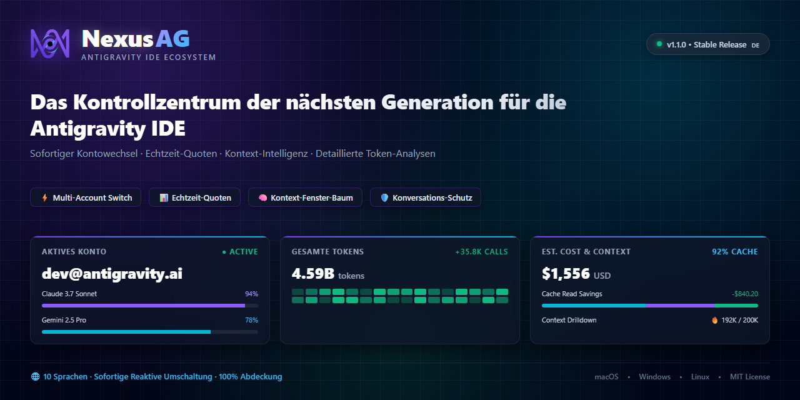
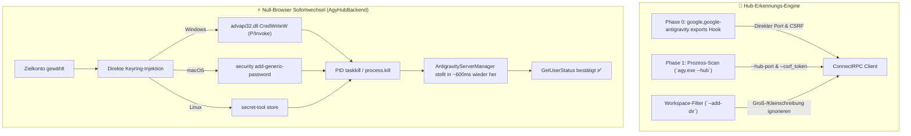

<p align="center">
  <a href="readme.md">English</a> •
  <a href="README.tr.md">Türkçe</a> •
  <a href="README.pt-BR.md">Português</a> •
  <a href="README.es.md">Español</a> •
  <a href="README.de.md"><b>Deutsch</b></a> •
  <a href="README.fr.md">Français</a> •
  <a href="README.ja.md">日本語</a> •
  <a href="README.zh-CN.md">简体中文</a> •
  <a href="README.hi.md">हिन्दी</a> •
  <a href="README.ru.md">Русский</a>
</p>

<p align="center">
  
</p>

<p align="center">
  <a href="https://github.com/AlperenAKKAYA99/NexusAG/releases"></a>
  
  
  
  
  
  
  
</p>

---

# NexusAG

> **Das Problem:** Die Verwaltung mehrerer Google-Konten in der Antigravity IDE erfordert umständliche manuelle Abmeldungen, wiederholte Browser-Anmeldungen, unklares Raten der verbleibenden KI-Quoten und das Risiko verlorener, nicht indizierter Konversationen auf der Festplatte. Zudem ersetzte das Antigravity 2.27.0-Update den Language Server durch `agy.exe --hub`, was herkömmliche Prozess- und Port-Erkennungsverfahren unbrauchbar machte.
>
> **Die Lösung:** NexusAG bietet eine integrierte Steuerzentrale — wechseln Sie Konten mit **sofortiger Null-Browser-OS-Keyring-Injektion**, überwachen Sie Echtzeit-Quoten mit sekundengenauen Reset-Timern, analysieren Sie den Token-Fußabdruck jedes Prompt-Schritts, stellen Sie verwaiste Konversationen wieder her und prüfen Sie die Gesamtkosten im Bento-Editor-Dashboard. Vollständig optimiert für **Antigravity ≥ 2.27 (`agy --hub`)** mit 100%iger Abwärtskompatibilität.

---

## ⚡ Schnellstart in 60 Sekunden

1. **Installieren** — Suchen Sie nach `NexusAG` im Antigravity Marketplace oder installieren Sie die `nexus-ag-1.3.4.vsix`-Datei.
2. **Konto hinzufügen** — Klicken Sie in der Seitenleiste auf `+` für Google OAuth oder nutzen Sie `🔑` zum direkten Einfügen von Tokens.
3. **Überwachen & Wechseln** — Ihre Live-Quotenanzeigen, Reset-Countdowns und Analysen sind sofort aktiv!

---

## 📸 Multi-Account-Schaltzentrale & UI Showcase

<table align="center" width="100%">
  <tr>
    <td align="center" width="25%" valign="top">
      <br/>
      <sub><b>⚡ Multi-Account-Schaltzentrale</b><br/>1-Klick-Kontowechsel, Live-Quotenfortschritt & Reset-Countdown</sub>
    </td>
    <td align="center" width="25%" valign="top">
      <br/>
      <sub><b>🔑 Token-Budget & Kontext</b><br/>Anpassungs-Donut, aktive Sitzungsanzeige & Workspace-Regeln</sub>
    </td>
    <td align="center" width="25%" valign="top">
      <br/>
      <sub><b>📈 Nutzungsstatistiken (Sidebar)</b><br/>Sitzungstoken-Gesamtwerte, stündliche Aktivität & monatliche Kosten</sub>
    </td>
    <td align="center" width="25%" valign="top">
      <br/>
      <sub><b>🌐 Einstellungen & 10-Sprachen-Hub</b><br/>Reaktiver Sprachwechsler, Hintergrundintervalle & Reparatur</sub>
    </td>
  </tr>
  <tr>
    <td align="center" width="25%" valign="top">
      <br/>
      <sub><b>🔑 Konten per Token hinzufügen</b><br/>Batch-Einfügen von OAuth-Refresh-Tokens mit Verifikation</sub>
    </td>
    <td align="center" width="25%" valign="top">
      <br/>
      <sub><b>🔒 Nahtloser Google-Login</b><br/>1-Klick-Browser-Authentifizierung mit automatischer Rückkehr</sub>
    </td>
    <td align="center" colspan="2" valign="top">
      <br/>
      <sub><b>🔍 Kontextfenster-Detailprüfung (Editor-Tab)</b><br/>Hierarchischer Schritt-Baum, Token-Kategorien & Markdown-Export</sub>
    </td>
  </tr>
  <tr>
    <td align="center" colspan="4" valign="top">
      <br/>
      <sub><b>📊 Tiefen-Token-Analyse Bento-Dashboard (Voll-Editor)</b><br/>Gesamte Konversationsprüfung, GitHub-Aktivitäts-Heatmap, Modellkosten & Top-Sitzungen</sub>
    </td>
  </tr>
</table>

---

## 🆕 Antigravity 2.27+ Next-Gen Kompatibilitätsarchitektur

Antigravity 2.27.0 ersetzte den separaten `language_server_win.exe`-Prozess durch die vereinheitlichte **`agy.exe --hub`**-Engine. NexusAG v1.3.4 bringt dafür eine dedizierte modulare Architektur:



### 1. Phase 0 Direkter Extension-Hook & Netstat-freie Erkennung

- **Direkter Hook (`getAgyExtensionEndpoint`):** Liest `port` und `csrfToken` unmittelbar aus den Exports von `google.google-antigravity`, ohne langwierige Prozess-Scans.
- **`--hub-port` Direkt-Parsing:** Der Port wird direkt per Regex aus den Prozessargumenten ausgelesen (keine Netstat-Overheads).
- **Workspace-Isolation (`--add-dir`):** Jedes IDE-Fenster startet seine eigene Hub-Instanz. NexusAG vergleicht `--add-dir` mit dem aktiven Workspace-Pfad (`pathsEqual`) und schließt Fehlleitungen zwischen Fenstern aus.

### 2. Null-Browser-Sofortkontowechsel (`AgyHubBackend`)

- **Direkte OS-Keyring-Injektion:** Schreibt OAuth-Zugangsdaten direkt in den Systemtresor:
  - **Windows:** P/Invoke `advapi32.dll CredWriteW` via Base64 in `gemini:antigravity`.
  - **macOS:** Natives `security add-generic-password` in die Keychain.
  - **Linux:** Freedesktop Secret Service via `secret-tool`.
- **Automatische Wiederherstellung:** Beendet den Ziel-`agy.exe`-Prozess sauber. Der interne `AntigravityServerManager` startet den Hub innerhalb von ~600ms neu und lädt sofort die neuen Zugangsdaten – **ganz ohne Browser-Popups!**
- **Nativer Fallback:** Fehlen Tokens, wechselt NexusAG nahtlos zum geführten nativen Anmeldedialog via `antigravity.internal.loginWithRedirect`.

### 3. Moderne SQLite-Konversationsspeicherung (`isAgyHubStorage`)

- Erkennt automatisch die neue `conversation_summaries.db`-Datenbank und `.done`-Migrationsmarkierungen in `~/.gemini/antigravity/`.
- Vermeidet falsche Warnungen vor verlorenen Konversationen unter der neuen SQLite-Speicherung.

### 4. 100%ige Abwärtskompatibilität (`LegacyUssBackend`)

- Behält die vollständige Unterstützung für Versionen vor 2.27 (`language_server_*`, UnifiedStateSync und `RegisterGdmUser`) bei.

---

## 🔄 Evolution & Was hat sich seit früheren Versionen geändert?

| Bereich / Teilsystem      | Ältere Versionen (v1.0 - v1.1)      | Zwischenversion (v1.2)               | Aktuelles NexusAG (v1.3.4 b24)                                                                 |
| ------------------------- | ----------------------------------- | ------------------------------------ | ---------------------------------------------------------------------------------------------- |
| **Antigravity-Engine**    | Nur vor 2.27 (`language_server_*`)  | Erste experimentelle `agy`-Erkennung | **Native Dual-Architektur (`AgyHubBackend` + `LegacyUssBackend`)**                             |
| **Kontowechsel**          | Manuelle Browser-Pop-ups            | Browser-unterstützte Umleitung       | **Null-Browser Sofortwechsel via OS-Keyring P/Invoke**                                         |
| **Port-Erkennung**        | Langsames `netstat -ano` / `lsof`   | Teilweise Flag-Erkennung             | **Phase 0 Extension-Hook + Direktes `--hub-port` Parsing**                                     |
| **Fenster-Isolation**     | `--workspace_id` (in 2.27 entfernt) | Einfacher String-Abgleich            | **Strikte `--add-dir`-Prüfung mit Windows Case-Insensitivity**                                 |
| **Konversationsspeicher** | Starre `.pb`-Protobuf-Dateiprüfung  | Starre `.pb`-Dateiprüfung            | **Erkennt `conversation_summaries.db` & `.done`-Markierungen**                                 |
| **Sicherheit & Härtung**  | Grundlegendes HTML-Escaping         | Grundlegendes HTML-Escaping          | **Gehärtetes `escHtml` (`&quot;`, `&#39;`), Nonce-CSP, parametrisiertes `execFile` & `stdin`** |
| **Modellpreise**          | Feste Modellraten                   | LiteLLM veränderlicher `main`-Branch | **LiteLLM Pinned Commit (`5338edb7...`) + Gemini 3.8 Flash & Claude 4.6 Thinking**             |
| **Schriftarten**          | Externe Google/CDN-Webfonts         | Lokale Schriftdateien                | **Font Awesome Pro 7.3.1 als Base64 eingebettet (null externe Anfragen)**                      |
| **Lokalisierung**         | Englisch & Türkisch partiell        | 10 Sprachen mit Lücken               | **10 native Sprachen mit 100% verifizierter Schlüsselparität (251/251)**                       |
| **VSIX-Paketgröße**       | ~8.71 MB                            | ~8.71 MB                             | **6.91 MB optimiert (~1.8 MB leichter, null `node_modules`)**                                  |

---

## ✨ Hauptfunktionen

### ⚡ Multi-Account-Schaltzentrale & Live-Quoten

- **Unbegrenzte Profile:** Persönliche, geschäftliche und Kundenkonten parallel verwalten.
- **Sofortiger Kontowechsel:** Ohne Browserfenster und ohne Neuladen der IDE.
- **Statusleisten-Integration:** Markieren Sie Ihre bevorzugten Modelle mit Stern (★), um Quoten in der VS Code-Statusleiste anzuzeigen.
- **Proaktive Erneuerung:** Automatischer Token-Refresh im Hintergrund verhindert 401-Fehler.

### 🌍 100% Lokalisierung (10 Sprachen)

- `English` • `Türkçe` • `Português` • `Español` • `Deutsch` • `Français` • `日本語` • `简体中文` • `हिन्दी` • `Русский`
- Reaktiv ohne Fenster-Reload umschaltbar.

### 🔑 Token-Budget & Kontextfenster-Inspektor

- Granulare Aufschlüsselung nach MCP Tools, Workspace-Regeln, Workflows und Skills.
- Echtzeit-Tracking bei Streaming-Antworten.

### 📈 Deep Token Analytics & Bento Dashboard

- Lebenslange Aggregation aller Konversationen.
- GitHub-Aktivitäts-Heatmap für 365 Tage mit Kosten-Tooltips.

---

## 🔒 Sicherheit & Datenschutz (Audit A+)

- **100% Lokale Daten:** Keine Prompts, Chats oder Dateien verlassen Ihren Rechner.
- **0 Laufzeit-Abhängigkeiten:** `dependencies: {}` in `package.json`.
- **OS-Tresor:** Token-Speicherung über DPAPI / Keychain / Secret Service.
- **Prüfbericht:** Ausführlicher Bericht unter [SIBER_GUVENLIK_DENETIM_RAPORU.md](docs/SIBER_GUVENLIK_DENETIM_RAPORU.md).

---

## 🚀 Installation & Befehle

Installieren Sie `nexus-ag-1.3.4.vsix` über den Marketplace oder das Terminal:

```bash
antigravity-ide.cmd --install-extension nexus-ag-1.3.4.vsix --force
```

| Befehl                                 | ID                     | Beschreibung                                |
| -------------------------------------- | ---------------------- | ------------------------------------------- |
| **NexusAG: Refresh Quota**             | `ag.refreshQuota`      | Quoten und Budgets sofort aktualisieren.    |
| **NexusAG: Add Account**               | `ag.addAccount`        | Google-Konto per Browser hinzufügen.        |
| **NexusAG: Add Account via Token**     | `ag.addAccountByToken` | Refresh-Token manuell einfügen.             |
| **NexusAG: Remove Account**            | `ag.removeAccount`     | Konto aus der Verwaltung entfernen.         |
| **NexusAG: Open Usage Statistics**     | `ag.openUsageStats`    | Vollbild-Bento-Dashboard öffnen.            |
| **NexusAG: Fix Missing Conversations** | `ag.fixConversations`  | Nicht indizierte Konversationen reparieren. |

---

## 📄 Lizenz

Open-Source unter der **[MIT-Lizenz](LICENSE)**.
