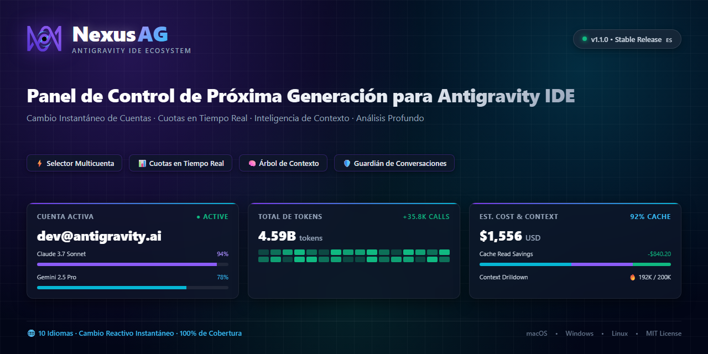
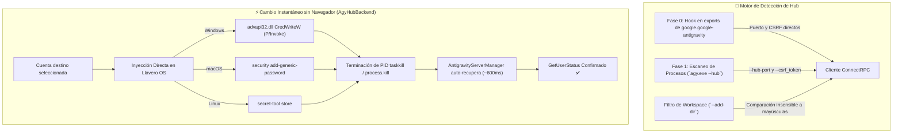

<p align="center">
  <a href="readme.md">English</a> •
  <a href="README.tr.md">Türkçe</a> •
  <a href="README.pt-BR.md">Português</a> •
  <a href="README.es.md"><b>Español</b></a> •
  <a href="README.de.md">Deutsch</a> •
  <a href="README.fr.md">Français</a> •
  <a href="README.ja.md">日本語</a> •
  <a href="README.zh-CN.md">简体中文</a> •
  <a href="README.hi.md">हिन्दी</a> •
  <a href="README.ru.md">Русский</a>
</p>

<p align="center">
  
</p>

<p align="center">
  <a href="https://github.com/AlperenAKKAYA99/NexusAG/releases"></a>
  
  
  
  
  
  
  
</p>

---

# NexusAG

> **El Problema:** Gestionar múltiples cuentas de Google en Antigravity IDE requiere tediosos cierres de sesión manuales, constantes confirmaciones en el navegador, incertidumbre sobre los límites de cuota restantes y el riesgo de perder conversaciones no indexadas en disco. Además, la actualización Antigravity 2.27.0 migró el servidor de lenguaje a `agy.exe --hub`, invalidando los mecanismos anteriores de detección de puertos y procesos.
>
> **La Solución:** NexusAG proporciona un centro de control integral — cambie de cuenta con **inyección instantánea en el llavero del sistema operativo sin abrir el navegador**, supervise cuotas con temporizadores exactos, audite tokens en cada paso de prompt, recupere conversaciones huérfanas y analice los costos históricos en un panel bento completo. Totalmente optimizado para **Antigravity ≥ 2.27 (`agy --hub`)** con 100% de compatibilidad regresiva.

---

## ⚡ Inicio Rápido en 60 Segundos

1. **Instalar** — Busque `NexusAG` en el Marketplace de Antigravity o instale el archivo `nexus-ag-1.3.3.vsix`.
2. **Añadir Cuenta** — Haga clic en `+` en la barra lateral para iniciar sesión con Google o use `🔑` para pegar tokens.
3. **Monitorear y Cambiar** — ¡Sus indicadores de cuota, temporizadores y analíticas estarán activos al instante!

---

## 📸 Conmutador Multicuenta y Galería de Interfaz (UI Showcase)

<table align="center" width="100%">
  <tr>
    <td align="center" width="25%" valign="top">
      <br/>
      <sub><b>⚡ Conmutador Multicuenta</b><br/>Cambio en 1 clic, progreso de cuota y temporizadores</sub>
    </td>
    <td align="center" width="25%" valign="top">
      <br/>
      <sub><b>🔑 Presupuesto de Tokens</b><br/>Donut de personalizaciones, sesión activa y reglas</sub>
    </td>
    <td align="center" width="25%" valign="top">
      <br/>
      <sub><b>📈 Estadísticas en Barra Lateral</b><br/>Totales de tokens, actividad horaria y costos</sub>
    </td>
    <td align="center" width="25%" valign="top">
      <br/>
      <sub><b>🌐 Ajustes e Idiomas</b><br/>Selector de idioma reactivo, intervalos y reparación</sub>
    </td>
  </tr>
  <tr>
    <td align="center" width="25%" valign="top">
      <br/>
      <sub><b>🔑 Añadir por Token</b><br/>Pegado masivo de refresh tokens con verificación</sub>
    </td>
    <td align="center" width="25%" valign="top">
      <br/>
      <sub><b>🔒 Google OAuth Fluido</b><br/>Autenticación en 1 clic con retorno automático</sub>
    </td>
    <td align="center" colspan="2" valign="top">
      <br/>
      <sub><b>🔍 Análisis de Contexto (Editor)</b><br/>Árbol de pasos jerárquico, categorías de tokens y exportación</sub>
    </td>
  </tr>
  <tr>
    <td align="center" colspan="4" valign="top">
      <br/>
      <sub><b>📊 Panel Bento de Analítica Profunda (Editor Completo)</b><br/>Auditoría histórica de conversaciones, mapa de calor GitHub, costos por modelo y mejores sesiones</sub>
    </td>
  </tr>
</table>

---

## 🆕 Arquitectura de Compatibilidad de Próxima Generación para Antigravity 2.27+

Antigravity 2.27.0 sustituyó el antiguo binario `language_server_win.exe` por el motor unificado **`agy.exe --hub`**. NexusAG v1.3.3 incorpora una arquitectura modular diseñada para este estándar:



### 1. Hook Directo en Fase 0 y Detección Sin Netstat
- **Hook Directo (`getAgyExtensionEndpoint`):** Obtiene el `port` y `csrfToken` de la ventana activa directamente desde los exports de `google.google-antigravity`, eliminando el consumo de recursos por escaneo de procesos.
- **Lectura Directa de `--hub-port`:** El puerto se extrae directamente de los argumentos con regex, evitando sondeos lentos con `netstat` o `lsof`.
- **Aislamiento Multi-Ventana (`--add-dir`):** Cada ventana del IDE ejecuta su propia instancia de Hub. NexusAG compara `--add-dir` con las carpetas activas (`pathsEqual`), previniendo cambios de cuenta accidentales entre ventanas.

### 2. Cambio de Cuenta Instantáneo sin Abrir Navegador (`AgyHubBackend`)
- **Inyección en Llavero Nativo:** Registra las credenciales OAuth directamente en el almacén seguro del sistema operativo:
  - **Windows:** P/Invoke `advapi32.dll CredWriteW` en Base64 hacia `gemini:antigravity`.
  - **macOS:** Comando nativo `security add-generic-password` hacia Keychain.
  - **Linux:** Almacén seguro Freedesktop vía `secret-tool`.
- **Reinicio con Auto-Recuperación:** Termina el proceso `agy.exe` correspondiente al puerto del Hub. El componente `AntigravityServerManager` del IDE lo reinicia en ~600ms y carga las nuevas credenciales de inmediato: **¡sin necesidad de abrir pestañas en el navegador!**
- **Fallback Guiado:** Si no hay tokens disponibles, NexusAG pasa automáticamente al flujo nativo guiado mediante `antigravity.internal.loginWithRedirect`.

### 3. Soporte para Almacenamiento SQLite Moderno (`isAgyHubStorage`)
- Detecta automáticamente la base de datos `conversation_summaries.db` y las marcas `.done` en `~/.gemini/antigravity/`.
- Evita falsas alarmas de conversaciones perdidas bajo el nuevo sistema SQLite.

### 4. 100% de Compatibilidad Regresiva (`LegacyUssBackend`)
- Mantiene compatibilidad total con versiones anteriores a 2.27 (`language_server_*`, UnifiedStateSync y `RegisterGdmUser`).

---

## 🔄 Evolución: ¿Qué Cambió Respecto a Versiones Anteriores?

| Característica / Subsistema | Versiones Anteriores (v1.0 - v1.1) | Intermedia (v1.2) | NexusAG Actual (v1.3.3 b23) |
|---|---|---|---|
| **Motor de Antigravity** | Solo pre-2.27 (`language_server_*`) | Detección preliminar de `agy` | **Arquitectura Dual Nativa (`AgyHubBackend` + `LegacyUssBackend`)** |
| **Cambio de Cuenta** | Apertura obligatoria de navegador | Redirección asistida | **Cambio Instantáneo Sin Navegador vía P/Invoke en Llavero OS** |
| **Detección de Puertos** | Sondeo lento con `netstat -ano` / `lsof` | Lectura parcial de flags | **Hook Fase 0 en Exports + Extracción directa de `--hub-port`** |
| **Aislamiento de Ventanas** | `--workspace_id` (obsoleto en 2.27) | Coincidencia básica de texto | **Parseo estricto de `--add-dir` insensible a mayúsculas en Windows** |
| **Depósito de Conversaciones** | Escaneo rígido de `.pb` Protobuf | Escaneo rígido de `.pb` | **Detección de `conversation_summaries.db` y marcas `.done` SQLite** |
| **Seguridad y Aislamiento** | Escape HTML elemental | Escape HTML elemental | **`escHtml` reforzado (`&quot;`, `&#39;`), Nonce CSP, `execFile` y `stdin`** |
| **Precios de Modelos** | Tarifas estáticas | Rama `main` mutable de LiteLLM | **Commit Inmutable de LiteLLM (`5338edb7...`) + Gemini 3.8 & Claude 4.6** |
| **Fuentes y Estilos** | Peticiones a CDNs externas | Archivos locales sueltos | **Font Awesome Pro 7.3.1 embebido en Base64 (cero peticiones externas)** |
| **Localización** | Inglés y Turco parcial | 10 idiomas incompletos | **10 Idiomas Nativos con 100% de paridad de claves (251/251)** |
| **Tamaño de Paquete VSIX** | ~8.71 MB | ~8.71 MB | **6.91 MB optimizado (~1.8 MB de ahorro, cero `node_modules`)** |

---

## ✨ Características Destacadas

### ⚡ Conmutador Multicuenta y Monitoreo de Cuotas en Vivo
- **Perfiles Ilimitados:** Gestione cuentas personales, corporativas y de clientes simultáneamente.
- **Cambio Inmediato:** Sin ventanas de navegador ni recargas del IDE.
- **Integración en Barra de Estado:** Marque con estrella (★) sus modelos para fijar cuotas en la barra de VS Code.
- **Renovación Proactiva:** Refresco automático de tokens en segundo plano para evitar errores 401.

### 🌍 100% Internacionalización (10 Idiomas)
- `English` • `Türkçe` • `Português` • `Español` • `Deutsch` • `Français` • `日本語` • `简体中文` • `हिन्दी` • `Русский`
- Cambio reactivo inmediato sin necesidad de recargar la ventana.

### 🔑 Presupuesto de Tokens y Ventana de Contexto
- Desglose detallado de tokens consumidos por herramientas MCP, reglas de workspace y skills.
- Medición en tiempo real durante la generación de respuestas por streaming.

### 📈 Analítica Profunda de Tokens y Dashboard Bento
- Agregación histórica de todas las conversaciones de por vida.
- Mapa de calor de contribuciones tipo GitHub para 365 días con costos por celda.

---

## 🔒 Seguridad y Privacidad (Auditoría A+)

- **100% Datos Locales:** Ningún prompt, código o conversación sale de su equipo.
- **0 Dependencias de Runtime:** `dependencies: {}` en `package.json`.
- **Cifrado de Llavero OS:** Tokens almacenados mediante DPAPI, Keychain o Secret Service.
- **Informe de Auditoría:** Documento completo en [SIBER_GUVENLIK_DENETIM_RAPORU.md](docs/SIBER_GUVENLIK_DENETIM_RAPORU.md).

---

## 🚀 Instalación y Comandos

Instale `nexus-ag-1.3.3.vsix` desde el Marketplace o terminal:
```bash
antigravity-ide.cmd --install-extension nexus-ag-1.3.3.vsix --force
```

| Comando | ID | Descripción |
|---|---|---|
| **NexusAG: Refresh Quota** | `ag.refreshQuota` | Actualiza cuotas y presupuestos al instante. |
| **NexusAG: Add Account** | `ag.addAccount` | Inicia sesión con Google vía navegador. |
| **NexusAG: Add Account via Token** | `ag.addAccountByToken` | Pega refresh tokens por lote. |
| **NexusAG: Remove Account** | `ag.removeAccount` | Elimina la cuenta seleccionada. |
| **NexusAG: Open Usage Statistics** | `ag.openUsageStats` | Abre el panel bento de analíticas completas. |
| **NexusAG: Fix Missing Conversations** | `ag.fixConversations` | Repara conversaciones no indexadas. |

---

## 📄 Licencia

Código abierto bajo la **[Licencia MIT](LICENSE)**.

