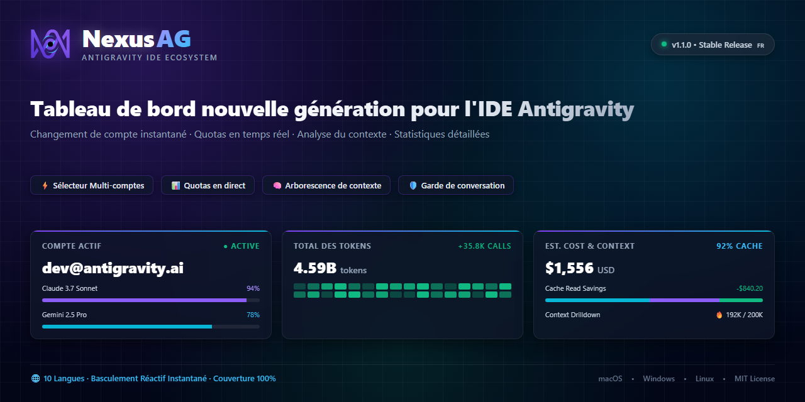
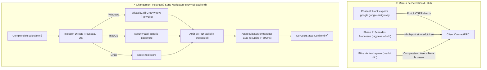

<p align="center">
  <a href="readme.md">English</a> •
  <a href="README.tr.md">Türkçe</a> •
  <a href="README.pt-BR.md">Português</a> •
  <a href="README.es.md">Español</a> •
  <a href="README.de.md">Deutsch</a> •
  <a href="README.fr.md"><b>Français</b></a> •
  <a href="README.ja.md">日本語</a> •
  <a href="README.zh-CN.md">简体中文</a> •
  <a href="README.hi.md">हिन्दी</a> •
  <a href="README.ru.md">Русский</a>
</p>

<p align="center">
  
</p>

<p align="center">
  <a href="https://github.com/AlperenAKKAYA99/NexusAG/releases"></a>
  
  
  
  
  
  
  
</p>

---

# NexusAG

> **Le Problème :** Gérer plusieurs comptes Google dans Antigravity IDE nécessite des déconnexions manuelles répétitives, des validations incessantes dans le navigateur, des estimations approximatives des quotas d'IA restants et le risque de perdre des conversations non indexées sur le disque. De plus, la mise à jour Antigravity 2.27.0 a remplacé le serveur de langage par `agy.exe --hub`, rendant obsolètes les anciennes méthodes de détection de processus et de ports.
>
> **La Solution :** NexusAG offre un tableau de bord de commande tout-en-un — changez de compte avec **une injection instantanée dans le trousseau de clés du système d'exploitation sans ouvrir de navigateur**, surveillez vos quotas en temps réel avec des compteurs de réinitialisation précis, disséquez l'empreinte de jetons de chaque prompt, restaurez les conversations orphelines et auditez vos dépenses globales dans un panneau bento complet. Entièrement optimisé pour **Antigravity ≥ 2.27 (`agy --hub`)** avec 100 % de rétrocompatibilité.

---

## ⚡ Prise en Main en 60 Secondes

1. **Installer** — Recherchez `NexusAG` dans le Marketplace d'Antigravity ou installez le fichier `nexus-ag-1.3.4.vsix`.
2. **Ajouter un Compte** — Cliquez sur `+` dans la barre latérale pour une connexion Google OAuth ou utilisez `🔑` pour coller vos jetons.
3. **Surveiller & Basculer** — Vos jauges de quota, comptes à rebours et métriques sont instantanément opérationnels !

---

## 📸 Sélecteur Multi-Comptes et Galerie d'Interface (UI Showcase)

<table align="center" width="100%">
  <tr>
    <td align="center" width="25%" valign="top">
      <br/>
      <sub><b>⚡ Sélecteur Multi-Comptes</b><br/>Changement en 1 clic, progression des quotas & comptes à rebours</sub>
    </td>
    <td align="center" width="25%" valign="top">
      <br/>
      <sub><b>🔑 Budget de Jetons</b><br/>Donut de personnalisation, jauge de session & règles</sub>
    </td>
    <td align="center" width="25%" valign="top">
      <br/>
      <sub><b>📈 Statistiques d'Utilisation</b><br/>Totaux de jetons, activité horaire & coûts</sub>
    </td>
    <td align="center" width="25%" valign="top">
      <br/>
      <sub><b>🌐 Paramètres & Langues</b><br/>Sélecteur réactif, intervalles & réparation</sub>
    </td>
  </tr>
  <tr>
    <td align="center" width="25%" valign="top">
      <br/>
      <sub><b>🔑 Ajout par Jeton</b><br/>Import groupé de refresh tokens avec vérification</sub>
    </td>
    <td align="center" width="25%" valign="top">
      <br/>
      <sub><b>🔒 Google OAuth Fluide</b><br/>Authentification en 1 clic avec retour automatique</sub>
    </td>
    <td align="center" colspan="2" valign="top">
      <br/>
      <sub><b>🔍 Analyse de Contexte (Éditeur)</b><br/>Arbre d'étapes hiérarchique, catégories de jetons & export Markdown</sub>
    </td>
  </tr>
  <tr>
    <td align="center" colspan="4" valign="top">
      <br/>
      <sub><b>📊 Dashboard Bento d'Analytique (Plein Éditeur)</b><br/>Audit historique complet, carte thermique GitHub, coûts par modèle et sessions phares</sub>
    </td>
  </tr>
</table>

---

## 🆕 Architecture de Compatibilité Nouvelle Génération pour Antigravity 2.27+

Antigravity 2.27.0 a remplacé l'ancien binaire `language_server_win.exe` par le moteur unifié **`agy.exe --hub`**. NexusAG v1.3.4 intègre une architecture modulaire dédiée à ce standard :



### 1. Hook Direct Phase 0 & Détection Sans Netstat

- **Hook Direct (`getAgyExtensionEndpoint`) :** Lit immédiatement le `port` et le `csrfToken` depuis les exports de `google.google-antigravity`, supprimant les analyses de processus superflues.
- **Extraction Directe de `--hub-port` :** Le port est lu directement dans les arguments par regex (pas de délais liés à `netstat` ou `lsof`).
- **Isolation Multi-Fenêtres (`--add-dir`) :** Chaque fenêtre de l'IDE lance son propre Hub. NexusAG compare `--add-dir` avec les dossiers du projet actif (`pathsEqual`), empêchant toute bascule accidentelle entre différentes fenêtres.

### 2. Changement de Compte Instantané Sans Navigateur (`AgyHubBackend`)

- **Injection Directe dans le Trousseau de Clés de l'OS :** Écrit les identifiants OAuth directement dans le gestionnaire sécurisé du système :
  - **Windows :** P/Invoke `advapi32.dll CredWriteW` encodé en Base64 dans `gemini:antigravity`.
  - **macOS :** Commande native `security add-generic-password` dans le Keychain.
  - **Linux :** Service Secret Freedesktop via `secret-tool`.
- **Relance Automatique :** Termine le processus `agy.exe` correspondant. Le module `AntigravityServerManager` de l'IDE le relance en ~600 ms et applique immédiatement les nouveaux identifiants : **aucun onglet de navigateur ne s'ouvre !**
- **Repli Guidé :** Si les jetons manquent, NexusAG bascule automatiquement sur la connexion guidée standard via `antigravity.internal.loginWithRedirect`.

### 3. Support Moderne du Stockage SQLite (`isAgyHubStorage`)

- Détecte automatiquement la base `conversation_summaries.db` et les marqueurs `.done` dans `~/.gemini/antigravity/`.
- Évite les fausses alertes de conversations manquantes sous la nouvelle architecture SQLite.

### 4. 100 % de Rétrocompatibilité (`LegacyUssBackend`)

- Préserve la prise en charge complète des versions antérieures à 2.27 (`language_server_*`, UnifiedStateSync et `RegisterGdmUser`).

---

## 🔄 Évolution : Qu'est-ce qui a changé par rapport aux versions précédentes ?

| Fonctionnalité / Sous-système | Anciennes Versions (v1.0 - v1.1)          | Intermédiaire (v1.2)             | NexusAG Actuel (v1.3.4 b24)                                                 |
| ----------------------------- | ----------------------------------------- | -------------------------------- | --------------------------------------------------------------------------- |
| **Moteur Antigravity**        | Uniquement pré-2.27 (`language_server_*`) | Détection préliminaire d'`agy`   | **Architecture Double Native (`AgyHubBackend` + `LegacyUssBackend`)**       |
| **Changement de Compte**      | Fenêtres contextuelles manuelles          | Redirection assistée             | **Changement Instantané Sans Navigateur via P/Invoke Trousseau OS**         |
| **Détection des Ports**       | Analyse lente `netstat -ano` / `lsof`     | Détection partielle              | **Hook Phase 0 sur Exports + Extraction directe de `--hub-port`**           |
| **Isolation des Fenêtres**    | `--workspace_id` (cassé en 2.27)          | Comparaison basique              | **Analyse stricte de `--add-dir` insensible à la casse sur Windows**        |
| **Stockage Conversations**    | Analyse rigide de fichiers `.pb`          | Analyse rigide de fichiers `.pb` | **Détection de `conversation_summaries.db` & marqueurs `.done`**            |
| **Sécurité & Protection**     | Échappement HTML basique                  | Échappement HTML basique         | **`escHtml` renforcé (`&quot;`, `&#39;`), Nonce CSP, `execFile` & `stdin`** |
| **Tarifs des Modèles**        | Barèmes statiques                         | Branche `main` instable LiteLLM  | **Commit Fixé LiteLLM (`5338edb7...`) + Gemini 3.8 & Claude 4.6**           |
| **Polices & Styles**          | Requêtes CDN externes                     | Fichiers locaux dispersés        | **Font Awesome Pro 7.3.1 intégré en Base64 (zéro requête externe)**         |
| **Traduction**                | Anglais & Turc partiels                   | 10 langues incomplètes           | **10 Langues Natives avec 100 % de parité vérifiée (251/251)**              |
| **Taille du Paquet VSIX**     | ~8.71 Mo                                  | ~8.71 Mo                         | **6.91 Mo optimisé (~1.8 Mo d'économie, zéro `node_modules`)**              |

---

## ✨ Points Forts et Fonctionnalités

### ⚡ Sélecteur Multi-Comptes et Quotas en Direct

- **Profils Illimités :** Gérez vos comptes personnels, professionnels et clients en simultané.
- **Changement Instantané :** Sans ouverture de navigateur et sans recharger l'IDE.
- **Barre d'État :** Étoilez (★) vos modèles préférés pour afficher leurs quotas dans la barre VS Code.
- **Renouvellement Proactif :** Rafraîchissement automatique des jetons en arrière-plan pour éviter les erreurs 401.

### 🌍 100 % Internationalisation (10 Langues)

- `English` • `Türkçe` • `Português` • `Español` • `Deutsch` • `Français` • `日本語` • `简体中文` • `हिन्दी` • `Русский`
- Bascule réactive sans rechargement de fenêtre.

### 🔑 Budget de Jetons et Fenêtre de Contexte

- Décomposition fine par outils MCP, règles de projet et skills.
- Suivi en temps réel pendant les réponses streamées.

### 📈 Analytique Approfondie et Dashboard Bento

- Consolidation historique de l'ensemble de vos conversations.
- Carte thermique GitHub sur 365 jours avec info-bulles de coût.

---

## 🔒 Sécurité et Confidentialité (Audité A+)

- **100 % Données Locales :** Aucun prompt, code ou échange ne quitte votre ordinateur.
- **0 Dépendance d'Exécution :** `dependencies: {}` dans `package.json`.
- **Chiffrement du Système :** Stockage sécurisé des jetons via DPAPI, Keychain ou Secret Service.
- **Rapport d'Audit :** Document complet disponible sur [SIBER_GUVENLIK_DENETIM_RAPORU.md](docs/SIBER_GUVENLIK_DENETIM_RAPORU.md).

---

## 🚀 Installation et Commandes

Installez `nexus-ag-1.3.4.vsix` depuis le Marketplace ou le terminal :

```bash
antigravity-ide.cmd --install-extension nexus-ag-1.3.4.vsix --force
```

| Commande                               | Identifiant            | Description                                    |
| -------------------------------------- | ---------------------- | ---------------------------------------------- |
| **NexusAG: Refresh Quota**             | `ag.refreshQuota`      | Actualise les quotas et budgets immédiatement. |
| **NexusAG: Add Account**               | `ag.addAccount`        | Connecte un compte Google via navigateur.      |
| **NexusAG: Add Account via Token**     | `ag.addAccountByToken` | Importe des jetons de rafraîchissement.        |
| **NexusAG: Remove Account**            | `ag.removeAccount`     | Supprime le compte sélectionné.                |
| **NexusAG: Open Usage Statistics**     | `ag.openUsageStats`    | Ouvre le tableau de bord bento plein écran.    |
| **NexusAG: Fix Missing Conversations** | `ag.fixConversations`  | Répare les conversations non indexées.         |

---

## 📄 Licence

Projet open-source sous **[Licence MIT](LICENSE)**.
