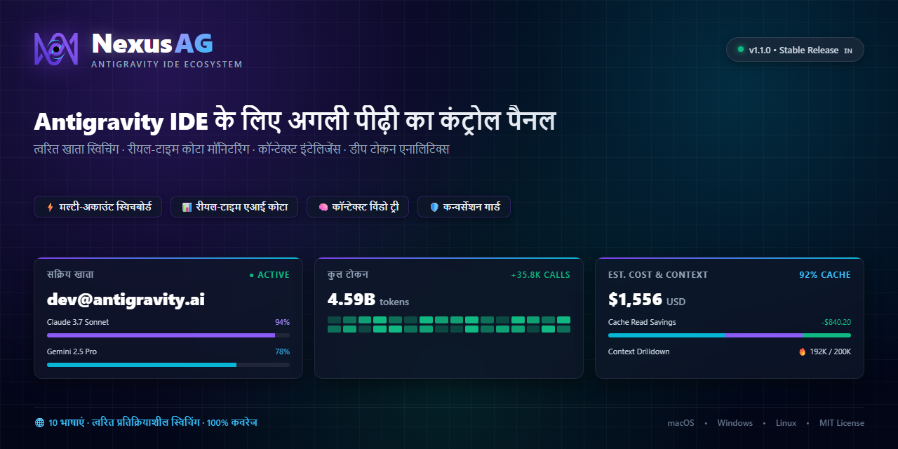

<p align="center">
  <a href="readme.md">English</a> •
  <a href="README.tr.md">Türkçe</a> •
  <a href="README.pt-BR.md">Português</a> •
  <a href="README.es.md">Español</a> •
  <a href="README.de.md">Deutsch</a> •
  <a href="README.fr.md">Français</a> •
  <a href="README.ja.md">日本語</a> •
  <a href="README.zh-CN.md">简体中文</a> •
  <a href="README.hi.md"><b>हिन्दी</b></a> •
  <a href="README.ru.md">Русский</a>
</p>

<p align="center">
  
</p>

<p align="center">
  <a href="https://github.com/AlperenAKKAYA99/NexusAG/releases"></a>
  
  
  
  
  
  
  
</p>

---

# NexusAG

> **समस्या:** Antigravity IDE में कई Google खातों का प्रबंधन करने में बार-बार मैन्युअल रूप से लॉग आउट करना, ब्राउज़र में बार-बार अनुमतियां देना, शेष AI कोटा सीमाओं का केवल अनुमान लगाना और डिस्क पर अनइंडेक्स की गई बातचीत के खो जाने का जोखिम शामिल होता है। इसके अलावा, Antigravity 2.27.0 अपडेट ने भाषा सर्वर को `agy.exe --hub` में बदल दिया, जिससे पुरानी पोर्ट और प्रक्रिया खोज विधियां निष्प्रभावी हो गईं।
>
> **समाधान:** NexusAG एक एकीकृत नियंत्रण कक्ष प्रदान करता है — **ब्राउज़र खोले बिना सीधे ऑपरेटिंग सिस्टम के कीरिंग (OS Keyring) के माध्यम से तुरंत खाता बदलें**, सटीक रीसेट टाइमर के साथ लाइव कोटा गेज की निगरानी करें, प्रत्येक प्रॉम्प्ट चरण के टोकन उपयोग का विश्लेषण करें, अनइंडेक्स बातचीत को पुनर्प्राप्त करें और बेंटो डैशबोर्ड में ऐतिहासिक लागतों का ऑडिट करें। **Antigravity ≥ 2.27 (`agy --hub`)** के लिए पूर्ण रूप से अनुकूलित और पुराने संस्करणों के साथ 100% संगत।

---

## ⚡ 60 सेकंड में शुरू करें

1. **इंस्टॉल करें** — Antigravity एक्सटेंशन मार्केटप्लेस में `NexusAG` खोजें या `nexus-ag-1.3.3.vsix` पैकेज इंस्टॉल करें।
2. **खाता जोड़ें** — ब्राउज़र के माध्यम से Google लॉगिन के लिए साइडबार में `+` पर क्लिक करें, या सीधे टोकन चिपकाने के लिए `🔑` का उपयोग करें।
3. **निगरानी और स्विच करें** — आपके लाइव कोटा संकेतक, काउंटडाउन और विश्लेषण तुरंत सक्रिय हो जाएंगे!

---

## 📸 मल्टी-अकाउंट स्विचबोर्ड और इंटरफ़ेस गैलरी (UI Showcase)

<table align="center" width="100%">
  <tr>
    <td align="center" width="25%" valign="top">
      <br/>
      <sub><b>⚡ मल्टी-अकाउंट स्विचबोर्ड</b><br/>1-क्लिक में खाता बदलें, लाइव कोटा और रीसेट टाइमर</sub>
    </td>
    <td align="center" width="25%" valign="top">
      <br/>
      <sub><b>🔑 टोकन बजट और संदर्भ</b><br/>कस्टमाइज़ेशन डोनट, सक्रिय सत्र और नियम</sub>
    </td>
    <td align="center" width="25%" valign="top">
      <br/>
      <sub><b>📈 उपयोग आँकड़े (साइडबार)</b><br/>सत्र टोकन योग, प्रति घंटा गतिविधि और मासिक लागत</sub>
    </td>
    <td align="center" width="25%" valign="top">
      <br/>
      <sub><b>🌐 सेटिंग्स और 10 भाषाएं</b><br/>त्वरित भाषा स्विचर, बैकग्राउंड अंतराल और सुधार</sub>
    </td>
  </tr>
  <tr>
    <td align="center" width="25%" valign="top">
      <br/>
      <sub><b>🔑 टोकन द्वारा जोड़ें</b><br/>सत्यापन के साथ बैच रीफ्रेश टोकन इनपुट</sub>
    </td>
    <td align="center" width="25%" valign="top">
      <br/>
      <sub><b>🔒 सहज Google OAuth</b><br/>स्वचालित वापसी के साथ 1-क्लिक प्रमाणीकरण</sub>
    </td>
    <td align="center" colspan="2" valign="top">
      <br/>
      <sub><b>🔍 संदर्भ विंडो विवरण (संपादक)</b><br/>पदानुक्रमित चरण ट्री, टोकन श्रेणियां और Markdown निर्यात</sub>
    </td>
  </tr>
  <tr>
    <td align="center" colspan="4" valign="top">
      <br/>
      <sub><b>📊 बेंटो एनालिटिक्स डैशबोर्ड (पूर्ण संपादक)</b><br/>जीवनकाल बातचीत ऑडिट, GitHub शैली हीटमैप, मॉडल लागत और शीर्ष सत्र</sub>
    </td>
  </tr>
</table>

---

## 🆕 Antigravity 2.27+ अगली पीढ़ी की अनुकूलता वास्तुकला

Antigravity 2.27.0 ने पुराने एकल `language_server_win.exe` को एकीकृत **`agy.exe --hub`** इंजन से बदल दिया है। NexusAG v1.3.3 इस आधुनिकीकरण के लिए विशेष रूप से डिज़ाइन किया गया मॉड्यूलर ढांचा पेश करता है:

```mermaid
flowchart TD
    subgraph खोज["🚀 Hub खोज इंजन"]
        EXT["चरण 0: google.google-antigravity exports हुक"] -->|सीधा पोर्ट और CSRF| CONN["ConnectRPC क्लाइंट"]
        CLI["चरण 1: प्रक्रिया स्कैन (`agy.exe --hub`)"] -->|"--hub-port और --csrf_token"| CONN
        MATCH["वर्कस्पेस फ़िल्टर (`--add-dir`)"] -->|केस-इनसेंसिटिव पाथ मैच| CONN
    end

    subgraph स्विच["⚡ बिना ब्राउज़र के त्वरित स्विच (AgyHubBackend)"]
        ACC["लक्षित खाता चुना गया"] --> INJECT["सीधे OS कीरिंग में लिखना"]
        INJECT -->|Windows| WCK["advapi32.dll CredWriteW (P/Invoke)"]
        INJECT -->|macOS| MCK["security add-generic-password"]
        INJECT -->|Linux| LCK["secret-tool store"]
        WCK & MCK & LCK --> KILL["PID समाप्ति taskkill / process.kill"]
        KILL --> RECOVER["AntigravityServerManager ~600ms में पुनः चालू करता है"]
        RECOVER --> VERIFY["GetUserStatus सत्यापित ✅"]
    end
```

### 1. चरण 0 सीधा एक्सटेंशन हुक और बिना Netstat के तेज़ खोज
- **सीधा हुक (`getAgyExtensionEndpoint`):** प्रक्रिया स्कैनिंग के लोड को पूरी तरह समाप्त करते हुए सीधे `google.google-antigravity` एक्सटेंशन के एक्सपोर्ट्स से सक्रिय विंडो का `port` और `csrfToken` पढ़ता है।
- **`--hub-port` सीधी पार्सिंग:** पोर्ट सीधे तर्कों से पार्स किया जाता है; धीमे `netstat` या `lsof` स्कैन की आवश्यकता नहीं होती।
- **मल्टी-विंडो अलगाव (`--add-dir`):** प्रत्येक IDE विंडो अपना Hub शुरू करती है। NexusAG विभिन्न विंडो के बीच गलत खाता परिवर्तन को रोकने के लिए `--add-dir` की तुलना सक्रिय फ़ोल्डर पथ (`pathsEqual`) से करता है।

### 2. ब्राउज़र खोले बिना त्वरित खाता स्विचिंग (`AgyHubBackend`)
- **OS कीरिंग में सीधा इनपुट:** OAuth क्रेडेंशियल्स को सीधे सुरक्षित सिस्टम स्टोर में लिखता है:
  - **Windows:** Base64 के माध्यम से P/Invoke `advapi32.dll CredWriteW` द्वारा `gemini:antigravity` में।
  - **macOS:** Keychain में नेटिव `security add-generic-password`।
  - **Linux:** `secret-tool` के माध्यम से Secret Service में।
- **स्वचालित पुनर्प्राप्ति रीस्टार्ट:** संबंधित पोर्ट की `agy.exe` प्रक्रिया को सुरक्षित रूप से समाप्त करता है। IDE का आंतरिक `AntigravityServerManager` इसे ~600ms में तुरंत पुनरारंभ करता है और नए क्रेडेंशियल्स को लोड करता है — **ब्राउज़र विंडो खोलने की बिल्कुल आवश्यकता नहीं होती!**
- **नेटिव फॉलबैक:** टोकन न होने पर, NexusAG स्वचालित रूप से `antigravity.internal.loginWithRedirect` के माध्यम से आधिकारिक लॉगिन पर चला जाता है।

### 3. आधुनिक SQLite वार्तालाप संग्रहण (`isAgyHubStorage`)
- `~/.gemini/antigravity/` में `conversation_summaries.db` और `.done` माइग्रेशन मार्करों का स्वतः पता लगाता है।
- SQLite वातावरण में पुरानी `.pb` तुलना के कारण आने वाली झूठी "गुम बातचीत" चेतावनियों को रोकता है।

### 4. 100% पश्चगामी अनुकूलता (`LegacyUssBackend`)
- 2.27 से पहले के पुराने संस्करणों (`language_server_*`, UnifiedStateSync और `RegisterGdmUser`) के लिए पूर्ण समर्थन बरकरार है।

---

## 🔄 विकास और पुराने संस्करणों से क्या बदला है?

| सुविधा / सबसिस्टम | पुराने संस्करण (v1.0 - v1.1) | मध्यवर्ती (v1.2) | वर्तमान NexusAG (v1.3.3 b23) |
|---|---|---|---|
| **Antigravity इंजन** | केवल 2.27 से पहले (`language_server_*`) | आंशिक `agy` पहचान | **नेटिव डुअल आर्किटेक्चर (`AgyHubBackend` + `LegacyUssBackend`)** |
| **खाता बदलना** | हमेशा ब्राउज़र पॉप-अप अनिवार्य | ब्राउज़र-सहायता रीडायरेक्ट | **ब्राउज़र-मुक्त: OS कीरिंग P/Invoke के माध्यम से त्वरित स्विच** |
| **पोर्ट का पता लगाना** | धीमा `netstat -ano` / `lsof` स्कैन | आंशिक फ़्लैग मिलान | **चरण 0 एक्सटेंशन हुक + सीधा `--hub-port` पार्सिंग** |
| **विंडो अलगाव** | `--workspace_id` (2.27 में हटाया गया) | बुनियादी स्ट्रिंग तुलना | **सख्त `--add-dir` पार्सिंग और Windows केस-इनसेंसिटिव पाथ जांच** |
| **बातचीत संग्रहण** | केवल `.pb` Protobuf स्कैन | केवल `.pb` स्कैन | **`conversation_summaries.db` और `.done` माइग्रेशन की पहचान** |
| **सुरक्षा और सैनिटाइजेशन** | बुनियादी HTML एस्केपिंग | बुनियादी एस्केपिंग | **मजबूत `escHtml` (`&quot;`, `&#39;`), Nonce CSP, सुरक्षित `execFile` और `stdin`** |
| **मॉडल मूल्य सूची** | स्थिर दरें | LiteLLM की अस्थिर `main` शाखा | **LiteLLM स्थिर कमिट (`5338edb7...`) + Gemini 3.8 और Claude 4.6** |
| **फ़ॉन्ट संपत्तियां** | बाहरी CDN कॉल | स्थानीय फ़ाइलें | **Font Awesome Pro 7.3.1 Base64 में एम्बेडेड (शून्य बाहरी अनुरोध)** |
| **स्थानीयकरण** | केवल अंग्रेजी और तुर्की आंशिक | 10 भाषाओं में कई अधूरी कुंजियां | **10 मूल भाषाएं, 251/251 कुंजियों की 100% सत्यापित पूर्ण समानता** |
| **VSIX पैकेज का आकार** | ~8.71 MB | ~8.71 MB | **6.91 MB अनुकूलित (~1.8 MB की बचत, शून्य `node_modules`)** |

---

## ✨ मुख्य विशेषताएं

### ⚡ मल्टी-अकाउंट स्विचबोर्ड और लाइव कोटा
- **असीमित प्रोफाइल:** व्यक्तिगत, कंपनी और ग्राहक खातों को एक साथ ट्रैक करें।
- **बिना ब्राउज़र के तुरंत स्विच:** बिना किसी रुकावट के साइडबार से तुरंत बदलें।
- **स्टेटस बार एकीकरण:** VS Code के नीचे पसंदीदा मॉडल के कोटा प्रतिशत को पिन करें।
- **स्वचालित नवीनीकरण:** 401 त्रुटियों को रोकने के लिए पृष्ठभूमि में टोकन रीफ़्रेश।

### 🌍 100% स्थानीयकरण (10 भाषाएं)
- `English` • `Türkçe` • `Português` • `Español` • `Deutsch` • `Français` • `日本語` • `简体中文` • `हिन्दी` • `Русский`
- बिना खिड़की पुनः लोड किए तुरंत भाषा परिवर्तन।

### 🔑 टोकन बजट और संदर्भ विश्लेषक
- MCP टूल्स, प्रोजेक्ट रूल्स और स्किल्स द्वारा खपत का पारदर्शी ब्यौरा।
- AI मॉडल के रिस्पॉन्स के साथ-साथ रीयल-टाइम में टोकन की सटीक गणना।

### 📈 डीप टोकन एनालिटिक्स और बेंटो डैशबोर्ड
- इतिहास की सभी बातचीत का एकमुश्त विश्लेषण।
- लागत टूलटिप्स के साथ 365 दिनों का GitHub-शैली योगदान हीटमैप।

---

## 🔒 सुरक्षा और गोपनीयता (ऑडिटेड A+)

- **100% स्थानीय डेटा:** कोई भी प्रॉम्प्ट, कोड या बातचीत आपके डिवाइस से बाहर नहीं जाती।
- **शून्य रनटाइम निर्भरताएं:** `package.json` में `dependencies: {}` पूरी तरह खाली है।
- **OS-स्तरीय एन्क्रिप्शन:** टोकन DPAPI, Keychain या Secret Service द्वारा सुरक्षित हैं।
- **ऑडिट रिपोर्ट:** पूरी रिपोर्ट [SIBER_GUVENLIK_DENETIM_RAPORU.md](docs/SIBER_GUVENLIK_DENETIM_RAPORU.md) में उपलब्ध है।

---

## 🚀 स्थापना और कमांड

मार्केटप्लेस या टर्मिनल से `nexus-ag-1.3.3.vsix` इंस्टॉल करें:
```bash
antigravity-ide.cmd --install-extension nexus-ag-1.3.3.vsix --force
```

| कमांड | पहचानकर्ता | विवरण |
|---|---|---|
| **NexusAG: Refresh Quota** | `ag.refreshQuota` | कोटा और टोकन बजट को तुरंत रीफ़्रेश करें। |
| **NexusAG: Add Account** | `ag.addAccount` | ब्राउज़र के माध्यम से Google खाता जोड़ें। |
| **NexusAG: Add Account via Token** | `ag.addAccountByToken` | रीफ़्रेश टोकन इनपुट करें। |
| **NexusAG: Remove Account** | `ag.removeAccount` | चयनित खाते को हटाएं। |
| **NexusAG: Open Usage Statistics** | `ag.openUsageStats` | पूर्ण स्क्रीन बेंटो डैशबोर्ड खोलें। |
| **NexusAG: Fix Missing Conversations** | `ag.fixConversations` | अनइंडेक्स बातचीत को पुनर्प्राप्त करें। |

---

## 📄 लाइसेंस

ओपन-सोर्स **[MIT लाइसेंस](LICENSE)** के तहत वितरित।

