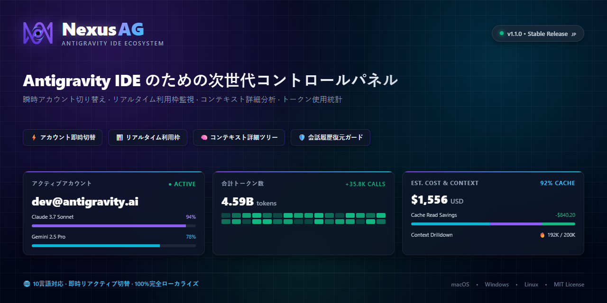
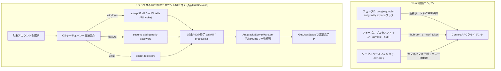

<p align="center">
  <a href="readme.md">English</a> •
  <a href="README.tr.md">Türkçe</a> •
  <a href="README.pt-BR.md">Português</a> •
  <a href="README.es.md">Español</a> •
  <a href="README.de.md">Deutsch</a> •
  <a href="README.fr.md">Français</a> •
  <a href="README.ja.md"><b>日本語</b></a> •
  <a href="README.zh-CN.md">简体中文</a> •
  <a href="README.hi.md">हिन्दी</a> •
  <a href="README.ru.md">Русский</a>
</p>

<p align="center">
  
</p>

<p align="center">
  <a href="https://github.com/AlperenAKKAYA99/NexusAG/releases"></a>
  
  
  
  
  
  
  
</p>

---

# NexusAG

> **課題:** Antigravity IDEで複数のGoogleアカウントを管理する際、頻繁な手動ログアウト、ブラウザでの繰り返し認証、AIクォータ残量の不透明さ、ディスク上の未インデックス会話の消失リスクなどの問題がありました。さらに、Antigravity 2.27.0のアップデートにより言語サーバーが`agy.exe --hub`へ刷新され、従来のポート・プロセス検出手法が無効化されました。
>
> **解決策:** NexusAGは、**ブラウザ起動不要のOSキーチェーン注入による即時アカウント切り替え**、正確なリセットタイマー付きリアルタイムクォータ監視、各プロンプトステップのトークン内訳分析、孤立した会話の自動修復、フルエディタBentoダッシュボードを提供します。**Antigravity ≥ 2.27 (`agy --hub`)** に完全対応し、旧環境とも100%の下位互換性を確保しています。

---

## ⚡ 60秒で始めるクイックスタート

1. **インストール** — Antigravityの拡張機能マーケットプレイスで`NexusAG`を検索するか、`nexus-ag-1.3.3.vsix`をインストールします。
2. **アカウント追加** — サイドバーの`+`アイコンをクリックしてブラウザ経由でログインするか、`🔑`アイコンからトークンを貼り付けます。
3. **監視と切り替え** — クォータメーター、カウントダウン、コンテキスト詳細、使用統計が即座に利用可能になります！

---

## 📸 マルチアカウント管理画面とUIギャラリー (UI Showcase)

<table align="center" width="100%">
  <tr>
    <td align="center" width="25%" valign="top">
      <br/>
      <sub><b>⚡ マルチアカウント管理盤</b><br/>1クリック切り替え、リアルタイムクォータ＆リセット時計</sub>
    </td>
    <td align="center" width="25%" valign="top">
      <br/>
      <sub><b>🔑 トークン予算とコンテキスト</b><br/>カスタマイズドーナツ、セッション消費＆ルール一覧</sub>
    </td>
    <td align="center" width="25%" valign="top">
      <br/>
      <sub><b>📈 サイドバー利用統計</b><br/>セッショントークン合計、時間別推移＆月間コスト</sub>
    </td>
    <td align="center" width="25%" valign="top">
      <br/>
      <sub><b>🌐 設定と10言語ハブ</b><br/>即時言語切り替え、バックグラウンド間隔＆修復機能</sub>
    </td>
  </tr>
  <tr>
    <td align="center" width="25%" valign="top">
      <br/>
      <sub><b>🔑 トークン追加モーダル</b><br/>検証付きリフレッシュトークンの一括登録</sub>
    </td>
    <td align="center" width="25%" valign="top">
      <br/>
      <sub><b>🔒 Google OAuth連携</b><br/>ワンクリック自動リターン認証</sub>
    </td>
    <td align="center" colspan="2" valign="top">
      <br/>
      <sub><b>🔍 コンテキスト詳細分析（エディタ）</b><br/>ステップツリー、カテゴリ別トークン比率＆Markdown出力</sub>
    </td>
  </tr>
  <tr>
    <td align="center" colspan="4" valign="top">
      <br/>
      <sub><b>📊 Bento分析ダッシュボード（フルエディタ）</b><br/>過去全会話の監査、GitHub風ヒートマップ、モデル別費用＆主要セッション</sub>
    </td>
  </tr>
</table>

---

## 🆕 Antigravity 2.27+ 次世代互換アーキテクチャ

Antigravity 2.27.0では、独立した`language_server_win.exe`バイナリが統合エンジン**`agy.exe --hub`**に刷新されました。NexusAG v1.3.3はこの新しい環境に最適化された専用設計を備えています：



### 1. フェーズ0 直接拡張機能フック＆Netstat不要の高速検出
- **直接フック (`getAgyExtensionEndpoint`):** プロセス列挙の負荷を完全に排し、アクティブウィンドウの`port`と`csrfToken`を`google.google-antigravity`拡張のエクスポートから直接読み取ります。
- **`--hub-port` 直接解析:** プロセス引数から正規表現でポートを直接取得し、重い`netstat`スキャンを回避します。
- **マルチウィンドウ分離 (`--add-dir`):** 各ウィンドウが固有のHubを起動します。NexusAGは`--add-dir`と開いているフォルダパスを厳密に比較（`pathsEqual`）し、他ウィンドウへの誤った影響を防ぎます。

### 2. ブラウザ起動不要の即時アカウント切り替え (`AgyHubBackend`)
- **OSネイティブキーチェーン注入:** OAuth認証情報をOSのセキュア領域に直接書き込みます：
  - **Windows:** P/Invoke `advapi32.dll CredWriteW`（Base64経由）で`gemini:antigravity`へ登録。
  - **macOS:** ネイティブの`security add-generic-password`でKeychainへ登録。
  - **Linux:** `secret-tool`経由でSecret Serviceへ登録。
- **自動復帰再起動:** 対象ポートの`agy.exe`を安全に終了させると、IDE内蔵の`AntigravityServerManager`が約600msで自動再起動し、新しい認証情報を即時読み込みます。**ブラウザを開く必要は一切ありません！**
- **ネイティブフォールバック:** トークンがない場合、`antigravity.internal.loginWithRedirect`を用いたガイド付きサインインへ自動移行します。

### 3. 最新のSQLite会話ストレージ対応 (`isAgyHubStorage`)
- `~/.gemini/antigravity/`配下の`conversation_summaries.db`と`.done`マーカーを自動検知します。
- 新しいSQLite環境下で旧来の`.pb`比較による誤検知アラートを防止します。

### 4. 100%の下位互換性 (`LegacyUssBackend`)
- 2.27以前の旧バージョン（`language_server_*`、UnifiedStateSync、`RegisterGdmUser`）への完全なフォールバックも維持されています。

---

## 🔄 バージョン進化：旧バージョンからの変更点

| 項目 / サブシステム | 旧バージョン (v1.0 - v1.1) | 中間バージョン (v1.2) | 最新 NexusAG (v1.3.3 b23) |
|---|---|---|---|
| **Antigravityエンジン** | 2.27以前のみ (`language_server_*`) | 初期的な`agy`検出 | **ネイティブデュアル構造 (`AgyHubBackend` + `LegacyUssBackend`)** |
| **アカウント切り替え** | 毎回ブラウザが開く手動認証 | ブラウザ誘導方式 | **ブラウザ起動不要：OSキーチェーン直接注入による即時切り替え** |
| **ポート検出** | 重い`netstat -ano` / `lsof`巡回 | 部分的な引数一致 | **フェーズ0エクスポートフック + `--hub-port`直接解析** |
| **ウィンドウ分離** | `--workspace_id`（2.27で廃止） | 単純な文字列比較 | **厳格な`--add-dir`解析（Windowsの大文字小文字不問パス照合）** |
| **会話ストレージ** | 固定的な`.pb` Protobuf走査 | 固定的な`.pb`走査 | **`conversation_summaries.db`および`.done` SQLite移行検知** |
| **セキュリティ・保護** | 最低限のHTMLエスケープ | 最低限のエスケープ | **強化版`escHtml`（`&quot;`, `&#39;`対応）、Nonce CSP、安全な`execFile` & `stdin`** |
| **モデル価格表** | 固定値 | 変更されやすいLiteLLM `main`枝 | **LiteLLM固定コミット (`5338edb7...`) + Gemini 3.8 / Claude 4.6対応** |
| **フォント資産** | 外部CDNへのWebフォント要求 | 分散ローカルファイル | **Font Awesome Pro 7.3.1をBase64内蔵（外部リクエストゼロ）** |
| **多言語ローカライズ** | 英語とトルコ語のみ一部対応 | 10言語で未翻訳キー多数 | **10言語すべてで251/251キーの完全一致・100%ローカライズを検証済み** |
| **VSIXパッケージ容量** | 約8.71 MB（未最適化） | 約8.71 MB | **6.91 MBに最適化（約1.8 MBの軽量化、`node_modules`完全除外）** |

---

## ✨ 主な機能

### ⚡ マルチアカウント管理＆リアルタイムクォータ監視
- **無制限プロファイル:** 個人、会社、クライアントの各Googleアカウントを同時に監視。
- **ブラウザ不要の即時切り替え:** 作業を中断せず、サイドバーから1クリックでアカウント変更。
- **ステータスバー固定:** お気に入りモデルを星（★）マークでVS Code下部バーに表示。
- **プロアクティブ更新:** バックグラウンド自動トークン更新により401認証エラーを予防。

### 🌍 10言語完全対応 (ネイティブ翻訳)
- `English` • `Türkçe` • `Português` • `Español` • `Deutsch` • `Français` • `日本語` • `简体中文` • `हिन्दी` • `Русский`
- ウィンドウのリロードなしで即時に全UIが切り替わります。

### 🔑 トークン予算とコンテキスト解析
- MCPツール、プロジェクトルール、ワークフロー、スキルごとの消費トークンを円グラフで可視化。
- AIモデルの応答ストリーミング中もリアルタイムでトークン蓄積を追跡。

### 📈 深層トークン分析＆Bentoダッシュボード
- 過去の全会話セッションをローカルディスクから集約。
- 365日分のGitHub風コントリビューションヒートマップ表示。

---

## 🔒 セキュリティとプライバシー（監査評価 A+）

- **100%ローカル管理:** 会話内容、プロンプト、コードが外部へ送信されることは一切ありません。
- **実行時依存関係ゼロ:** `package.json`の`dependencies: {}`は空です。
- **OSによる暗号化保管:** トークンはDPAPI、Keychain、Secret Serviceで保護されます。
- **監査報告書:** 詳細は[SIBER_GUVENLIK_DENETIM_RAPORU.md](docs/SIBER_GUVENLIK_DENETIM_RAPORU.md)をご確認ください。

---

## 🚀 インストールとコマンド一覧

Marketplaceまたはターミナルから`nexus-ag-1.3.3.vsix`をインストール：
```bash
antigravity-ide.cmd --install-extension nexus-ag-1.3.3.vsix --force
```

| コマンド | 識別子 | 説明 |
|---|---|---|
| **NexusAG: Refresh Quota** | `ag.refreshQuota` | クォータとトークン予算を即座に更新。 |
| **NexusAG: Add Account** | `ag.addAccount` | ブラウザからGoogleアカウントを追加。 |
| **NexusAG: Add Account via Token** | `ag.addAccountByToken` | リフレッシュトークンを一括入力。 |
| **NexusAG: Remove Account** | `ag.removeAccount` | 選択したアカウントを削除。 |
| **NexusAG: Open Usage Statistics** | `ag.openUsageStats` | フル画面Bentoダッシュボードを開く。 |
| **NexusAG: Fix Missing Conversations** | `ag.fixConversations` | 未インデックスの会話を修復。 |

---

## 📄 ライセンス

オープンソース **[MITライセンス](LICENSE)** のもとで公開されています。

