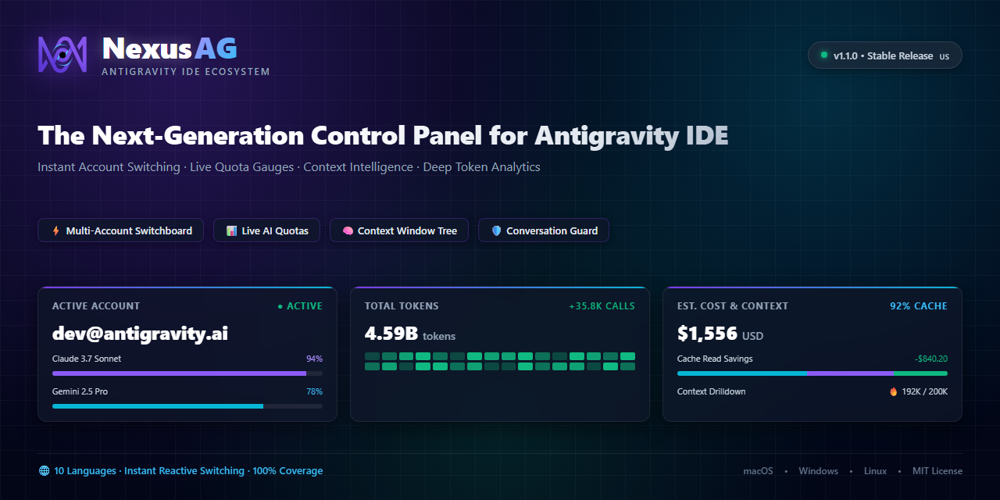
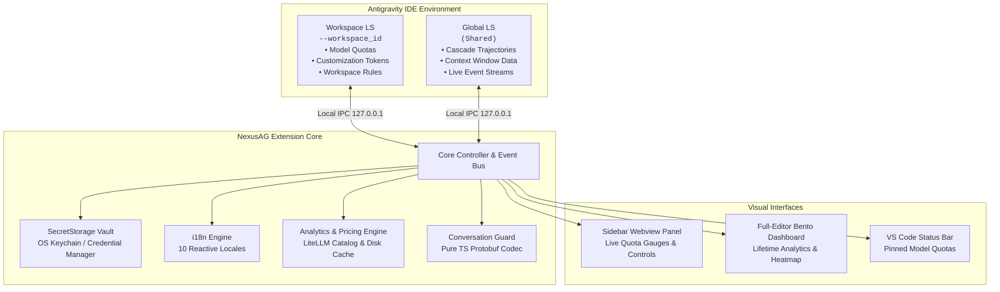

<p align="center">
  <a href="README.md"><b>English</b></a> •
  <a href="docs/i18n/README.tr.md">Türkçe</a> •
  <a href="docs/i18n/README.pt-BR.md">Português</a> •
  <a href="docs/i18n/README.es.md">Español</a> •
  <a href="docs/i18n/README.de.md">Deutsch</a> •
  <a href="docs/i18n/README.fr.md">Français</a> •
  <a href="docs/i18n/README.ja.md">日本語</a> •
  <a href="docs/i18n/README.zh-CN.md">简体中文</a> •
  <a href="docs/i18n/README.hi.md">हिन्दी</a> •
  <a href="docs/i18n/README.ru.md">Русский</a>
</p>

<p align="center">
  
</p>

<p align="center">
  <a href="https://github.com/AlperenAKKAYA99/NexusAG/releases"></a>
  
  
  
  
  
  
</p>

---

# NexusAG

> **The Problem:** Managing multiple Google accounts in Antigravity IDE requires cumbersome manual re-authentications, blind guessing of remaining AI quota limits, lost context across profile switches, and risks of losing unindexed conversations on disk.
>
> **The Solution:** NexusAG delivers an integrated mission-control sidebar — switch accounts in **1-click**, inspect real-time AI quota gauges with exact reset timers, dissect token footprints across every prompt step, recover orphaned conversations directly from local storage, and audit lifetime token costs with a full-editor bento analytics dashboard.

---

## ⚡ Get Started in 60 Seconds

1. **Install** — Search `NexusAG` in the Antigravity Extensions Marketplace or install the `.vsix` package.
2. **Add Account** — Click the `+` icon in the sidebar for 1-click Google OAuth browser sign-in, or use `🔑` to paste tokens.
3. **Monitor & Switch** — Your live quota gauges, reset countdowns, active context window metrics, and lifetime token analytics are instantly live!

---

## 📸 Multi-Account Switchboard & UI Showcase

<table align="center" width="100%">
  <tr>
    <td align="center" width="25%" valign="top">
      <br/>
      <sub><b>⚡ Multi-Account Switchboard</b><br/>One-click account switching, live quota progress & reset timers</sub>
    </td>
    <td align="center" width="25%" valign="top">
      <br/>
      <sub><b>🔑 Token Budget & Context</b><br/>Customizations donut, active session gauge & workspace rules</sub>
    </td>
    <td align="center" width="25%" valign="top">
      <br/>
      <sub><b>📈 Usage Stats (Sidebar)</b><br/>Session token totals, hourly activity & monthly cost breakdown</sub>
    </td>
    <td align="center" width="25%" valign="top">
      <br/>
      <sub><b>🌐 Settings & 10-Language Hub</b><br/>Instant reactive language switcher & background interval settings</sub>
    </td>
  </tr>
  <tr>
    <td align="center" width="25%" valign="top">
      <br/>
      <sub><b>🔑 Add Accounts via Token</b><br/>Batch OAuth refresh token paste with verification</sub>
    </td>
    <td align="center" width="25%" valign="top">
      <br/>
      <sub><b>🔒 Seamless Google OAuth</b><br/>One-click browser authentication with auto-return</sub>
    </td>
    <td align="center" colspan="2" valign="top">
      <br/>
      <sub><b>🔍 Context Window Drill-Down (Editor Tab)</b><br/>Hierarchical step tree, token category breakdown & Markdown export</sub>
    </td>
  </tr>
  <tr>
    <td align="center" colspan="4" valign="top">
      <br/>
      <sub><b>📊 Deep Token Analytics Bento Dashboard (Full Editor)</b><br/>Lifetime conversation auditing, GitHub-style activity heatmap, model cost distribution & top conversations</sub>
    </td>
  </tr>
</table>

---

## ✨ Core Highlights & Features

### ⚡ Multi-Account Switchboard & Live Quota Monitoring
*Switch between accounts effortlessly and never hit quota blind spots.*
- **Unlimited Profiles** — Monitor personal, corporate, and client Google accounts simultaneously with zero cross-talk.
- **Instant 1-Click Switching** — Switch the active Antigravity IDE account instantly directly from the sidebar without reloading the window.
- **Live Quota Gauges** — Color-coded capacity indicators (🟢 >50%, 🟡 20–50%, 🔴 <20%) with exact reset countdown timers down to the minute.
- **Status Bar Integration** — Star (★) your favorite models to display their real-time quota gauges right in the IDE status bar.
- **Proactive Token Renewal** — Automated background refresh of OAuth access tokens prevents 401 session expirations during long coding marathons.
- **Plan Tier Insights** — Instant display of tier classification (Ultra, Pro, Free), AI prompt credits, and flow credits.

### 🌍 100% Internationalization & Instant Reactive Localization
*Engineered for developers worldwide with native translations.*
- **10 Native Locales** supported out of the box:
  `English (en)` • `Türkçe (tr)` • `Português (pt-BR)` • `Español (es)` • `Deutsch (de)` • `Français (fr)` • `日本語 (ja)` • `简体中文 (zh-CN)` • `हिन्दी (hi)` • `Русский (ru)`
- **Zero-Reload Reactive Switching** — Changing language in the Settings tab instantly translates **100%** of the UI (Sidebar, Full-Editor Bento Dashboard, Context Drill-Down, notifications, and tooltips).
- **System Locale Auto-Detection** — Automatically identifies and adopts your IDE locale upon initial boot.

### 🔑 Token Budget & Context Window Intelligence
*Inspect and optimize your agentic context footprint in real time.*
- **Customization Budget Donut** — Granular token breakdown consumed by MCP Tools, Project Rules, Workflows, and Skills.
- **Active Context Window Gauge** — Live donut visualization comparing current conversation tokens against the model's physical maximum context ceiling.
- **Workspace Context Inspector** — Direct file links to all `.agent/` rules, workflows, and skills with their active runtime states (`always-on`, `model-decision`, `manual`).
- **Real-Time Stream Updates** — Dynamically tracks token accumulation step-by-step as the AI model streams responses.

### 🔍 Context Window Drill-Down (Full-Editor Tab)
*Audit every prompt step, tool output, and system instruction.*
- **Hierarchical Step Tree** — Grouped breakdown of System Prompt, Tools, MCP Tools, and User/Model Chat Messages with exact token counts and percentages.
- **Inline Step Previews** — Click any step to inspect prompt text, model response, tool inputs, command stdout, and grep outputs without leaving your editor.
- **Flame Badges (🔥)** — Visual flags marking the heaviest token consumers in the context window.
- **Markdown Audit Export** — Export complete token breakdowns to the clipboard or `.md` files for cost auditing and team reviews.

### 📈 Deep Token Analytics & Bento Dashboard
*Comprehensive lifetime intelligence on your AI consumption patterns.*
- **Lifetime Aggregation** — Recursively scans and aggregates token usage across every conversation ever conducted in Antigravity.
- **9 KPI Metrics** — Input, Cache Reads, Output, Reasoning tokens, total calls, estimated cost, active days, and cache hit rate.
- **GitHub-Style Contribution Heatmap** — 365-day historical activity grid with year selector, cell-level cost tooltips, and peak day markers.
- **Dynamic Pricing Engine** — Powered by the LiteLLM pricing catalog with custom per-model rate overrides for exact financial tracking.
- **Expenditure Patterns** — Weekday vs. weekend distribution charts and monthly stacked expenditure breakdowns.

### 🛡️ Conversation Guard & Orphaned Trajectory Recovery
*Safeguard your prompts and restore unindexed conversations with zero data loss.*
- **Automatic Discrepancy Detection** — Compares local `.pb` files on disk against the sidebar index 15 seconds after IDE boot.
- **Expandable Warning Banner** — Displays exact missing counts and extracted titles of unindexed conversations.
- **One-Click Standalone Rebuild** — Detached Node.js repair worker terminates AG safely, rebuilds the database index from disk, and auto-relaunches the IDE with the active workspace preserved.

---

## 🔒 Security & Privacy

Security and privacy are fundamental design principles of NexusAG. An independent comprehensive security audit was conducted on the codebase:

- **100% Local Data** — No conversational data, prompts, file contents, or personal telemetry ever leave your machine.
- **OS-Level Credential Encryption** — All OAuth refresh tokens are encrypted using VS Code's native `SecretStorage` (backed by **macOS Keychain**, **Windows Credential Manager**, or **Linux Secret Service / Keyring**).
- **Strictly Local Communication** — Communication with Language Servers is restricted exclusively to `127.0.0.1` loopback IPC sockets.
- **Zero (0) Runtime Dependencies** — Clean supply chain with **0 third-party runtime npm packages**. Everything is written in pure TypeScript, including the Protobuf varint codec.
- **Official API Endpoints Only** — Network requests are strictly limited to official Google OAuth and Cloud Code Quota APIs.
- **Security Audited** — Detailed audit documentation is available in [SECURITY_AUDIT.md](docs/SECURITY_AUDIT.md) (0 critical vulnerabilities, 0 malware/backdoors).
- **Open Source** — Every line of code is transparent and auditable under the permissive **MIT License**.

---

## 🏗️ Architecture & Internal Mechanics

NexusAG coordinates directly with the local Language Server (LS) processes launched by the Google Antigravity IDE:



### Key Engineering Highlights:
- **Dual-LS Discovery** — Scans local network listeners (`netstat`/`lsof`) to discover LS ports and binds strictly to the matching `--workspace_id` to prevent cross-workspace contamination.
- **Kubernetes-Style Readiness Gate** — Employs a robust readiness probe ensuring USS IPC reconnection is fully healthy before dispatching `registerGdmUser`, guaranteeing glitch-free account handoffs.
- **Pure TypeScript Protobuf Codec** — Encodes and decodes Protobuf wire-format trajectories without heavy binary dependencies or external native compilation.

---

## ⚡ How It Works

```
1. IDE Launch ─────► Dual-LS Port Discovery ─────► Fetch Active Quota & Rules
                            │
2. User Action ────► 1-Click Account Switch ─────► Token Exchange via SecretStorage
                            │
3. Readiness Gate ──► Verify USS IPC Socket ─────► Register New User with Language Server
                            │
4. Active Session ─► Real-Time Stream Hook  ─────► Live Quota & Context Meter Updates
```

---

## 🚀 Getting Started

### Prerequisites
- **Google Antigravity IDE** (or compatible VS Code environment)
- At least one active Google account with Antigravity AI privileges
- Operating System: **macOS**, **Windows**, or **Linux**

### Installation

#### Method 1: Marketplace (Recommended)
1. Open the Extensions view (`Ctrl+Shift+X` or `Cmd+Shift+X`).
2. Search for **NexusAG**.
3. Click **Install**.

#### Method 2: Manual VSIX Installation
Download the latest `.vsix` release from the [GitHub Releases](https://github.com/AlperenAKKAYA99/NexusAG/releases) tab and install via terminal:
```bash
antigravity-ide.cmd --install-extension nexus-ag-1.1.1.vsix --force
```

### 🎯 First Steps After Installation
1. Click the **NexusAG** icon on your Activity Bar.
2. Your primary active account will load automatically.
3. Click `+` to add secondary accounts via Google browser login or `🔑` to import refresh tokens.
4. Star (★) your primary model to pin its quota percentage directly onto your status bar.
5. Click **"Open Full Dashboard →"** in the Usage tab to explore your lifetime AI analytics.

---

## ⌨️ Command Palette

All core features can be triggered from the VS Code Command Palette (`Ctrl+Shift+P` / `Cmd+Shift+P`):

| Command | Identifier | Description |
|---|---|---|
| **NexusAG: Refresh Quota** | `ag.refreshQuota` | Forces an immediate quota and token budget refresh from Google APIs. |
| **NexusAG: Add Account** | `ag.addAccount` | Opens browser window for 1-click Google OAuth authentication. |
| **NexusAG: Add Account via Token** | `ag.addAccountByToken` | Opens modal for batch importing OAuth refresh tokens. |
| **NexusAG: Copy Account Tokens** | `ag.copyTokens` | Opens multi-select picker to export refresh tokens in Plain, Labeled, or JSON format. |
| **NexusAG: Remove Account** | `ag.removeAccount` | Removes a selected account from local storage and tracking. |
| **NexusAG: Open Usage Statistics** | `ag.openUsageStats` | Launches the full-editor deep analytics bento dashboard. |
| **NexusAG: Fix Missing Conversations** | `ag.fixConversations` | Scans disk storage and repairs unindexed `.pb` conversations. |

---

## ⚙️ Configuration Settings

Configure NexusAG under **Settings** (`Ctrl+,` or `Cmd+,`) → Search `NexusAG`:

| Setting | Type | Default | Description |
|---|---|---|---|
| `ag-switchboard.language` | `string` | `auto` | Interface language (`auto`, `en`, `tr`, `pt-BR`, `es`, `de`, `fr`, `ja`, `zh-CN`, `hi`, `ru`). |
| `ag-switchboard.refreshInterval` | `string` | `1m` | Background polling frequency for quota updates (`instant`, `30s`, `1m`, `2m`, `5m`). |
| `ag-switchboard.modelPricing` | `object` | Defaults | Custom per-model rates per 1M tokens (`input`, `output`, `cache`). |
| `ag-switchboard.switchWithFixConversations` | `boolean` | `true` | Automatically synchronizes and repairs the conversation index on account switch. |
| `ag-switchboard.tokenExport.defaultFormat` | `string` | `plain` | Default export format when copying multiple tokens (`plain`, `labeled`, `json`). |
| `ag-switchboard.tokenExport.clearClipboardSeconds` | `number` | `0` | Automatically clear tokens from clipboard after N seconds (0 = disabled). |
| `ag-switchboard.tokenExport.confirmBulkCopy` | `boolean` | `true` | Show confirmation security dialog before copying multiple tokens. |
| `ag-switchboard.diagnosticMode` | `boolean` | `false` | Enables verbose diagnostic file logging for troubleshooting. |

---

## 📊 Project Stats

<div align="center">

| Metric | Specification |
|---|---|
| **Total Source Modules** | 62 TypeScript + 2 CSS files |
| **Codebase Volume** | ~19,600+ Lines of Code |
| **Runtime Dependencies** | **0** (Zero external dependencies) |
| **Build System** | esbuild (Sub-second webview bundling) |
| **Supported Locales** | 10 Native Languages (273 keys each, 100% parity) |
| **Security Audit** | Passed — 0 critical / high findings |
| **Supported Platforms** | macOS (Apple Silicon / Intel), Windows 10/11, Linux (x64/arm64) |

</div>

---

## 🛠️ Built With

- **[TypeScript](https://www.typescriptlang.org/)** — End-to-end static typing and enterprise resilience
- **[esbuild](https://esbuild.github.io/)** — Lightning-fast compilation and optimized asset packaging
- **[Font Awesome Pro](https://fontawesome.com/)** — Crisp, modern vector iconography
- **[LiteLLM Pricing Catalog](https://github.com/BerriAI/litellm)** — Accurate, community-maintained AI token pricing
- **Native VS Code API** — Deep integration with `SecretStorage`, `WebviewViewProvider`, and `StatusBarItem`

---

## ❓ Frequently Asked Questions (FAQ)

<details>
<summary><b>Is my code, prompt, or account data sent to any third-party servers?</b></summary>
<br/>
<b>No.</b> NexusAG operates with a strict zero-telemetry policy. The extension communicates exclusively with official Google authentication and quota APIs (`oauth2.googleapis.com` and `cloudcode-pa.googleapis.com`), and with your local Antigravity Language Server on <code>127.0.0.1</code>. No analytics, transcripts, or telemetry are ever collected or transmitted.
</details>

<details>
<summary><b>Where are my Google credentials and OAuth tokens stored?</b></summary>
<br/>
All authentication tokens are secured using VS Code's native <code>SecretStorage</code> API. This delegates encryption directly to your operating system's keychain (macOS Keychain, Windows Credential Manager, or Linux Secret Service/Keyring).
</details>

<details>
<summary><b>Can I run multiple Antigravity IDE windows simultaneously?</b></summary>
<br/>
<b>Yes.</b> NexusAG uses workspace-isolated state tracking (<code>workspaceState</code>) and filters Language Server processes by <code>--workspace_id</code>, ensuring that different IDE windows never corrupt or overwrite each other's session data.
</details>

<details>
<summary><b>Why does NexusAG have zero (0) runtime dependencies?</b></summary>
<br/>
To eliminate supply-chain vulnerability vectors, minimize package bundle size, and guarantee maximum execution speed. All protocol handling—including Protobuf binary encoding and decoding—is custom-built in native TypeScript.
</details>

<details>
<summary><b>What happens when an account's quota resets?</b></summary>
<br/>
The background quota scheduler refreshes your metrics according to your configured interval (default 1m). The sidebar gauges automatically turn green (🟢) and the reset countdown timer updates smoothly in real time.
</details>

<details>
<summary><b>Can NexusAG be used without the Google Antigravity IDE?</b></summary>
<br/>
NexusAG is specifically tailored to hook into Google Antigravity IDE's internal Language Server architecture and quota endpoints. It requires the Antigravity IDE environment to function.
</details>

---

## 🤝 Contributing & Development

Contributions, bug reports, and feature suggestions are warmly welcomed!

### Local Development Setup

1. **Clone the repository:**
   ```bash
   git clone https://github.com/AlperenAKKAYA99/NexusAG.git
   cd NexusAG
   ```

2. **Install development dependencies:**
   ```bash
   npm install
   ```

3. **Compile the extension & webviews:**
   ```bash
   npm run compile
   ```

4. **Launch Extension in Debug Mode:**
   - Press `F5` in VS Code / Antigravity IDE to open an Extension Development Host window.

5. **Verify Internationalization:**
   ```bash
   npm run verify:i18n
   ```

---

## 📋 Changelog Highlights

For the full release history, see [CHANGELOG.md](CHANGELOG.md).

- **v1.1.1 (Current)** — Bulk token export & copy system with smart round-trip extraction, clipboard auto-clearing timer, and enhanced multi-account security.
- **v1.1.0** — 10-language instant reactive localization, multi-banner asset generation, enhanced UI showcase, and unified branding.
- **v1.0.5** — Usage Stats deduplication via `responseId`, dynamic model auto-humanization, and quota 100% bugfix.
- **v1.0.4** — **Conversation Guard**, standalone detached repair worker, and pure-TypeScript Protobuf trajectory codec for orphaned conversation recovery.
- **v1.0.3** — Multi-window state isolation, USS event gating, and background polling resilience.
- **v1.0.2** — Cross-source pin matching (★), status bar quota integration, heatmap cost tooltips, and diagnostic logging harness.
- **v1.0.1** — Dual-LS architecture, full context window drill-down tab, and live event stream monitoring.
- **v1.0.0** — Initial public release: 1-click Google account switching, full-editor bento analytics, GitHub-style activity heatmap, and SecretStorage vault.


---

## 🙏 Acknowledgments

- Thanks to the Antigravity community for ongoing feature feedback and testing.

---

## 📄 License & Author

Distributed under the **MIT License**. See [LICENSE](LICENSE) for full details.

Developed with ☕ by **[Alperen AKKAYA](https://github.com/AlperenAKKAYA99)**
