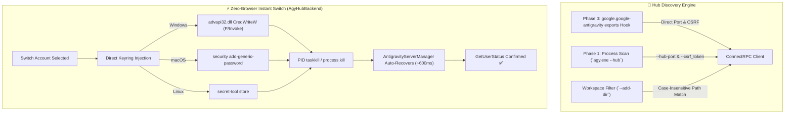
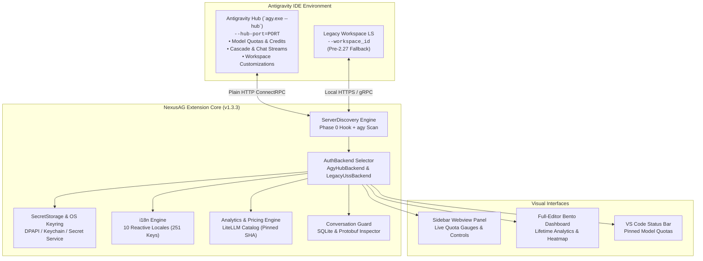

<p align="center">
  <a href="readme.md"><b>English</b></a> •
  <a href="README.tr.md">Türkçe</a> •
  <a href="README.pt-BR.md">Português</a> •
  <a href="README.es.md">Español</a> •
  <a href="README.de.md">Deutsch</a> •
  <a href="README.fr.md">Français</a> •
  <a href="README.ja.md">日本語</a> •
  <a href="README.zh-CN.md">简体中文</a> •
  <a href="README.hi.md">हिन्दी</a> •
  <a href="README.ru.md">Русский</a>
</p>

<p align="center">
  
</p>

<p align="center">
  <a href="https://github.com/AlperenAKKAYA99/NexusAG/releases"></a>
  
  
  
  
  
  
  
</p>

---

# NexusAG

> **The Problem:** Managing multiple Google accounts in Antigravity IDE typically requires tedious manual sign-outs and browser re-authentications, blind guessing of remaining model quota limits, lost context across profile switches, and risks of losing unindexed conversations on disk. Furthermore, the Antigravity 2.27.0 update transitioned the language server engine to `agy.exe --hub`, breaking traditional PID-port and token discovery mechanisms.
>
> **The Solution:** NexusAG delivers an integrated mission-control sidebar — switch accounts with **instant zero-browser OS keyring injection**, inspect real-time AI quota gauges with exact reset timers, dissect token footprints across every prompt step, recover orphaned conversations directly from local storage, and audit lifetime token costs with a full-editor bento analytics dashboard. Fully optimized for **Antigravity ≥ 2.27 (`agy --hub`)** with 100% backward compatibility for legacy environments.

---

## ⚡ Get Started in 60 Seconds

1. **Install** — Search `NexusAG` in the Antigravity Extensions Marketplace or install the packaged `nexus-ag-1.3.3.vsix`.
2. **Add Account** — Click the `+` icon in the sidebar for 1-click Google OAuth browser sign-in, or use `🔑` to paste tokens directly.
3. **Monitor & Switch** — Your live quota gauges, reset countdowns, active context window metrics, and lifetime token analytics are instantly active!

---

## 📸 Multi-Account Switchboard & UI Showcase

<table align="center" width="100%">
  <tr>
    <td align="center" width="25%" valign="top">
      <br/>
      <sub><b>⚡ Multi-Account Switchboard</b><br/>One-click account switching, live quota progress & reset countdowns</sub>
    </td>
    <td align="center" width="25%" valign="top">
      <br/>
      <sub><b>🔑 Token Budget & Context</b><br/>Customizations donut, active session gauge & workspace rules</sub>
    </td>
    <td align="center" width="25%" valign="top">
      <br/>
      <sub><b>📈 Usage Stats (Sidebar)</b><br/>Session token totals, hourly activity & monthly cost breakdown</sub>
    </td>
    <td align="center" width="25%" valign="top">
      <br/>
      <sub><b>🌐 Settings & 10-Language Hub</b><br/>Instant reactive language switcher & background interval settings</sub>
    </td>
  </tr>
  <tr>
    <td align="center" width="25%" valign="top">
      <br/>
      <sub><b>🔑 Add Accounts via Token</b><br/>Batch OAuth refresh token paste with verification</sub>
    </td>
    <td align="center" width="25%" valign="top">
      <br/>
      <sub><b>🔒 Seamless Google OAuth</b><br/>One-click browser authentication with auto-return</sub>
    </td>
    <td align="center" colspan="2" valign="top">
      <br/>
      <sub><b>🔍 Context Window Drill-Down (Editor Tab)</b><br/>Hierarchical step tree, token category breakdown & Markdown export</sub>
    </td>
  </tr>
  <tr>
    <td align="center" colspan="4" valign="top">
      <br/>
      <sub><b>📊 Deep Token Analytics Bento Dashboard (Full Editor)</b><br/>Lifetime conversation auditing, GitHub-style activity heatmap, model cost distribution & top conversations</sub>
    </td>
  </tr>
</table>

---

## 🆕 Antigravity 2.27+ Next-Gen Compatibility Architecture

Google Antigravity 2.27.0 replaced the legacy standalone `language_server_win.exe` binary with the unified **`agy.exe --hub`** engine. NexusAG v1.3.3 introduces a dedicated, modular architecture specifically tailored for this modernization:



### 1. Phase 0 Direct Extension Hook & Zero-Netstat Discovery
- **Direct Hook (`getAgyExtensionEndpoint`):** Directly queries `vscode.extensions.getExtension('google.google-antigravity').exports` for the active window's `port` and `csrfToken`, eliminating process enumeration overhead entirely.
- **`--hub-port` Parsing:** Port is parsed directly from process arguments with regex, bypassing slow `netstat` and `lsof` scans.
- **Multi-Window Isolation (`--add-dir`):** Each IDE window spawns its own `agy --hub` instance. NexusAG matches `--add-dir` against active workspace directories using platform-specific case-sensitivity (`pathsEqual`), completely preventing accidental cross-window account switching.

### 2. Zero-Browser Instant Account Switching (`AgyHubBackend`)
- **Native OS Keyring Injection:** Formats and writes OAuth credentials directly into the OS credential store:
  - **Windows:** P/Invoke `advapi32.dll CredWriteW` with base64 `-EncodedCommand` into `gemini:antigravity`.
  - **macOS:** Native `security add-generic-password` into Keychain.
  - **Linux:** Freedesktop Secret Service via `secret-tool`.
- **Graceful Auto-Recovery Relaunch:** Resolves the `agy.exe` PID listening on the specific `--hub-port` and terminates it cleanly. Antigravity's internal `AntigravityServerManager` automatically restarts `agy.exe` in ~600ms, immediately picking up the new credentials from the keyring without browser popups!
- **Guided Native Fallback:** If tokens are missing or the direct switch does not settle, NexusAG gracefully falls back to guided native browser login via `antigravity.internal.loginWithRedirect`.

### 3. Modern SQLite Conversation Storage (`isAgyHubStorage`)
- Automatically detects the new `conversation_summaries.db` SQLite database and `.done` migration markers in `~/.gemini/antigravity/`.
- Seamlessly transitions from legacy `.pb` Protobuf file diffing to modern SQLite tracking without generating false missing-conversation alerts.

### 4. 100% Backward Compatibility (`LegacyUssBackend`)
- Retains complete fallback support for pre-2.27 environments using `language_server_*`, UnifiedStateSync (`antigravityUnifiedStateSync`), and `RegisterGdmUser`.

---

## 🔄 Evolution & What Changed from Previous Versions

| Feature / Subsystem | Legacy (v1.0 - v1.1) | Intermediate (v1.2) | Current NexusAG (v1.3.3 b23) |
|---|---|---|---|
| **Antigravity Engine** | Pre-2.27 only (`language_server_*`) | Preliminary `agy` discovery | **Native Dual Architecture (`AgyHubBackend` + `LegacyUssBackend`)** |
| **Account Switching** | Manual browser popup re-auth | Browser-assisted redirect | **Zero-Browser Instant Switch via OS Keyring P/Invoke** |
| **Port Discovery** | Slow `netstat -ano` / `lsof` polling | Partial flag matching | **Phase 0 Extension Exports Hook + Direct `--hub-port` parsing** |
| **Workspace Isolation** | `--workspace_id` (broken in 2.27) | Basic string path match | **Strict `--add-dir` parsing with Windows case-insensitive comparison** |
| **Conversation Storage** | Hardcoded `.pb` Protobuf scanning | Hardcoded `.pb` scanning | **Auto-detects `conversation_summaries.db` & `.done` migration markers** |
| **Security & Sanitization** | Basic HTML escaping | Basic HTML escaping | **Hardened `escHtml` (`&quot;`, `&#39;`), Nonce CSP, Parametric `execFile` & `stdin`** |
| **Model Catalogs** | Hardcoded model rates | LiteLLM mutable `main` branch | **LiteLLM Pinned Commit (`5338edb7...`) + Gemini 3.8 Flash & Claude 4.6 Thinking** |
| **Font Assets** | External Google/FontCDN calls | Local font files | **Font Awesome Pro 7.3.1 embedded as Base64 (zero external requests)** |
| **Internationalization** | English & Turkish partial | 10 locales with string gaps | **10 Native Locales with 100% verified key parity (251 / 251 keys)** |
| **VSIX Package Size** | ~8.71 MB (unoptimized) | ~8.71 MB | **6.91 MB optimized (~1.8 MB payload reduction, zero `node_modules`)** |

---

## ✨ Core Highlights & Features

### ⚡ Multi-Account Switchboard & Live Quota Monitoring
*Switch between accounts effortlessly and never hit quota blind spots.*
- **Unlimited Profiles** — Monitor personal, corporate, and client Google accounts simultaneously with zero cross-talk.
- **Zero-Browser Instant Switching** — Switch the active Antigravity IDE account instantly directly from the sidebar without opening browser tabs or reloading the window.
- **Live Quota Gauges** — Color-coded capacity indicators (🟢 >50%, 🟡 20–50%, 🔴 <20%) with exact reset countdown timers down to the minute.
- **Status Bar Integration** — Star (★) your favorite models to display their real-time quota gauges right in the IDE status bar.
- **Proactive Token Renewal** — Automated background refresh of OAuth access tokens prevents 401 session expirations during long coding marathons.
- **Plan Tier Insights** — Instant display of tier classification (Ultra, Pro, Free), AI prompt credits, and flow credits.

### 🌍 100% Internationalization & Instant Reactive Localization
*Engineered for developers worldwide with native translations.*
- **10 Native Locales** supported out of the box:
  `English (en)` • `Türkçe (tr)` • `Português (pt-BR)` • `Español (es)` • `Deutsch (de)` • `Français (fr)` • `日本語 (ja)` • `简体中文 (zh-CN)` • `हिन्दी (hi)` • `Русский (ru)`
- **Zero-Reload Reactive Switching** — Changing language in the Settings tab instantly translates **100%** of the UI (Sidebar, Full-Editor Bento Dashboard, Context Drill-Down, notifications, and tooltips).
- **System Locale Auto-Detection** — Automatically identifies and adopts your IDE locale upon initial boot.

### 🔑 Token Budget & Context Window Intelligence
*Inspect and optimize your agentic context footprint in real time.*
- **Customization Budget Donut** — Granular token breakdown consumed by MCP Tools, Project Rules, Workflows, and Skills.
- **Active Context Window Gauge** — Live donut visualization comparing current conversation tokens against the model's physical maximum context ceiling.
- **Workspace Context Inspector** — Direct file links to all `.agent/` rules, workflows, and skills with their active runtime states (`always-on`, `model-decision`, `manual`).
- **Real-Time Stream Updates** — Dynamically tracks token accumulation step-by-step as the AI model streams responses.

### 🔍 Context Window Drill-Down (Full-Editor Tab)
*Audit every prompt step, tool output, and system instruction.*
- **Hierarchical Step Tree** — Grouped breakdown of System Prompt, Tools, MCP Tools, and User/Model Chat Messages with exact token counts and percentages.
- **Inline Step Previews** — Click any step to inspect prompt text, model response, tool inputs, command stdout, and grep outputs without leaving your editor.
- **Flame Badges (🔥)** — Visual flags marking the heaviest token consumers in the context window.
- **Markdown Audit Export** — Export complete token breakdowns to the clipboard or `.md` files for cost auditing and team reviews.

### 📈 Deep Token Analytics & Bento Dashboard
*Comprehensive lifetime intelligence on your AI consumption patterns.*
- **Lifetime Aggregation** — Recursively scans and aggregates token usage across every conversation ever conducted in Antigravity.
- **9 KPI Metrics** — Input, Cache Reads, Output, Reasoning tokens, total calls, estimated cost, active days, and cache hit rate.
- **GitHub-Style Contribution Heatmap** — 365-day historical activity grid with year selector, cell-level cost tooltips, and peak day markers.
- **Dynamic Pricing Engine** — Powered by the LiteLLM pricing catalog (pinned commit) with custom per-model rate overrides for exact financial tracking.
- **Expenditure Patterns** — Weekday vs. weekend distribution charts and monthly stacked expenditure breakdowns.

### 🛡️ Conversation Guard & Orphaned Trajectory Recovery
*Safeguard your prompts and restore unindexed conversations with zero data loss.*
- **Automatic Discrepancy Detection** — Compares local storage against the sidebar index on IDE boot.
- **Expandable Warning Banner** — Displays exact missing counts and extracted titles of unindexed conversations.
- **One-Click Standalone Rebuild** — Detached Node.js repair worker terminates AG safely, rebuilds the database index from disk, and auto-relaunches the IDE with the active workspace preserved.

---

## 🔒 Security & Privacy (Audited A+)

Security and privacy are fundamental design principles of NexusAG. An exhaustive independent security audit was conducted on the codebase (see [SIBER_GUVENLIK_DENETIM_RAPORU.md](docs/SIBER_GUVENLIK_DENETIM_RAPORU.md)):

- **100% Local Data** — No conversational data, prompts, file contents, or personal telemetry ever leave your machine.
- **Zero (0) Runtime Dependencies** — Clean supply chain with **0 third-party runtime npm packages (`dependencies: {}`)**. Everything runs on standard Node.js and VS Code APIs.
- **OS-Level Credential Encryption** — All OAuth refresh tokens are encrypted using VS Code's native `SecretStorage` and OS Keyrings (**macOS Keychain**, **Windows Credential Manager / DPAPI**, or **Linux Secret Service**).
- **Strictly Local Communication** — Communication with Language Servers is restricted exclusively to `127.0.0.1` loopback IPC sockets.
- **Hardened Webview CSP** — Protected by nonces (`script-src 'nonce-...'`), `default-src 'none'`, and `connect-src 'none'`.
- **SQL & Command Injection Immune** — SQLite fallback uses shell-free parametric `cp.execFile` and direct `stdin` streaming.
- **Open Source** — Every line of code is transparent and auditable under the permissive **MIT License**.

---

## 🏗️ Architecture & Internal Mechanics



---

## ⚡ How It Works

```
1. IDE Launch ─────► Phase 0 Direct Extension Hook / agy.exe Discovery ──► Fetch Active Quotas & Rules
                             │
2. User Action ────► 1-Click Zero-Browser Account Switch ──────────────► Direct Keyring Write (advapi32.dll / Keychain)
                             │
3. Hub Restart ────► AntigravityServerManager Auto-Recovers agy.exe ────► New Credentials Loaded in ~600ms
                             │
4. Active Session ─► Real-Time Stream Hook ────────────────────────────► Live Quota & Context Meter Updates
```

---

## 🚀 Getting Started

### Prerequisites
- **Google Antigravity IDE** (or compatible VS Code environment)
- At least one active Google account with Antigravity AI privileges
- Operating System: **macOS**, **Windows**, or **Linux**

### Installation

#### Method 1: Marketplace (Recommended)
1. Open the Extensions view (`Ctrl+Shift+X` or `Cmd+Shift+X`).
2. Search for **NexusAG**.
3. Click **Install**.

#### Method 2: Manual VSIX Installation
Download the latest `nexus-ag-1.3.3.vsix` release from the [GitHub Releases](https://github.com/AlperenAKKAYA99/NexusAG/releases) tab and install via terminal:
```bash
antigravity-ide.cmd --install-extension nexus-ag-1.3.3.vsix --force
```

### 🎯 First Steps After Installation
1. Click the **NexusAG** icon on your Activity Bar.
2. Your primary active account will load automatically.
3. Click `+` to add secondary accounts via Google browser login.
4. Star (★) your primary model to pin its quota percentage directly onto your status bar.
5. Click **"Open Full Dashboard →"** in the Usage tab to explore your lifetime AI analytics.

---

## ⌨️ Command Palette

All core features can be triggered from the VS Code Command Palette (`Ctrl+Shift+P` / `Cmd+Shift+P`):

| Command | Identifier | Description |
|---|---|---|
| **NexusAG: Refresh Quota** | `ag.refreshQuota` | Forces an immediate quota and token budget refresh from Google APIs. |
| **NexusAG: Add Account** | `ag.addAccount` | Opens browser window for 1-click Google OAuth authentication. |
| **NexusAG: Add Account via Token** | `ag.addAccountByToken` | Opens modal for batch importing OAuth refresh tokens. |
| **NexusAG: Remove Account** | `ag.removeAccount` | Removes a selected account from local storage and tracking. |
| **NexusAG: Open Usage Statistics** | `ag.openUsageStats` | Launches the full-editor deep analytics bento dashboard. |
| **NexusAG: Fix Missing Conversations** | `ag.fixConversations` | Scans disk storage and repairs unindexed conversations. |

---

## 📄 License & Transparency

NexusAG is distributed under the open-source **[MIT License](LICENSE)**. Designed with 100% data locality, zero external telemetry, and zero runtime dependencies.

