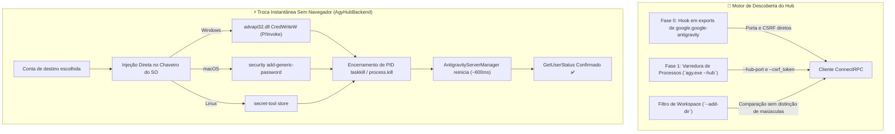

<p align="center">
  <a href="readme.md">English</a> •
  <a href="README.tr.md">Türkçe</a> •
  <a href="README.pt-BR.md"><b>Português</b></a> •
  <a href="README.es.md">Español</a> •
  <a href="README.de.md">Deutsch</a> •
  <a href="README.fr.md">Français</a> •
  <a href="README.ja.md">日本語</a> •
  <a href="README.zh-CN.md">简体中文</a> •
  <a href="README.hi.md">हिन्दी</a> •
  <a href="README.ru.md">Русский</a>
</p>

<p align="center">
  
</p>

<p align="center">
  <a href="https://github.com/AlperenAKKAYA99/NexusAG/releases"></a>
  
  
  
  
  
  
  
</p>

---

# NexusAG

> **O Problema:** Gerenciar várias contas do Google no Antigravity IDE exige desconexões manuais cansativas, repetidas confirmações no navegador, palpites incertos sobre cotas restantes de IA e o risco de perder conversas não indexadas no disco. Além disso, a atualização Antigravity 2.27.0 substituiu o servidor de linguagem pelo `agy.exe --hub`, tornando obsoletos os antigos métodos de varredura de processos e portas.
>
> **A Solução:** O NexusAG oferece uma central de comando integrada — troque de conta com **injeção instantânea no chaveiro do sistema operacional sem abrir o navegador**, acompanhe cotas com cronômetros de redefinição exatos, audite o consumo de tokens a cada etapa do prompt, recupere conversas órfãs e avalie custos no painel bento completo. Totalmente otimizado para **Antigravity ≥ 2.27 (`agy --hub`)** com 100% de compatibilidade retroativa.

---

## ⚡ Comece em 60 Segundos

1. **Instalar** — Pesquise `NexusAG` no Marketplace do Antigravity ou instale o arquivo `nexus-ag-1.3.3.vsix`.
2. **Adicionar Conta** — Clique no ícone `+` na barra lateral para login com Google via navegador ou use `🔑` para colar tokens.
3. **Monitorar e Alternar** — Seus medidores de cota, contagens regressivas e métricas estarão ativos na hora!

---

## 📸 Central Multicontas e Galeria de Interface (UI Showcase)

<table align="center" width="100%">
  <tr>
    <td align="center" width="25%" valign="top">
      <br/>
      <sub><b>⚡ Central Multicontas</b><br/>Troca em 1 clique, progresso de cota e cronômetros</sub>
    </td>
    <td align="center" width="25%" valign="top">
      <br/>
      <sub><b>🔑 Orçamento de Tokens</b><br/>Donut de personalização, sessão ativa e regras</sub>
    </td>
    <td align="center" width="25%" valign="top">
      <br/>
      <sub><b>📈 Estatísticas de Uso</b><br/>Totais de tokens, atividade horária e custos</sub>
    </td>
    <td align="center" width="25%" valign="top">
      <br/>
      <sub><b>🌐 Configurações e Idiomas</b><br/>Troca reativa de idioma, intervalos e reparo</sub>
    </td>
  </tr>
  <tr>
    <td align="center" width="25%" valign="top">
      <br/>
      <sub><b>🔑 Adicionar por Token</b><br/>Colagem em lote de refresh tokens com verificação</sub>
    </td>
    <td align="center" width="25%" valign="top">
      <br/>
      <sub><b>🔒 Google OAuth Fluido</b><br/>Autenticação em 1 clique com retorno automático</sub>
    </td>
    <td align="center" colspan="2" valign="top">
      <br/>
      <sub><b>🔍 Análise de Contexto (Editor)</b><br/>Árvore hierárquica de passos, categorias de tokens e exportação Markdown</sub>
    </td>
  </tr>
  <tr>
    <td align="center" colspan="4" valign="top">
      <br/>
      <sub><b>📊 Painel Bento de Análise (Editor Completo)</b><br/>Auditoria histórica de conversas, mapa de calor GitHub, custos por modelo e sessões de destaque</sub>
    </td>
  </tr>
</table>

---

## 🆕 Arquitetura de Compatibilidade de Próxima Geração para Antigravity 2.27+

O Antigravity 2.27.0 unificou os antigos binários no motor **`agy.exe --hub`**. O NexusAG v1.3.3 apresenta uma arquitetura modular dedicada a esse ecossistema:



### 1. Hook Direto na Fase 0 e Descoberta Sem Netstat
- **Hook Direto (`getAgyExtensionEndpoint`):** Lê a `port` e o `csrfToken` da janela ativa diretamente nos exports de `google.google-antigravity`, eliminando o custo de varreduras de processos.
- **Leitura Direta de `--hub-port`:** A porta é obtida diretamente dos argumentos via regex, sem necessidade de consultas lentas com `netstat` ou `lsof`.
- **Isolamento entre Janelas (`--add-dir`):** Cada janela do IDE inicializa seu próprio Hub. O NexusAG compara `--add-dir` com as pastas ativas (`pathsEqual`), impedindo qualquer troca indevida entre janelas.

### 2. Troca Instantânea de Conta Sem Abrir Navegador (`AgyHubBackend`)
- **Injeção no Chaveiro Nativo do SO:** Grava as credenciais OAuth diretamente no cofre seguro do sistema:
  - **Windows:** P/Invoke `advapi32.dll CredWriteW` em Base64 no `gemini:antigravity`.
  - **macOS:** Comando nativo `security add-generic-password` no Keychain.
  - **Linux:** Freedesktop Secret Service via `secret-tool`.
- **Recuperação Automática Imediata:** Encerra o processo `agy.exe` daquela porta. O `AntigravityServerManager` do IDE o reinicia em ~600 ms com as novas credenciais já carregadas: **sem abrir nenhuma aba no navegador!**
- **Fallback Guiado:** Caso não haja tokens salvos, o NexusAG direciona automaticamente para o fluxo guiado nativo com `antigravity.internal.loginWithRedirect`.

### 3. Suporte ao Armazenamento Moderno em SQLite (`isAgyHubStorage`)
- Detecta o banco `conversation_summaries.db` e os marcadores `.done` em `~/.gemini/antigravity/`.
- Evita avisos indevidos de conversas perdidas na nova arquitetura SQLite.

### 4. 100% de Compatibilidade Retroativa (`LegacyUssBackend`)
- Mantém suporte integral às versões anteriores a 2.27 (`language_server_*`, UnifiedStateSync e `RegisterGdmUser`).

---

## 🔄 Evolução: O Que Mudou em Relação às Versões Anteriores?

| Recurso / Subsistema | Versões Anteriores (v1.0 - v1.1) | Intermediária (v1.2) | NexusAG Atual (v1.3.3 b23) |
|---|---|---|---|
| **Motor do Antigravity** | Apenas pré-2.27 (`language_server_*`) | Detecção preliminar de `agy` | **Arquitetura Dupla Nativa (`AgyHubBackend` + `LegacyUssBackend`)** |
| **Troca de Conta** | Abertura contínua de navegador | Redirecionamento assistido | **Troca Instantânea Sem Navegador via P/Invoke no Chaveiro do SO** |
| **Detecção de Portas** | Varredura pesada com `netstat` | Verificação parcial | **Hook Fase 0 em Exports + Extração direta de `--hub-port`** |
| **Isolamento de Janelas** | `--workspace_id` (quebrado na 2.27) | Comparação simples de texto | **Análise estrita de `--add-dir` insensível a maiúsculas no Windows** |
| **Repositório de Conversas** | Leitura rígida de arquivos `.pb` | Leitura rígida de `.pb` | **Detecção de `conversation_summaries.db` e marcadores `.done`** |
| **Segurança e Isolamento** | Escape HTML básico | Escape HTML básico | **`escHtml` reforçado (`&quot;`, `&#39;`), Nonce CSP, `execFile` e `stdin`** |
| **Tabela de Preços** | Tarifas fixas | Ramo `main` mutável do LiteLLM | **Commit Imutável do LiteLLM (`5338edb7...`) + Gemini 3.8 e Claude 4.6** |
| **Fontes e Estilos** | Requisições a CDNs externas | Arquivos locais soltos | **Font Awesome Pro 7.3.1 embutido em Base64 (zero chamadas externas)** |
| **Localização** | Inglês e Turco parcial | 10 idiomas com lacunas | **10 Idiomas Nativos com 100% de paridade de chaves (251/251)** |
| **Tamanho do VSIX** | ~8.71 MB | ~8.71 MB | **6.91 MB otimizado (~1.8 MB a menos, zero `node_modules`)** |

---

## ✨ Recursos Principais

### ⚡ Central Multicontas e Monitoramento de Cotas em Tempo Real
- **Perfis Ilimitados:** Gerencie contas pessoais, corporativas e de clientes ao mesmo tempo.
- **Troca Sem Navegador:** Sem abas extras e sem recarregar o IDE.
- **Barra de Status:** Favorite (★) modelos para exibir cotas na barra inferior do VS Code.
- **Renovação Proativa:** Atualização automática de tokens em segundo plano para prevenir erros 401.

### 🌍 100% Internacionalização (10 Idiomas)
- `English` • `Türkçe` • `Português` • `Español` • `Deutsch` • `Français` • `日本語` • `简体中文` • `हिन्दी` • `Русский`
- Alternância reativa instantânea sem recarregar a janela.

### 🔑 Orçamento de Tokens e Janela de Contexto
- Detalhamento por ferramentas MCP, regras do workspace e skills.
- Medição em tempo real durante o streaming de respostas de IA.

### 📈 Análise Profunda e Painel Bento
- Histórico completo de conversas consolidadas.
- Mapa de calor de 365 dias no estilo GitHub com dicas de custo.

---

## 🔒 Segurança e Privacidade (Auditoria A+)

- **100% Dados Locais:** Nenhuma conversa, prompt ou código sai da sua máquina.
- **0 Dependências de Runtime:** `dependencies: {}` no `package.json`.
- **Criptografia do SO:** Tokens protegidos por DPAPI, Keychain ou Secret Service.
- **Relatório Completo:** Disponível em [SIBER_GUVENLIK_DENETIM_RAPORU.md](docs/SIBER_GUVENLIK_DENETIM_RAPORU.md).

---

## 🚀 Instalação e Comandos

Instale o pacote `nexus-ag-1.3.3.vsix` pelo Marketplace ou terminal:
```bash
antigravity-ide.cmd --install-extension nexus-ag-1.3.3.vsix --force
```

| Comando | Identificador | Descrição |
|---|---|---|
| **NexusAG: Refresh Quota** | `ag.refreshQuota` | Atualiza cotas e orçamentos na hora. |
| **NexusAG: Add Account** | `ag.addAccount` | Adiciona conta do Google via navegador. |
| **NexusAG: Add Account via Token** | `ag.addAccountByToken` | Cola refresh tokens em lote. |
| **NexusAG: Remove Account** | `ag.removeAccount` | Remove a conta selecionada. |
| **NexusAG: Open Usage Statistics** | `ag.openUsageStats` | Abre o painel bento completo. |
| **NexusAG: Fix Missing Conversations** | `ag.fixConversations` | Repara conversas não indexadas. |

---

## 📄 Licença

Código aberto sob a **[Licença MIT](LICENSE)**.

