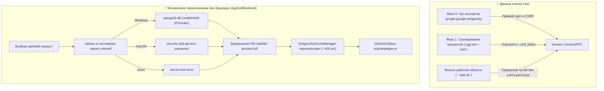

<p align="center">
  <a href="readme.md">English</a> •
  <a href="README.tr.md">Türkçe</a> •
  <a href="README.pt-BR.md">Português</a> •
  <a href="README.es.md">Español</a> •
  <a href="README.de.md">Deutsch</a> •
  <a href="README.fr.md">Français</a> •
  <a href="README.ja.md">日本語</a> •
  <a href="README.zh-CN.md">简体中文</a> •
  <a href="README.hi.md">हिन्दी</a> •
  <a href="README.ru.md"><b>Русский</b></a>
</p>

<p align="center">
  
</p>

<p align="center">
  <a href="https://github.com/AlperenAKKAYA99/NexusAG/releases"></a>
  
  
  
  
  
  
  
</p>

---

# NexusAG

> **Проблема:** Управление несколькими аккаунтами Google в Antigravity IDE обычно требует постоянных выходов из профилей, бесконечных подтверждений в браузере, неопределенности в остатках лимитов ИИ и риска потери неиндексированных диалогов на диске. Кроме того, обновление Antigravity 2.27.0 перевело языковой сервер на архитектуру `agy.exe --hub`, нарушив привычные механизмы отслеживания портов и процессов.
>
> **Решение:** NexusAG предоставляет единый командный центр — переключайте аккаунты **мгновенно без открытия браузера через прямую запись в системную связку ключей (OS Keyring)**, контролируйте квоты с точными таймерами сброса, анализируйте расход токенов на каждом шаге запроса, восстанавливайте потерянные диалоги с диска и оценивайте затраты на дашборде Bento. Полностью оптимизировано для **Antigravity ≥ 2.27 (`agy --hub`)** со 100% обратной совместимостью.

---

## ⚡ Быстрый старт за 60 секунд

1. **Установка** — Найдите `NexusAG` в Marketplace Antigravity или установите пакет `nexus-ag-1.3.4.vsix`.
2. **Добавление аккаунта** — Нажмите `+` на боковой панели для входа через Google или значок `🔑` для вставки токена.
3. **Мониторинг и переключение** — Индикаторы квот, таймеры сброса и детальная статистика активны сразу!

---

## 📸 Панель переключения и галерея интерфейса (UI Showcase)

<table align="center" width="100%">
  <tr>
    <td align="center" width="25%" valign="top">
      <br/>
      <sub><b>⚡ Панель аккаунтов</b><br/>Смена в 1 клик, шкала квот и таймеры сброса</sub>
    </td>
    <td align="center" width="25%" valign="top">
      <br/>
      <sub><b>🔑 Бюджет токенов</b><br/>Диаграмма настроек, текущая сессия и правила</sub>
    </td>
    <td align="center" width="25%" valign="top">
      <br/>
      <sub><b>📈 Статистика на панели</b><br/>Токены сессии, почасовая активность и затраты</sub>
    </td>
    <td align="center" width="25%" valign="top">
      <br/>
      <sub><b>🌐 Настройки и языки</b><br/>Мгновенный выбор языка, интервалы и ремонт</sub>
    </td>
  </tr>
  <tr>
    <td align="center" width="25%" valign="top">
      <br/>
      <sub><b>🔑 Ввод токена</b><br/>Пакетная вставка токенов обновления с проверкой</sub>
    </td>
    <td align="center" width="25%" valign="top">
      <br/>
      <sub><b>🔒 Бесшовный Google OAuth</b><br/>Авторизация в 1 клик с автовозвратом в IDE</sub>
    </td>
    <td align="center" colspan="2" valign="top">
      <br/>
      <sub><b>🔍 Анализ контекста (Редактор)</b><br/>Дерево шагов, категории токенов и экспорт в Markdown</sub>
    </td>
  </tr>
  <tr>
    <td align="center" colspan="4" valign="top">
      <br/>
      <sub><b>📊 Bento-дашборд (Полный экран)</b><br/>Аудит всех сессий, тепловая карта GitHub, затраты по моделям и топ диалогов</sub>
    </td>
  </tr>
</table>

---

## 🆕 Архитектура совместимости нового поколения с Antigravity 2.27+

В Antigravity 2.27.0 отдельный процесс `language_server_win.exe` был заменен объединенным модулем **`agy.exe --hub`**. В NexusAG v1.3.4 разработана специальная модульная структура:



### 1. Прямой хук Фазы 0 и обнаружение без вызовов Netstat

- **Прямой хук (`getAgyExtensionEndpoint`):** Мгновенно считывает `port` и `csrfToken` из объектов экспорта расширения `google.google-antigravity`, полностью исключая нагрузку на процессор от перечисления процессов.
- **Прямое чтение `--hub-port`:** Порт извлекается регулярным выражением прямо из аргументов (без медленного сканирования через `netstat` или `lsof`).
- **Изоляция окон (`--add-dir`):** Каждое окно запускает свой экземпляр Hub. NexusAG сопоставляет путь `--add-dir` с текущей папкой проекта (`pathsEqual`), исключая путаницу между открытыми окнами.

### 2. Мгновенная смена аккаунта без открытия браузера (`AgyHubBackend`)

- **Прямая запись в связку ключей ОС:** Учетные данные OAuth сохраняются в безопасном системном хранилище:
  - **Windows:** P/Invoke `advapi32.dll CredWriteW` через Base64 в цель `gemini:antigravity`.
  - **macOS:** Системный вызов `security add-generic-password` в Keychain.
  - **Linux:** Служба Secret Service через утилиту `secret-tool`.
- **Автоматический перезапуск:** Завершает работу процесса `agy.exe` для нужного порта. Встроенный сервис IDE `AntigravityServerManager` перезапускает его примерно за 600 мс, сразу считывая новые токены: **окна браузера не открываются!**
- **Резервный сценарий:** При отсутствии токенов NexusAG плавно переходит к стандартному браузерному входу через `antigravity.internal.loginWithRedirect`.

### 3. Поддержка современного формата SQLite (`isAgyHubStorage`)

- Распознает базу данных `conversation_summaries.db` и маркеры `.done` в директории `~/.gemini/antigravity/`.
- Предотвращает ложные предупреждения о пропавших диалогах в новом формате SQLite.

### 4. 100% обратная совместимость (`LegacyUssBackend`)

- Сохраняет полную поддержку более ранних версий Antigravity (`language_server_*`, UnifiedStateSync и `RegisterGdmUser`).

---

## 🔄 Эволюция: Что изменилось по сравнению с прошлыми версиями?

| Подсистема / Компонент | Ранние версии (v1.0 - v1.1)             | Промежуточная (v1.2)              | Актуальная NexusAG (v1.3.4 b24)                                                         |
| ---------------------- | --------------------------------------- | --------------------------------- | --------------------------------------------------------------------------------------- |
| **Движок Antigravity** | Только до 2.27 (`language_server_*`)    | Экспериментальное обнаружение     | **Двойная нативная архитектура (`AgyHubBackend` + `LegacyUssBackend`)**                 |
| **Смена аккаунта**     | Обязательный вход через браузер         | Браузерный редирект               | **Мгновенно без браузера: запись в Keyring ОС через P/Invoke**                          |
| **Определение портов** | Медленный опрос `netstat -ano` / `lsof` | Частичное чтение флагов           | **Хук Фазы 0 + прямое чтение `--hub-port` из аргументов**                               |
| **Изоляция окон**      | `--workspace_id` (удален в 2.27)        | Простое сравнение строк           | **Строгий разбор `--add-dir` с учетом нечувствительности к регистру Windows**           |
| **Хранение истории**   | Только проверка файлов `.pb` Protobuf   | Только проверка `.pb`             | **Распознавание базы `conversation_summaries.db` и маркеров `.done`**                   |
| **Безопасность кода**  | Базовое экранирование HTML              | Базовое экранирование             | **Усиленный `escHtml` (`&quot;`, `&#39;`), Nonce CSP, безопасные `execFile` и `stdin`** |
| **Каталог цен**        | Жестко заданные тарифы                  | Нестабильная ветка `main` LiteLLM | **Фиксированный коммит LiteLLM (`5338edb7...`) + Gemini 3.8 и Claude 4.6**              |
| **Шрифты интерфейса**  | Запросы к внешним серверам CDN          | Локальные шрифты                  | **Font Awesome Pro 7.3.1 встроен в виде Base64 (0 внешних запросов)**                   |
| **Локализация**        | Частично английский и турецкий          | 10 языков с пропусками            | **10 языков с проверенным 100% соответствием 251/251 ключей перевода**                  |
| **Размер VSIX-файла**  | ~8.71 МБ                                | ~8.71 МБ                          | **6.91 МБ в оптимизированном виде (~1.8 МБ экономии, 0 `node_modules`)**                |

---

## ✨ Основные возможности

### ⚡ Панель аккаунтов и живой контроль квот

- **Любое количество профилей:** Раздельное ведение личных, рабочих и клиентских учетных записей.
- **Мгновенный переход:** Без всплывающих окон браузера и перезапуска IDE.
- **Интеграция со строкой состояния:** Закрепляйте модели звездочкой (★) для вывода процента квоты внизу экрана.
- **Фоновое продление:** Автоматическое обновление токенов для защиты от ошибок 401.

### 🌍 Полная локализация на 10 языков

- `English` • `Türkçe` • `Português` • `Español` • `Deutsch` • `Français` • `日本語` • `简体中文` • `हिन्दी` • `Русский`
- Моментальное переключение всего интерфейса без перезагрузки редактора.

### 🔑 Бюджет токенов и инспектор контекста

- Детализация по MCP-инструментам, правилам проекта и навыкам.
- Подсчет токенов в реальном времени при потоковой генерации ответов.

### 📈 Глубокая аналитика и Bento-дашборд

- Сканирование всей истории взаимодействия с ИИ за все время.
- Тепловая карта в стиле GitHub за 365 дней с подсказками стоимости.

---

## 🔒 Безопасность и конфиденциальность (Аудит A+)

- **100% локальное хранение:** Никакой код, запросы или диалоги не покидают ваше устройство.
- **0 сторонних зависимостей:** `dependencies: {}` в `package.json`.
- **Шифрование ОС:** Токены защищены DPAPI, Keychain или Secret Service.
- **Отчет об аудите:** Доступен в [SIBER_GUVENLIK_DENETIM_RAPORU.md](docs/SIBER_GUVENLIK_DENETIM_RAPORU.md).

---

## 🚀 Установка и команды

Установите `nexus-ag-1.3.4.vsix` через интерфейс расширений или терминал:

```bash
antigravity-ide.cmd --install-extension nexus-ag-1.3.4.vsix --force
```

| Команда                                | Идентификатор          | Описание                                    |
| -------------------------------------- | ---------------------- | ------------------------------------------- |
| **NexusAG: Refresh Quota**             | `ag.refreshQuota`      | Немедленное обновление квот и бюджетов.     |
| **NexusAG: Add Account**               | `ag.addAccount`        | Вход в Google через браузер.                |
| **NexusAG: Add Account via Token**     | `ag.addAccountByToken` | Массовый ввод токенов обновления.           |
| **NexusAG: Remove Account**            | `ag.removeAccount`     | Удаление выбранного профиля.                |
| **NexusAG: Open Usage Statistics**     | `ag.openUsageStats`    | Открытие полноэкранного Bento-дашборда.     |
| **NexusAG: Fix Missing Conversations** | `ag.fixConversations`  | Поиск и починка неиндексированных диалогов. |

---

## 📄 Лицензия

Открытый исходный код под **[Лицензией MIT](LICENSE)**.
