<p align="center">
  <a href="readme.md">English</a> •
  <a href="README.tr.md"><b>Türkçe</b></a> •
  <a href="README.pt-BR.md">Português</a> •
  <a href="README.es.md">Español</a> •
  <a href="README.de.md">Deutsch</a> •
  <a href="README.fr.md">Français</a> •
  <a href="README.ja.md">日本語</a> •
  <a href="README.zh-CN.md">简体中文</a> •
  <a href="README.hi.md">हिन्दी</a> •
  <a href="README.ru.md">Русский</a>
</p>

<p align="center">
  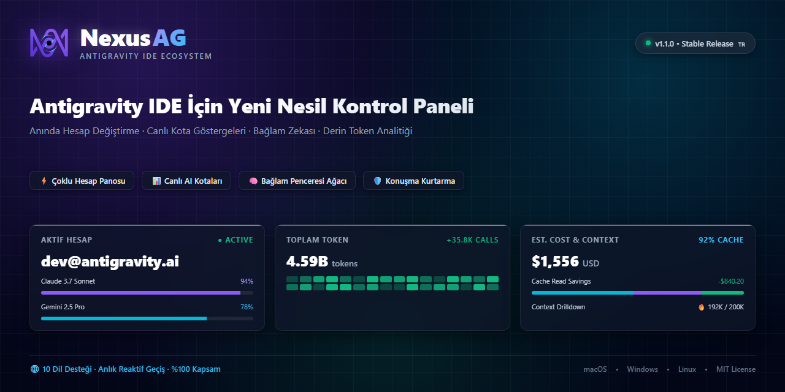
</p>

<p align="center">
  <a href="https://github.com/AlperenAKKAYA99/NexusAG/releases"></a>
  
  
  
  
  
  
  
</p>

---

# NexusAG

> **Sorun:** Antigravity IDE'de birden fazla Google hesabını yönetmek; yorucu manuel oturum kapatıp açmaları, tarayıcıda sürekli onay vermeyi, kalan yapay zeka kotasını tahmin etmeye çalışmayı ve diskteki indekslenmemiş konuşmaların kaybolma riskini beraberinde getirir. Dahası, Antigravity 2.27.0 güncellemesi dil sunucusunu `agy.exe --hub` mimarisine geçirerek eski süreç ve token keşif yöntemlerini geçersiz kılmıştır.
>
> **Çözüm:** NexusAG size entegre bir görev kontrol paneli sunar — **sıfır tarayıcı açılışıyla doğrudan işletim sistemi anahtarlığı üzerinden anında hesap değiştirin**, hassas sayaçlarla canlı kota göstergelerini izleyin, her prompt adımının token ayak izini analiz edin, sahipsiz kalan konuşmaları yerel depolamadan kurtarın ve tüm zamanların token maliyetini tam editör bento panelinde denetleyin. **Antigravity ≥ 2.27 (`agy --hub`)** için özel olarak optimize edilmiştir ve eski sürümlerle %100 geriye dönük uyumludur.

---

## ⚡ 60 Saniyede Başlayın

1. **Yükleyin** — Antigravity Eklenti Mağazası'nda `NexusAG` arayın veya `nexus-ag-1.3.3.vsix` paketini kurun.
2. **Hesap Ekleyin** — Kenar çubuğundaki `+` butonuna tıklayarak Google ile oturum açın veya `🔑` ile token yapıştırın.
3. **İzleyin & Değiştirin** — Canlı kota göstergeleriniz, sıfırlanma sayaçlarınız, aktif bağlam penceresi metrikleriniz ve kullanım analitiğiniz anında devrede!

---

## 📸 Çoklu Hesap Panosu ve Arayüz Galerisi (UI Showcase)

<table align="center" width="100%">
  <tr>
    <td align="center" width="25%" valign="top">
      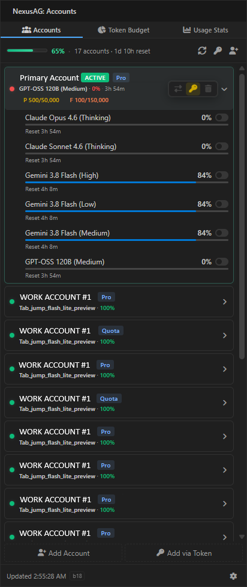<br/>
      <sub><b>⚡ Çoklu Hesap Panosu</b><br/>Tek tıkla hesap değişimi, canlı kota ilerlemesi ve sıfırlanma sayaçları</sub>
    </td>
    <td align="center" width="25%" valign="top">
      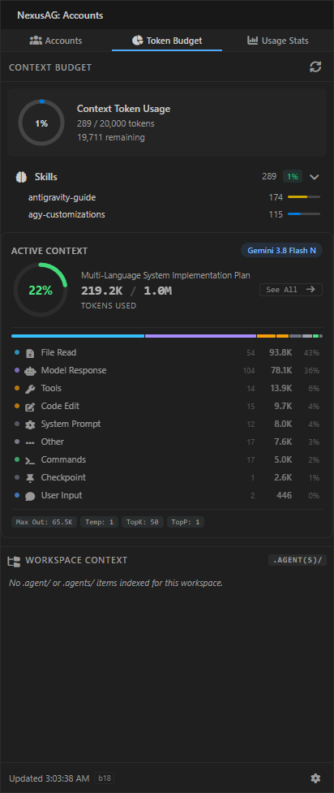<br/>
      <sub><b>🔑 Token Bütçesi ve Bağlam</b><br/>Özelleştirme donutu, aktif oturum göstergesi ve kurallar</sub>
    </td>
    <td align="center" width="25%" valign="top">
      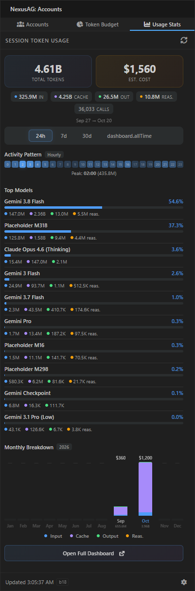<br/>
      <sub><b>📈 Kullanım İstatistikleri (Sidebar)</b><br/>Oturum token toplamları, saatlik etkinlik ve aylık maliyet dağılımı</sub>
    </td>
    <td align="center" width="25%" valign="top">
      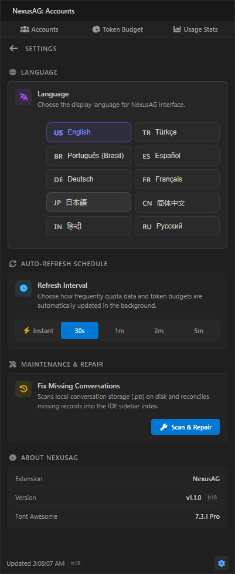<br/>
      <sub><b>🌐 Ayarlar ve 10 Dil Merkezi</b><br/>Anlık reaktif dil değiştirici, arka plan aralıkları ve onarım</sub>
    </td>
  </tr>
  <tr>
    <td align="center" width="25%" valign="top">
      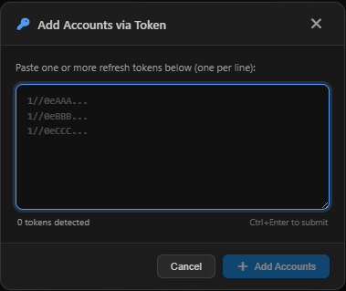<br/>
      <sub><b>🔑 Token ile Hesap Ekleme</b><br/>Doğrulamalı toplu OAuth yenileme tokenı yapıştırma</sub>
    </td>
    <td align="center" width="25%" valign="top">
      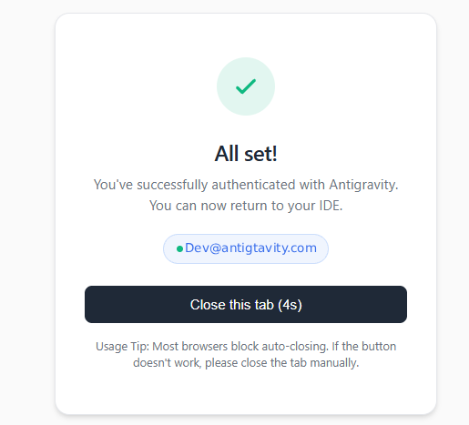<br/>
      <sub><b>🔒 Sorunsuz Google OAuth</b><br/>Tek tıkla tarayıcı kimlik doğrulaması ve otomatik dönüş</sub>
    </td>
    <td align="center" colspan="2" valign="top">
      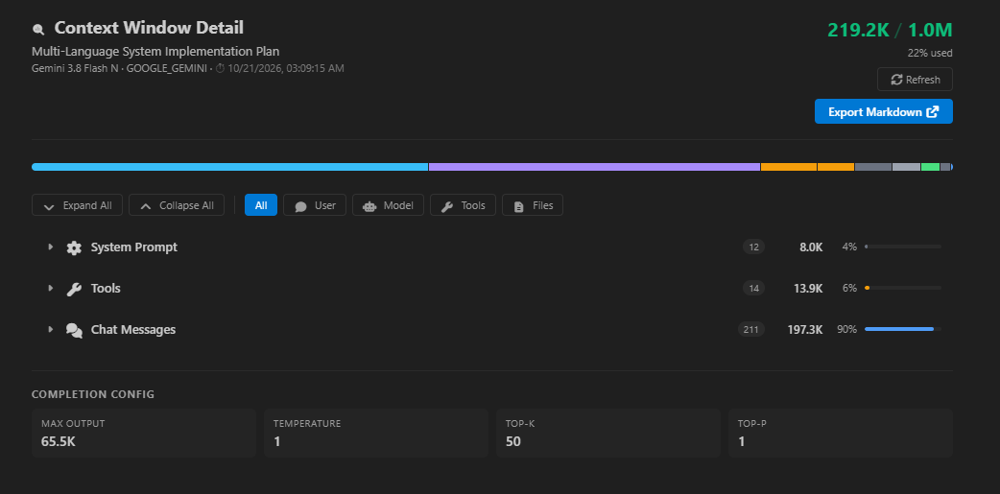<br/>
      <sub><b>🔍 Bağlam Penceresi Detaylı İnceleme (Editör Sekmesi)</b><br/>Hiyerarşik adım ağacı, token kategorisi dağılımı ve Markdown dışa aktarma</sub>
    </td>
  </tr>
  <tr>
    <td align="center" colspan="4" valign="top">
      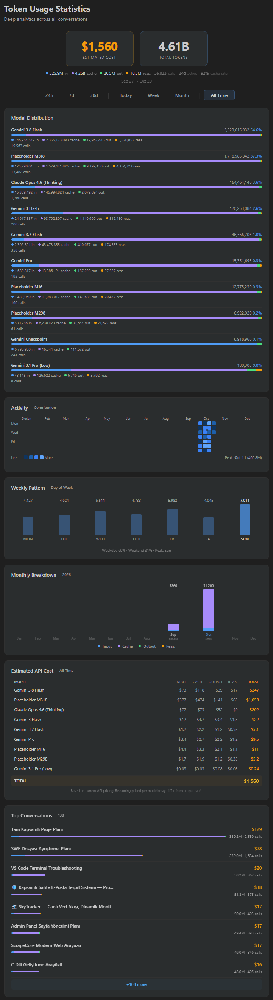<br/>
      <sub><b>📊 Derin Token Analitiği Bento Paneli (Tam Editör)</b><br/>Tüm zamanların konuşma denetimi, GitHub tarzı aktivite ısı haritası, model maliyet dağılımı ve en çok tüketilen oturumlar</sub>
    </td>
  </tr>
</table>

---

## 🆕 Antigravity 2.27+ Yeni Nesil Uyumluluk Mimarisi

Google Antigravity 2.27.0 sürümüyle birlikte eski `language_server_win.exe` ikilisi kaldırılarak yerine birleşik **`agy.exe --hub`** mimarisine geçilmiştir. NexusAG v1.3.3, bu modernizasyon için özel olarak geliştirilmiş modüler bir altyapı sunar:

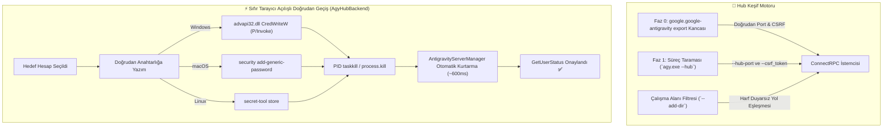

### 1. Faz 0 Doğrudan Eklenti Kancası ve Sıfır-Netstat Keşfi
- **Doğrudan Kanca (`getAgyExtensionEndpoint`):** Süreç listeleme maliyetini tamamen ortadan kaldırarak aktif pencerenin `port` ve `csrfToken` değerlerini doğrudan `google.google-antigravity` eklentisinin export'larından okur.
- **`--hub-port` Doğrudan Ayrıştırma:** Port doğrudan argüman regex'i ile alınır; yavaş `netstat` ve `lsof` taramalarına gerek kalmaz.
- **Çoklu Pencere İzolasyonu (`--add-dir`):** Her IDE penceresi kendi `agy --hub` sürecini başlatır. NexusAG, `--add-dir` değerini aktif çalışma alanı yoluyla (`pathsEqual`) karşılaştırarak pencereler arası yanlış hesap değişimini kesin olarak önler.

### 2. Sıfır Tarayıcı Açılışıyla Doğrudan Hesap Geçişi (`AgyHubBackend`)
- **İşletim Sistemi Anahtarlık Enjeksiyonu:** OAuth kimlik bilgilerini doğrudan işletim sistemi kasasına yazar:
  - **Windows:** P/Invoke `advapi32.dll CredWriteW` ile Base64 komut üzerinden `gemini:antigravity` hedefine yazım.
  - **macOS:** Yerel `security add-generic-password` ile Keychain'e yazım.
  - **Linux:** Freedesktop Secret Service üzerinden `secret-tool store`.
- **Otomatik Kurtarma Tetiklemesi:** İlgili `--hub-port` dinleyen `agy.exe` sürecini tespit edip sonlandırır. IDE'nin `AntigravityServerManager` bileşeni süreci ~600ms içinde yeniden başlatarak yeni kimlik bilgilerini otomatik yükler; **tarayıcı açılmasına gerek kalmaz!**
- **Yedek Doğal Akış:** Tokenlar eksikse veya doğrudan geçiş teyit edilemezse, eklenti otomatik olarak `antigravity.internal.loginWithRedirect` üzerinden yönlendirmeli oturum açmaya geçer.

### 3. Modern SQLite Konuşma Depolama Desteği (`isAgyHubStorage`)
- `~/.gemini/antigravity/` altındaki `conversation_summaries.db` SQLite veritabanını ve `.done` geçiş işaretlerini otomatik tespit eder.
- Eski `.pb` Protobuf diff mekanizmasını güvenle atlayarak asılsız "kayıp konuşma" uyarılarını engeller.

### 4. %100 Geriye Dönük Uyumluluk (`LegacyUssBackend`)
- Antigravity 2.27 öncesi eski sürümler (`language_server_*`, UnifiedStateSync ve `RegisterGdmUser`) için tam destek korunmaktadır.

---

## 🔄 Evrim ve Eski Sürümlerden Bu Yana Neler Değişti?

| Özellik / Alt Sistem | Eski Sürümler (v1.0 - v1.1) | Ara Sürüm (v1.2) | Güncel NexusAG (v1.3.3 b23) |
|---|---|---|---|
| **Antigravity Motoru** | Yalnızca 2.27 öncesi (`language_server_*`) | Kısmi `agy` tespiti | **Doğal Çift Mimari (`AgyHubBackend` + `LegacyUssBackend`)** |
| **Hesap Değişimi** | Sürekli tarayıcı pop-up girişi | Tarayıcı yönlendirmeli geçiş | **Sıfır Tarayıcı Açılışı: OS Keyring P/Invoke ile Doğrudan Geçiş** |
| **Port Keşfi** | Ağır `netstat -ano` / `lsof` taraması | Kısmi bayrak eşleşmesi | **Faz 0 Eklenti Kancası + Doğrudan `--hub-port` ayrıştırma** |
| **Pencere İzolasyonu** | `--workspace_id` (2.27'de kırık) | Basit dize karşılaştırması | **Katı `--add-dir` ayrıştırması ve Windows harf duyarsız yol denetimi** |
| **Konuşma Deposu** | Sabit `.pb` Protobuf taraması | Sabit `.pb` taraması | **`conversation_summaries.db` & `.done` SQLite geçiş tespiti** |
| **Güvenlik ve İzolasyon** | Temel HTML kaçışı | Temel HTML kaçışı | **Güçlendirilmiş `escHtml` (`&quot;`, `&#39;`), Nonce CSP, Parametrik `execFile` & `stdin`** |
| **Model Fiyat Listesi** | Sabit oranlar | LiteLLM değişken `main` dalı | **LiteLLM Değişmez Commit (`5338edb7...`) + Gemini 3.8 Flash & Claude 4.6 Thinking** |
| **Font Varlıkları** | Dış CDN yazı tipi çağrıları | Yerel font dosyaları | **Font Awesome Pro 7.3.1 gömülü Base64 (sıfır harici istek)** |
| **Yerelleştirme** | İngilizce & Türkçe kısmi | 10 dilde eksik anahtarlar | **10 Yerel Dil, 251/251 anahtar ile %100 doğrulanmış çeviri paritesi** |
| **VSIX Paket Boyutu** | ~8.71 MB (optimize edilmemiş) | ~8.71 MB | **6.91 MB optimize paket (~1.8 MB hafifletme, sıfır `node_modules`)** |

---

## ✨ Öne Çıkan Temel Özellikler

### ⚡ Çoklu Hesap Panosu ve Canlı Kota İzleme
*Hesaplar arasında zahmetsizce geçiş yapın ve kota tükenme sürprizlerinden kurtulun.*
- **Sınırsız Profil** — Kişisel, kurumsal ve müşteri Google hesaplarını birbirine karışmadan aynı anda izleyin.
- **Sıfır Tarayıcı Açılışıyla Anında Geçiş** — Aktif Antigravity IDE hesabını pencereyi yeniden başlatmaya ve tarayıcıda onay vermeye gerek kalmadan kenar çubuğundan anında değiştirin.
- **Canlı Kota Göstergeleri** — Renk kodlu kapasite çubukları (🟢 >%50, 🟡 %20–50, 🔴 <%20) ve dakikasına kadar tam sıfırlanma geri sayım sayaçları.
- **Durum Çubuğu Entegrasyonu** — Favori modellerinizi yıldızlayarak (★) kota göstergesini doğrudan IDE durum çubuğuna sabitleyin.
- **Proaktif Token Yenileme** — Arka planda otomatik yenilenen OAuth erişim tokenları, uzun kodlama maratonlarında 401 oturum kesintilerini önler.
- **Abonelik Katmanı Bilgileri** — Plan türü (Ultra, Pro, Free), yapay zeka istem kredileri ve akış kredilerinin anlık gösterimi.

### 🌍 %100 Uluslararasılaştırma ve Anlık Reaktif Yerelleştirme
*Dünya genelindeki tüm geliştiriciler için ana dillerinde uyarlandı.*
- **10 Yerel Dil Desteği**:
  `English (en)` • `Türkçe (tr)` • `Português (pt-BR)` • `Español (es)` • `Deutsch (de)` • `Français (fr)` • `日本語 (ja)` • `简体中文 (zh-CN)` • `हिन्दी (hi)` • `Русский (ru)`
- **Yeniden Yüklemesiz Reaktif Geçiş** — Ayarlar sekmesinde dil değiştirdiğiniz anda arayüzün **%100'ü** (Kenar Çubuğu, Tam Editör Bento Paneli, Bağlam İnceleyici, bildirimler ve ipuçları) sayfa yenilenmeden anında çevrilir.
- **Sistem Dili Otomatik Algılama** — İlk açılışta IDE'nizin mevcut dilini otomatik olarak tanır ve uygular.

### 🔑 Token Bütçesi ve Bağlam Penceresi Zekası
*Ajan bağlamınızı gerçek zamanlı denetleyin ve optimize edin.*
- **Özelleştirme Bütçesi Donutu** — MCP Araçları, Proje Kuralları, İş Akışları ve Yetenekler (Skills) tarafından tüketilen tokenların net dökümü.
- **Aktif Bağlam Penceresi Sayacı** — Mevcut konuşma tokenlarını modelin fiziksel maksimum bağlam tavanıyla karşılaştıran canlı donut görselleştirmesi.
- **Çalışma Alanı Bağlam Denetçisi** — Tüm `.agent/` kurallarına, iş akışlarına ve yeteneklerine çalışma zamanı durumlarıyla (`always-on`, `model-decision`, `manual`) doğrudan dosya bağlantıları.
- **Canlı Akış Güncellemeleri** — Yapay zeka modeli yanıt üretirken token birikimini adım adım gerçek zamanlı olarak izler.

### 🔍 Bağlam Penceresi Detaylı İnceleme (Tam Editör Sekmesi)
*Tüm sistem talimatlarını, araç çıktılarını ve adımları denetleyin.*
- **Hiyerarşik Adım Ağacı** — Sistem İstemi, Araçlar, MCP Araçları ve Kullanıcı/Model Mesajlarının net token ve yüzde dökümü.
- **Satır İçi Adım Önizleme** — İstemi, model yanıtını, araç girişlerini, terminal çıktılarını ve grep sonuçlarını editörden ayrılmadan inceleyin.
- **Alev Rozetleri (🔥)** — Bağlam penceresinde en çok token tüketen adımları anında vurgulayan görsel göstergeler.
- **Markdown Olarak Dışa Aktarma** — Denetim ve ekip paylaşımları için bağlam analizini tek tıkla panoya veya `.md` dosyasına kaydedin.

### 📈 Derin Token Analitiği ve Bento Paneli
*Yapay zeka kullanım alışkanlıklarınıza dair kapsamlı ömür boyu zeka.*
- **Ömür Boyu Birikim** — Antigravity içinde gerçekleştirdiğiniz tüm geçmiş konuşmaları disk üzerinden tarayarak token tüketimini konsolide eder.
- **9 Temel KPI Metriği** — Girdi, Önbellek Okuma, Çıktı, Akıl Yürütme (Reasoning) tokenları, toplam çağrılar, tahmini maliyet, aktif günler ve önbellek başarı oranı.
- **GitHub Tarzı Katkı Isı Haritası** — Yıl seçicili 365 günlük geçmiş aktivite tablosu, hücre bazlı maliyet ipuçları ve zirve gün göstergeleri.
- **Dinamik Fiyatlandırma Motoru** — Güncel API maliyet takibi için LiteLLM fiyat kataloğu (sabit commit) ve modele özel maliyet geçersiz kılma desteği.
- **Harcama Kalıpları** — Hafta içi ve hafta sonu kullanım dağılım grafikleri ile aylık yığılmış maliyet çubukları.

### 🛡️ Konuşma Koruması (Conversation Guard) ve Sahipsiz Konuşmaları Kurtarma
*İstemlerinizi güvence altına alın, indekslenmemiş konuşmaları veri kaybı yaşamadan kurtarın.*
- **Otomatik Uyuşmazlık Tespiti** — IDE açıldıktan sonra yerel depolamayı kenar çubuğu indeksiyle karşılaştırır.
- **Genişletilebilir Uyarı Başlığı** — İndekste bulunmayan konuşmaların sayısını ve çözümlenen başlıklarını listeler.
- **Tek Tıkla Bağımsız Onarım** — Bağımsız Node.js onarım çalışanı AG'yi güvenle kapatır, veritabanı indeksini diskten yeniden kurar ve IDE'yi açık çalışma alanıyla otomatik yeniden başlatır.

---

## 🔒 Güvenlik ve Gizlilik (Denetlendi A+)

Güvenlik ve kullanıcı gizliliği, NexusAG'nin temel tasarım ilkeleridir. Kod tabanı üzerinde kapsamlı bir güvenlik denetimi gerçekleştirilmiştir (bkz. [SIBER_GUVENLIK_DENETIM_RAPORU.md](docs/SIBER_GUVENLIK_DENETIM_RAPORU.md)):

- **%100 Yerel Veri** — Konuşma verileriniz, istemleriniz, dosya içerikleriniz veya kişisel telemetriniz asla bilgisayarınızın dışına çıkmaz.
- **Sıfır (0) Çalışma Zamanı Bağımlılığı** — **0 harici runtime npm paketi (`dependencies: {}`)**. Her şey saf Node.js ve VS Code API'leri üzerinde çalışır.
- **İşletim Sistemi Seviyesinde Şifreleme** — Tüm OAuth yenileme tokenları VS Code'un yerel `SecretStorage` mekanizması ve OS anahtarlığı ile saklanır (**macOS Keychain**, **Windows Credential Manager / DPAPI** veya **Linux Secret Service**).
- **Yalnızca Yerel İletişim** — Language Server süreçleriyle kurulan iletişim yalnızca `127.0.0.1` döngü (loopback) IPC soketleriyle sınırlıdır.
- **Güçlendirilmiş Webview CSP** — Nonce koruması (`script-src 'nonce-...'`), `default-src 'none'` ve `connect-src 'none'` ile tam yalıtım.
- **SQL ve Komut Enjeksiyonuna Bağışık** — SQLite fallback çağrıları shell kabuğu kullanmayan `cp.execFile` ve doğrudan `stdin` akışı kullanır.
- **Açık Kaynak Kodlu** — Projenin her satırı **MIT Lisansı** altında şeffaf ve denetlenebilir durumdadır.

---

## 🏗️ Mimari ve İç Mekanizma

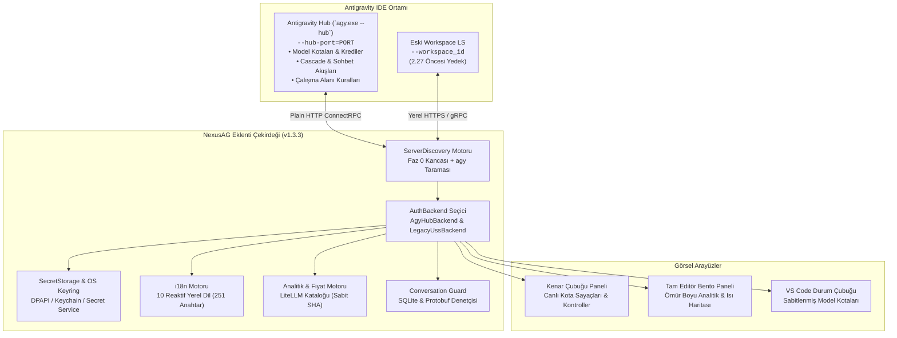

---

## ⚡ Nasıl Çalışır

```
1. IDE Başlatma ────► Faz 0 Doğrudan Eklenti Kancası / agy.exe Tespiti ─► Aktif Kota & Kuralların Çekilmesi
                             │
2. Kullanıcı Eylemi ► Sıfır Tarayıcı Açılışlı Tek Tık Hesap Değişimi ───► Doğrudan OS Keyring Yazımı (advapi32 / Keychain)
                             │
3. Hub Yenilenmesi ─► AntigravityServerManager agy.exe'yi Kurtarır ──────► Yeni Kimlik Bilgileri ~600ms'de Yüklenir
                             │
4. Aktif Oturum ────► Canlı Akış Kancası ───────────────────────────────► Canlı Kota & Bağlam Gösterge Güncellemeleri
```

---

## 🚀 Başlangıç ve Kurulum

### Gereksinimler
- **Google Antigravity IDE** (veya uyumlu VS Code çalışma ortamı)
- Antigravity AI erişimi olan en az bir Google hesabı
- İşletim Sistemi: **macOS**, **Windows** veya **Linux**

### Kurulum

#### 1. Yöntem: Eklenti Mağazası (Önerilen)
1. Eklentiler görünümünü açın (`Ctrl+Shift+X` veya `Cmd+Shift+X`).
2. **NexusAG** araması yapın.
3. **Yükle** (Install) butonuna tıklayın.

#### 2. Yöntem: Manuel VSIX Kurulumu
En güncel `nexus-ag-1.3.3.vsix` paketini [GitHub Releases](https://github.com/AlperenAKKAYA99/NexusAG/releases) sayfasından indirin ve terminalden kurun:
```bash
antigravity-ide.cmd --install-extension nexus-ag-1.3.3.vsix --force
```

### 🎯 Kurulum Sonrası İlk Adımlar
1. Etkinlik Çubuğundaki **NexusAG** simgesine tıklayın.
2. Birincil hesabınız otomatik olarak yüklenecektir.
3. İkincil Google hesaplarınızı eklemek için `+` butonuna tıklayın.
4. Modelin kota yüzdesini durum çubuğunuza sabitlemek için yanındaki yıldız (★) simgesine tıklayın.
5. Kullanım sekmesindeki **"Tam Panoyu Aç →"** butonuna basarak tüm geçmiş yapay zeka istatistiklerinizi inceleyin.

---

## ⌨️ Komut Paleti

Tüm temel özellikler VS Code Komut Paleti üzerinden tetiklenebilir (`Ctrl+Shift+P` / `Cmd+Shift+P`):

| Komut | Tanımlayıcı | Açıklama |
|---|---|---|
| **NexusAG: Refresh Quota** | `ag.refreshQuota` | Google API'lerinden en güncel kota ve token bütçesini anında yeniler. |
| **NexusAG: Add Account** | `ag.addAccount` | Tek tıkla tarayıcı üzerinden Google OAuth girişini başlatır. |
| **NexusAG: Add Account via Token** | `ag.addAccountByToken` | Toplu OAuth yenileme tokenı yapıştırma penceresini açar. |
| **NexusAG: Remove Account** | `ag.removeAccount` | Seçilen hesabı yerel depolamadan ve takipten kaldırır. |
| **NexusAG: Open Usage Statistics** | `ag.openUsageStats` | Tam editör bento kullanım analitiği panosunu açar. |
| **NexusAG: Fix Missing Conversations** | `ag.fixConversations` | Diski tarayarak indekste yer almayan konuşmaları onarır. |

---

## 📄 Lisans ve Şeffaflık

NexusAG, açık kaynaklı **[MIT Lisansı](LICENSE)** altında dağıtılmaktadır. %100 yerel veri gizliliği, sıfır dış telemetri ve sıfır çalışma zamanı bağımlılığı ile geliştirilmiştir.

