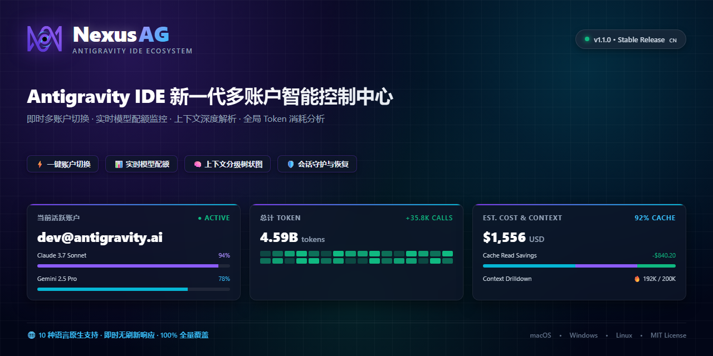
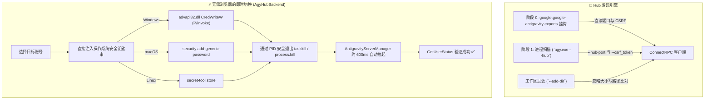

<p align="center">
  <a href="readme.md">English</a> •
  <a href="README.tr.md">Türkçe</a> •
  <a href="README.pt-BR.md">Português</a> •
  <a href="README.es.md">Español</a> •
  <a href="README.de.md">Deutsch</a> •
  <a href="README.fr.md">Français</a> •
  <a href="README.ja.md">日本語</a> •
  <a href="README.zh-CN.md"><b>简体中文</b></a> •
  <a href="README.hi.md">हिन्दी</a> •
  <a href="README.ru.md">Русский</a>
</p>

<p align="center">
  
</p>

<p align="center">
  <a href="https://github.com/AlperenAKKAYA99/NexusAG/releases"></a>
  
  
  
  
  
  
  
</p>

---

# NexusAG

> **痛点分析：** 在 Antigravity IDE 中管理多个 Google 账号通常极其繁琐：频繁的手动登出与浏览器重复登录、无法精准获知剩余 AI 配额、切换配置文件导致的工作流上下文丢失，以及未建立索引的本地对话丢失风险。此外，Antigravity 2.27.0 更新将语言服务器彻底重构为 `agy.exe --hub`，导致传统的进程端口检测机制完全失效。
>
> **解决方案：** NexusAG 提供了一体化的作战指挥面板 —— **无需弹出浏览器，直接向操作系统安全钥匙串注入凭证实现即时切号**，实时监测带精准重置倒计时的配额指示器，深度解析每一步提示词的 Token 开销，一键恢复本地孤立对话，并在全尺寸便当盒仪表盘中审计历史 Token 成本。全面适配 **Antigravity ≥ 2.27 (`agy --hub`)**，并对早期版本保持 100% 向下兼容。

---

## ⚡ 60 秒极速上手

1. **安装** — 在 Antigravity 插件市场搜索 `NexusAG` 或安装本地 `nexus-ag-1.3.3.vsix` 包。
2. **添加账号** — 点击侧边栏中的 `+` 按钮通过 Google 网页登录，或点击 `🔑` 直接批量粘贴 Token。
3. **监控与切换** — 实时配额仪表、倒计时器、上下文度量与使用统计立即可用！

---

## 📸 多账号控制面板与界面展示 (UI Showcase)

<table align="center" width="100%">
  <tr>
    <td align="center" width="25%" valign="top">
      <br/>
      <sub><b>⚡ 多账号切换面板</b><br/>一键秒级切号，实时配额进度与重置倒计时</sub>
    </td>
    <td align="center" width="25%" valign="top">
      <br/>
      <sub><b>🔑 Token 预算与上下文</b><br/>自定义项环形图、会话仪表与规则详情</sub>
    </td>
    <td align="center" width="25%" valign="top">
      <br/>
      <sub><b>📈 侧边栏使用统计</b><br/>会话 Token 总量、每小时活跃度与月度成本</sub>
    </td>
    <td align="center" width="25%" valign="top">
      <br/>
      <sub><b>🌐 设置与十国语言中心</b><br/>即时响应式语言切换、轮询间隔与修复工具</sub>
    </td>
  </tr>
  <tr>
    <td align="center" width="25%" valign="top">
      <br/>
      <sub><b>🔑 通过 Token 添加</b><br/>带格式校验的 OAuth Refresh Token 批量录入</sub>
    </td>
    <td align="center" width="25%" valign="top">
      <br/>
      <sub><b>🔒 丝滑 Google OAuth</b><br/>一键网页验证，自动返回 IDE</sub>
    </td>
    <td align="center" colspan="2" valign="top">
      <br/>
      <sub><b>🔍 上下文深度排查（编辑器标签）</b><br/>分层步骤树、Token 类别细分与 Markdown 导出</sub>
    </td>
  </tr>
  <tr>
    <td align="center" colspan="4" valign="top">
      <br/>
      <sub><b>📊 便当盒深度 Token 统计（全屏编辑器）</b><br/>历史全量会话审计、GitHub 风格贡献热力图、模型支出分布与峰值会话</sub>
    </td>
  </tr>
</table>

---

## 🆕 Antigravity 2.27+ 新一代兼容架构

Antigravity 2.27.0 弃用了原有的独立 `language_server_win.exe` 进程，由统一的 **`agy.exe --hub`** 架构取代。NexusAG v1.3.3 为此引入了针对性的模块化设计：



### 1. 阶段 0 插件导出直连与免 Netstat 探测
- **直连挂钩 (`getAgyExtensionEndpoint`)：** 直接从 `google.google-antigravity` 插件导出对象中读取当前窗口的 `port` 和 `csrfToken`，完全免除操作系统进程遍历开销。
- **命令行 `--hub-port` 直读：** 使用正则直接解析参数获取端口，无需进行缓慢的 `netstat` 或 `lsof` 网络扫描。
- **多窗口工作区隔离 (`--add-dir`)：** 每个窗口各自拉起独立 Hub。NexusAG 将 `--add-dir` 与打开的项目目录（`pathsEqual`）进行 Windows 忽略大小写的精准比对，彻底杜绝多窗口切换冲突。

### 2. 无需浏览器的零感知账号切换 (`AgyHubBackend`)
- **系统安全钥匙串凭证写入：** 将 OAuth 凭证直接格式化写入底层安全凭据中心：
  - **Windows:** 通过 Base64 命令调用 P/Invoke `advapi32.dll CredWriteW` 写入 `gemini:antigravity`。
  - **macOS:** 原生调用 `security add-generic-password` 写入 Keychain。
  - **Linux:** 通过 `secret-tool` 存入 Secret Service。
- **自动恢复重启：** 安全终止对应端口的 `agy.exe` 进程。IDE 内置的 `AntigravityServerManager` 将在约 600ms 内自动拉起新进程并加载钥匙串凭据 —— **全程无需弹窗或手动授权！**
- **原生兜底引导：** 若无 Token，则自动无缝降级至官方引导登录 `antigravity.internal.loginWithRedirect`。

### 3. 现代化 SQLite 对话存储支持 (`isAgyHubStorage`)
- 自动识别 `~/.gemini/antigravity/` 目录下的 `conversation_summaries.db` 与 `.done` 迁移标志。
- 在 SQLite 存储模式下安全停用传统的 `.pb` 文件差异比对，避免产生误报警告。

### 4. 100% 早期版本向下兼容 (`LegacyUssBackend`)
- 完整保留针对 Antigravity 2.27 之前版本的兼容链路（`language_server_*`、UnifiedStateSync 与 `RegisterGdmUser`）。

---

## 🔄 版本演进：与旧版本相比有哪些重大改进？

| 功能模块 / 子系统 | 早期版本 (v1.0 - v1.1) | 过渡版本 (v1.2) | 当前 NexusAG (v1.3.3 b23) |
|---|---|---|---|
| **Antigravity 引擎** | 仅支持 2.27 之前 (`language_server_*`) | 初步实验性 `agy` 识别 | **原生双架构引擎 (`AgyHubBackend` + `LegacyUssBackend`)** |
| **账号切换流程** | 必须弹出浏览器重新授权 | 依赖浏览器辅助重定向 | **无需浏览器：通过操作系统钥匙串 P/Invoke 实现瞬间切号** |
| **端口探测方式** | 缓慢轮询 `netstat -ano` / `lsof` | 部分参数匹配 | **阶段 0 插件导出直连 + 命令行 `--hub-port` 快速解析** |
| **多窗口隔离** | 依赖 `--workspace_id`（在 2.27 中失效） | 粗糙字符串比对 | **严格解析 `--add-dir` 并在 Windows 下不区分大小写比对** |
| **对话存储机制** | 强行扫描 `.pb` Protobuf 文件 | 强行扫描 `.pb` 文件 | **智能识别 `conversation_summaries.db` 及 `.done` 标志** |
| **安全与代码加固** | 简易 HTML 字符转义 | 简易字符转义 | **强化 `escHtml`（`&quot;`, `&#39;`）、随机 Nonce CSP、参数化 `execFile` 与 `stdin`** |
| **模型价格清单** | 写死静态价格 | 动态依赖易变动 LiteLLM `main` 分支 | **锚定 LiteLLM 不可变提交 (`5338edb7...`) + 适配 Gemini 3.8 / Claude 4.6** |
| **字体与样式** | 依赖外部 CDN 网页字体请求 | 零散本地字体文件 | **Font Awesome Pro 7.3.1 全量内嵌为 Base64（零外链请求）** |
| **国际化语言包** | 仅支持部分英语和土耳其语 | 10 种语言但缺漏较多 | **10 种本地语言，251/251 键值 100% 验证对齐，无翻译死角** |
| **VSIX 安装包体积** | 约 8.71 MB（未深度精简） | 约 8.71 MB | **优化至 6.91 MB（体积减少约 1.8 MB，零 `node_modules`）** |

---

## ✨ 核心亮点功能

### ⚡ 多账号切换与实时配额监控
- **无上限配置文件：** 个人、公司与客户账号并行无冲突管理。
- **免浏览器即时切换：** 侧边栏一键切换，无需重启 IDE。
- **状态栏常驻盯盘：** 给常用模型打星（★），即可在 VS Code 底部状态栏显示配额百分比。
- **自动防过期维护：** 后台智能刷新令牌，杜绝长时间编程中的 401 报错。

### 🌍 100% 响应式多语言系统 (10 国语言)
- `English` • `Türkçe` • `Português` • `Español` • `Deutsch` • `Français` • `日本語` • `简体中文` • `हिन्दी` • `Русский`
- 设置面板一键即时全量切换，无需重载窗口。

### 🔑 Token 预算与上下文可视化
- 清晰呈现 MCP 工具、规则、工作流与 Skills 的占用比例。
- AI 模型流式生成时实时同步计算 Token 消耗。

### 📈 深度 Token 统计与便当盒仪表盘
- 递归盘点历史全量对话。
- 完整展示 365 天 GitHub 风格贡献热力图与成本提示。

---

## 🔒 安全与隐私承诺 (审计评级 A+)

- **100% 本地化：** 对话、提示词和项目代码绝不离开您的本地计算机。
- **零运行时依赖：** `package.json` 中的 `dependencies: {}` 为空。
- **系统级加密：** 令牌交由系统钥匙串（DPAPI、Keychain、Secret Service）保管。
- **权威审计：** 详细审计报告请参阅 [SIBER_GUVENLIK_DENETIM_RAPORU.md](docs/SIBER_GUVENLIK_DENETIM_RAPORU.md)。

---

## 🚀 安装与常用命令

通过应用市场或终端安装 `nexus-ag-1.3.3.vsix`：
```bash
antigravity-ide.cmd --install-extension nexus-ag-1.3.3.vsix --force
```

| 快捷命令 | 标识符 | 功能说明 |
|---|---|---|
| **NexusAG: Refresh Quota** | `ag.refreshQuota` | 立即强制刷新配额与 Token 预算。 |
| **NexusAG: Add Account** | `ag.addAccount` | 通过浏览器登录 Google 账号。 |
| **NexusAG: Add Account via Token** | `ag.addAccountByToken` | 批量录入 Refresh Token。 |
| **NexusAG: Remove Account** | `ag.removeAccount` | 移除指定账号。 |
| **NexusAG: Open Usage Statistics** | `ag.openUsageStats` | 开启便当盒全景统计面板。 |
| **NexusAG: Fix Missing Conversations** | `ag.fixConversations` | 自动扫描并修复未索引的对话。 |

---

## 📄 许可证

基于宽松的 **[MIT 开源许可证](LICENSE)** 分发。

