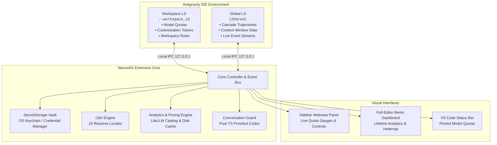

<p align="center">
  <a href="../../README.md">English</a> •
  <a href="README.tr.md">Türkçe</a> •
  <a href="README.pt-BR.md">Português</a> •
  <a href="README.es.md">Español</a> •
  <a href="README.de.md"><b>Deutsch</b></a> •
  <a href="README.fr.md">Français</a> •
  <a href="README.ja.md">日本語</a> •
  <a href="README.zh-CN.md">简体中文</a> •
  <a href="README.hi.md">हिन्दी</a> •
  <a href="README.ru.md">Русский</a>
</p>

<p align="center">
  
</p>

<p align="center">
  <a href="https://github.com/AlperenAKKAYA99/NexusAG/releases"></a>
  
  
  
  
  
  
</p>

---

# NexusAG

**NexusAG** ist die hochentwickelte Steuerzentrale für die **Google Antigravity IDE**. Es ermöglicht Entwicklern den sofortigen Kontowechsel mit einem Klick, Echtzeit-Überwachung von KI-Quoten über mehrere Google-Profile hinweg, tiefgehende Kontextfenster-Inspektion, Wiederherstellung verlorener Konversationen von der Festplatte und lebenslange Token-Kostenanalysen in einem vollständigen Editor-Dashboard.

---

## ⚡ Schnellstart in 60 Sekunden

1. **Installieren** — Suchen Sie nach `NexusAG` im Antigravity Marketplace oder installieren Sie die `.vsix`-Datei.
2. **Konto hinzufügen** — Klicken Sie in der Seitenleiste auf `+` für Google OAuth oder nutzen Sie `🔑` zum Einfügen von Tokens.
3. **Überwachen & Wechseln** — Ihre Live-Quotenanzeigen, Reset-Countdowns und Analysen sind sofort aktiv!

---

## 📸 Multi-Account-Schaltzentrale & UI Showcase

<table align="center" width="100%">
  <tr>
    <td align="center" width="25%" valign="top">
      <br/>
      <sub><b>⚡ Multi-Account-Schaltzentrale</b><br/>1-Klick-Kontowechsel, Live-Quotenfortschritt & Reset-Countdown</sub>
    </td>
    <td align="center" width="25%" valign="top">
      <br/>
      <sub><b>🔑 Token-Budget & Kontext</b><br/>Anpassungs-Donut, aktive Sitzungsanzeige & Workspace-Regeln</sub>
    </td>
    <td align="center" width="25%" valign="top">
      <br/>
      <sub><b>📈 Nutzungsstatistiken (Sidebar)</b><br/>Sitzungstoken-Gesamtwerte, stündliche Aktivität & monatliche Kosten</sub>
    </td>
    <td align="center" width="25%" valign="top">
      <br/>
      <sub><b>🌐 Einstellungen & 10-Sprachen-Zentrale</b><br/>Reaktiver Sofort-Sprachwechsler, Abfrageintervalle & Reparatur</sub>
    </td>
  </tr>
  <tr>
    <td align="center" width="25%" valign="top">
      <br/>
      <sub><b>🔑 Konten per Token hinzufügen</b><br/>Stapelweises Einfügen von OAuth-Refresh-Tokens mit Validierung</sub>
    </td>
    <td align="center" width="25%" valign="top">
      <br/>
      <sub><b>🔒 Nahtlose Google OAuth-Anmeldung</b><br/>1-Klick-Browser-Authentifizierung mit automatischer Rückkehr</sub>
    </td>
    <td align="center" colspan="2" valign="top">
      <br/>
      <sub><b>🔍 Kontextfenster-Detailansicht (Editor-Tab)</b><br/>Hierarchischer Schrittbaum, Token-Kategorien & Markdown-Export</sub>
    </td>
  </tr>
  <tr>
    <td align="center" colspan="4" valign="top">
      <br/>
      <sub><b>📊 Tiefgehendes Token-Analytics Bento-Dashboard (Vollbild)</b><br/>Lebenslange Konversations-Prüfung, GitHub-Aktivitäts-Heatmap, Modellkosten-Tabelle & Top-Chats</sub>
    </td>
  </tr>
</table>

---

## ✨ Hauptfunktionen im Überblick

### ⚡ Multi-Account-Schaltzentrale & Live-Quoten
- **Unbegrenzte Konten** — Überwachen Sie mehrere Google-Konten parallel ohne Überschneidungen.
- **Sofortiger 1-Klick-Wechsel** — Wechseln Sie das aktive IDE-Konto direkt aus der Seitenleiste.
- **Farbkodierte Quotenbalken** — Sofortige Übersicht (🟢 >50%, 🟡 20-50%, 🔴 <20%) mit präzisen Reset-Countdowns.
- **Statusleisten-Integration** — Heften Sie Favoritenmodelle mit einem Stern (★) an die Statusleiste an.
- **Proaktive Token-Erneuerung** — Automatische Aktualisierung von OAuth-Tokens verhindert 401-Fehler.
- **Abo-Plan-Details** — Direkte Anzeige des Tiers (Ultra, Premium, Free) und Guthaben.

### 🌍 100% Mehrsprachigkeit & Reaktiver Sofortwechsel
- **10 Native Sprachen**: Englisch, Türkisch, Portugiesisch, Spanisch, Deutsch, Französisch, Japanisch, Chinesisch, Hindi und Russisch.
- **Reaktiver Wechsel Ohne Neuladen** — Das Umschalten der Sprache übersetzt sofort **100%** der Benutzeroberfläche (Seitenleiste, Editor-Dashboard, Kontextfenster-Inspektor und Benachrichtigungen).

### 🔑 Token-Budget & Kontext-Intelligenz
- **Anpassungs-Donut-Diagramm** — Token-Verbrauch für MCP-Tools, Regeln, Workflows und Skills.
- **Aktives Kontextfenster-Meter** — Echtzeit-Vergleich zwischen verbrauchten Tokens und Modellgrenzen.
- **Workspace-Kontext-Inspektor** — Direkte Dateilinks zu allen `.agent/`-Dateien mit Aktivierungsmodi.

### 🔍 Kontextfenster-Detailansicht (Editor-Tab)
- Mit einem Klick über **"Alle anzeigen →"** erreichbar.
- **Hierarchischer Strukturbaum** — Detaillierte Aufschlüsselung von System-Prompt, Werkzeugen, MCP und Chat-Schritten.
- **Inline-Schrittvorschau** — Inhalte der einzelnen Schritte direkt im Editor prüfen.
- **Flammen-Symbole (🔥)** — Kennzeichnung der größten Token-Verbraucher im Kontext.
- **Markdown-Export** — Kontextdaten mit einem Klick in die Zwischenablage oder als Datei exportieren.

### 📈 Tiefgehende Token-Analysen & Bento-Dashboard
- Erreichbar über **"Vollständiges Dashboard öffnen →"**.
- **Gesamter Historien-Scan** — Erfasst und analysiert sämtliche vergangenen Konversationen in Antigravity.
- **9 KPI-Metriken** — Input-, Cache-, Output- und Reasoning-Tokens, API-Aufrufe, geschätzte Kosten und Cache-Rate.
- **GitHub-Style Aktivitäts-Heatmap** — 365-Tage-Aktivitätsgitter mit Jahresauswahl.
- **Dynamische LiteLLM-Preisberechnung** — Präzise Kostenschätzungen basierend auf aktuellen API-Preisen.

### 🛡️ Konversations-Schutz (Conversation Guard)
- **Automatische Erkennung verwaister Konversationen** — Gleicht `.pb`-Dateien auf der Festplatte mit dem Index ab.
- **1-Klick-Reparatur** — Beendet AG sicher, baut den Index neu auf und startet die IDE ohne Datenverlust neu.

---

## 🔒 Sicherheit & Datenschutz

- **100% Lokale Daten** — Keine Konversationsdaten, Prompts oder Dateien verlassen jemals Ihren Rechner.
- **Verschlüsselung auf Betriebssystemebene** — OAuth-Tokens werden über die native VS Code `SecretStorage`-Schnittstelle sicher gespeichert (macOS Keychain, Windows Credential Manager, Linux Secret Service).
- **Ausschließlich Lokale Kommunikation** — Die Kommunikation mit Language Servern erfolgt ausschließlich über `127.0.0.1` Loopback IPC-Sockets.
- **Null (0) Runtime-Abhängigkeiten** — Saubere Lieferkette mit **0 externen npm-Paketen**. Alles ist in reinem TypeScript geschrieben.
- **Nur Offizielle API-Endpunkte** — Beschränkt auf offizielle Google OAuth- und Cloud Code Quota-APIs.
- **Geprüfte Sicherheit** — Vollständiger Sicherheitsprüfbericht: [CYBER_SECURITY_AUDIT_REPORT.md](CYBER_SECURITY_AUDIT_REPORT.md) (0 kritische Schwachstellen, 0 Backdoors).
- **Open Source** — Jederzeit transparent und einsehbar unter der **MIT-Lizenz**.

---

## 🏗️ Architecture & Internal Mechanics



---

## 🚀 Erste Schritte

### Installation
1. Suchen Sie im Antigravity Extension Marketplace nach **NexusAG** und klicken Sie auf **Installieren**.
2. Oder installieren Sie direkt über die `.vsix`-Datei:
```bash
antigravity-ide.cmd --install-extension nexus-ag-1.1.0.vsix --force
```

---

## ⌨️ Command Palette

| Command | Identifier | Description |
|---|---|---|
| **NexusAG: Refresh Quota** | `ag.refreshQuota` | Forces an immediate quota and token budget refresh from Google APIs. |
| **NexusAG: Add Account** | `ag.addAccount` | Opens browser window for 1-click Google OAuth authentication. |
| **NexusAG: Add Account via Token** | `ag.addAccountByToken` | Opens modal for batch importing OAuth refresh tokens. |
| **NexusAG: Remove Account** | `ag.removeAccount` | Removes a selected account from local storage and tracking. |
| **NexusAG: Open Usage Statistics** | `ag.openUsageStats` | Launches the full-editor deep analytics bento dashboard. |
| **NexusAG: Fix Missing Conversations** | `ag.fixConversations` | Scans disk storage and repairs unindexed `.pb` conversations. |

---

## ⚙️ Configuration Settings

| Setting | Type | Default | Description |
|---|---|---|---|
| `ag-switchboard.language` | `string` | `auto` | Interface language (`auto`, `en`, `tr`, `pt-BR`, `es`, `de`, `fr`, `ja`, `zh-CN`, `hi`, `ru`). |
| `ag-switchboard.refreshInterval` | `string` | `1m` | Background polling frequency for quota updates (`instant`, `30s`, `1m`, `2m`, `5m`). |
| `ag-switchboard.modelPricing` | `object` | Defaults | Custom per-model rates per 1M tokens (`input`, `output`, `cache`). |
| `ag-switchboard.switchWithFixConversations` | `boolean` | `true` | Automatically synchronizes and repairs the conversation index on account switch. |
| `ag-switchboard.diagnosticMode` | `boolean` | `false` | Enables verbose diagnostic file logging for troubleshooting. |

---

## 📊 Project Stats

<div align="center">

| Metric | Specification |
|---|---|
| **Total Source Modules** | 60 TypeScript + 2 CSS files |
| **Codebase Volume** | ~19,200+ Lines of Code |
| **Runtime Dependencies** | **0** (Zero external dependencies) |
| **Build System** | esbuild (Sub-second webview bundling) |
| **Supported Locales** | 10 Native Languages (251 keys each, 100% parity) |
| **Security Audit** | Passed — 0 critical / high findings |
| **Supported Platforms** | macOS (Apple Silicon / Intel), Windows 10/11, Linux (x64/arm64) |

</div>

---

## 🛠️ Built With

- **[TypeScript](https://www.typescriptlang.org/)** — End-to-end static typing and enterprise resilience
- **[esbuild](https://esbuild.github.io/)** — Lightning-fast compilation and optimized asset packaging
- **[Font Awesome Pro](https://fontawesome.com/)** — Crisp, modern vector iconography
- **[LiteLLM Pricing Catalog](https://github.com/BerriAI/litellm)** — Accurate, community-maintained AI token pricing
- **Native VS Code API** — Deep integration with `SecretStorage`, `WebviewViewProvider`, and `StatusBarItem`

---

## ❓ Frequently Asked Questions (FAQ)

<details>
<summary><b>Is my code, prompt, or account data sent to any third-party servers?</b></summary>
<br/>
<b>No.</b> NexusAG operates with a strict zero-telemetry policy. The extension communicates exclusively with official Google authentication and quota APIs, and with your local Antigravity Language Server on <code>127.0.0.1</code>. No analytics, transcripts, or telemetry are ever collected or transmitted.
</details>

<details>
<summary><b>Where are my Google credentials and OAuth tokens stored?</b></summary>
<br/>
All authentication tokens are secured using VS Code's native <code>SecretStorage</code> API (macOS Keychain, Windows Credential Manager, or Linux Secret Service/Keyring).
</details>

<details>
<summary><b>Why does NexusAG have zero (0) runtime dependencies?</b></summary>
<br/>
To eliminate supply-chain vulnerability vectors, minimize package bundle size, and guarantee maximum execution speed. All protocol handling—including Protobuf binary encoding and decoding—is custom-built in native TypeScript.
</details>

---

## 🤝 Contributing & Development

Contributions, bug reports, and feature suggestions are warmly welcomed!

1. Fork the repository: `git clone https://github.com/AlperenAKKAYA99/NexusAG.git`
2. Install development dependencies: `npm install`
3. Compile the extension & webviews: `npm run compile`
4. Launch Extension in Debug Mode (`F5` in VS Code / Antigravity IDE)
---

## 📋 Changelog Highlights

For the full release history, see [CHANGELOG.md](CHANGELOG.md).

- **v1.1.0 (Current)** — 10-language instant reactive localization, multi-banner asset generation, enhanced UI showcase, and unified branding.
- **v1.0.5** — Usage Stats deduplication via `responseId`, dynamic model auto-humanization, and quota 100% bugfix.
- **v1.0.4** — **Conversation Guard**, standalone detached repair worker, and pure-TypeScript Protobuf trajectory codec for orphaned conversation recovery.
- **v1.0.3** — Multi-window state isolation, USS event gating, and background polling resilience.
- **v1.0.2** — Cross-source pin matching (★), status bar quota integration, heatmap cost tooltips, and diagnostic logging harness.
- **v1.0.1** — Dual-LS architecture, full context window drill-down tab, and live event stream monitoring.
- **v1.0.0** — Initial public release: 1-click Google account switching, full-editor bento analytics, GitHub-style activity heatmap, and SecretStorage vault.

---

## 📄 License & Author

Veröffentlicht unter der **MIT-Lizenz**. Entwickelt mit ☕ von **[Alperen AKKAYA](https://github.com/AlperenAKKAYA99)**

