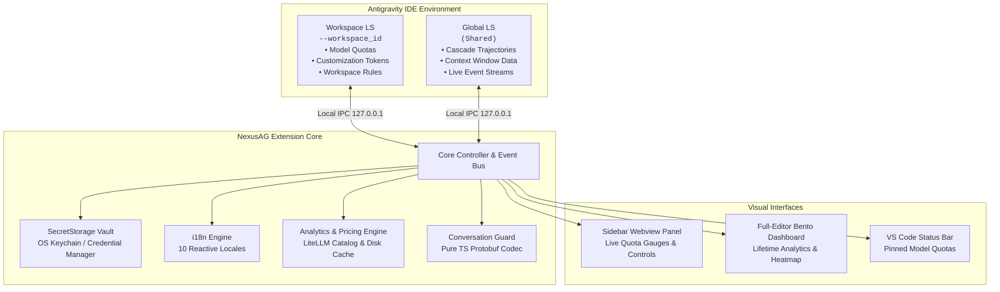

<p align="center">
  <a href="../../README.md">English</a> •
  <a href="README.tr.md">Türkçe</a> •
  <a href="README.pt-BR.md">Português</a> •
  <a href="README.es.md"><b>Español</b></a> •
  <a href="README.de.md">Deutsch</a> •
  <a href="README.fr.md">Français</a> •
  <a href="README.ja.md">日本語</a> •
  <a href="README.zh-CN.md">简体中文</a> •
  <a href="README.hi.md">हिन्दी</a> •
  <a href="README.ru.md">Русский</a>
</p>

<p align="center">
  
</p>

<p align="center">
  <a href="https://github.com/AlperenAKKAYA99/NexusAG/releases"></a>
  
  
  
  
  
  
</p>

---

# NexusAG

**NexusAG** es el panel de control y suite de inteligencia de última generación diseñado para **Google Antigravity IDE**. Permite a los desarrolladores cambiar de cuenta con 1 clic, supervisar las cuotas de IA en tiempo real en múltiples perfiles de Google, analizar la ventana de contexto token por token, recuperar conversaciones perdidas del disco y examinar el consumo de tokens histórico con un panel de análisis completo en el editor.

---

## ⚡ Primeros Pasos en 60 Segundos

1. **Instalar** — Busque `NexusAG` en el marketplace de extensiones de Antigravity o instale el archivo `.vsix`.
2. **Añadir Cuenta** — Haga clic en `+` en la barra lateral para autenticación Google OAuth en 1 clic o pulse `🔑` para pegar tokens.
3. **Monitorizar & Cambiar** — ¡Sus indicadores de cuota en vivo, temporizadores y analítica se activan al instante!

---

## 📸 Selector Multicuenta y Galería de Interfaz (UI Showcase)

<table align="center" width="100%">
  <tr>
    <td align="center" width="25%" valign="top">
      <br/>
      <sub><b>⚡ Selector Multicuenta</b><br/>Cambio de cuenta en 1 clic, progreso de cuotas y temporizadores</sub>
    </td>
    <td align="center" width="25%" valign="top">
      <br/>
      <sub><b>🔑 Presupuesto de Tokens y Contexto</b><br/>Donut de personalizaciones, medidor de sesión y reglas</sub>
    </td>
    <td align="center" width="25%" valign="top">
      <br/>
      <sub><b>📈 Estadísticas de Uso (Sidebar)</b><br/>Totales de tokens de sesión, actividad horaria y costes mensuales</sub>
    </td>
    <td align="center" width="25%" valign="top">
      <br/>
      <sub><b>🌐 Ajustes y Centro de 10 Idiomas</b><br/>Selector reactivo de idioma, intervalos de refresco y reparación</sub>
    </td>
  </tr>
  <tr>
    <td align="center" width="25%" valign="top">
      <br/>
      <sub><b>🔑 Añadir Cuentas vía Token</b><br/>Pegado por lotes de refresh tokens OAuth con validación</sub>
    </td>
    <td align="center" width="25%" valign="top">
      <br/>
      <sub><b>🔒 Autenticación Google OAuth Fluida</b><br/>Inicio de sesión en navegador con 1 clic y retorno automático</sub>
    </td>
    <td align="center" colspan="2" valign="top">
      <br/>
      <sub><b>🔍 Detalle de Ventana de Contexto (Pestaña Editor)</b><br/>Árbol jerárquico de pasos, categorías de tokens y exportación</sub>
    </td>
  </tr>
  <tr>
    <td align="center" colspan="4" valign="top">
      <br/>
      <sub><b>📊 Panel Bento de Analítica Profunda de Tokens (Pantalla Completa)</b><br/>Auditoría histórica total, mapa de calor estilo GitHub, tabla de costes y conversaciones top</sub>
    </td>
  </tr>
</table>

---

## ✨ Características Principales

### ⚡ Selector Multicuenta y Monitorización de Cuotas en Vivo
- **Cuentas Ilimitadas** — Monitorice múltiples cuentas de Google simultáneamente sin conflictos.
- **Cambio Instantáneo en 1 Clic** — Cambie la cuenta activa del IDE directamente desde la barra lateral.
- **Indicadores de Cuota en Tiempo Real** — Barras de capacidad con código de colores (🟢 >50%, 🟡 20-50%, 🔴 <20%) y temporizadores de reinicio exactos.
- **Integración con Barra de Estado** — Fije modelos con estrella (★) para ver cuotas sin abrir el panel.
- **Renovación Proactiva de Tokens** — Refresco automático de tokens OAuth para evitar errores 401.
- **Información del Nivel de Suscripción** — Visualice su categoría (Ultra, Premium, Free) y créditos disponibles.

### 🌍 100% Internacionalización y Cambio Reactivo Instantáneo
- **10 Idiomas Nativos**: Inglés, Turco, Portugués, Español, Alemán, Francés, Japonés, Chino Simplificado, Hindi y Ruso.
- **Cambio Reactivo Sin Recargar** — Cambiar el idioma en la pestaña Ajustes traduce instantáneamente el **100%** de la interfaz (Sidebar, Panel Bento en Editor, Detalle de Contexto y diálogos).

### 🔑 Presupuesto de Tokens e Inteligencia de Contexto
- **Gráfico Donut de Personalizaciones** — Desglose de tokens para MCP Tools, Reglas, Workflows y Skills.
- **Medidor de Contexto Activo** — Visualización en tiempo real del límite del modelo frente a tokens usados.
- **Inspector de Contexto de Workspace** — Enlaces directos a archivos en `.agent/` con modos de activación.

### 🔍 Detalle de Ventana de Contexto (Pestaña Completa de Editor)
- Acceda en un clic con el botón **"Ver Todo →"**.
- **Árbol Jerárquico** — Desglose agrupado de System Prompt, Herramientas, MCP y Mensajes de Chat.
- **Vistas Previas Inline** — Inspeccione el contenido de cada paso sin salir del IDE.
- **Insignias de Fuego (🔥)** — Destaque visual inmediato de los pasos con mayor consumo de tokens.
- **Exportación a Markdown** — Guarde o copie al portapapeles el historial de contexto formateado.

### 📈 Analítica Profunda de Tokens y Panel Bento
- Acceda mediante el botón **"Abrir Panel Completo →"**.
- **Agregación Histórica Total** — Escanea y suma el uso de tokens en cada conversación en Antigravity.
- **9 Métricas KPI** — Entrada, Lecturas de Caché, Salida, Razonamiento, llamadas totales, coste estimado y ratio de acierto de caché.
- **Mapa de Calor Estilo GitHub** — Grícula de actividad de 365 días con selector de año y picos de uso.
- **Motor de Precios LiteLLM** — Estimación precisa del coste de API según las tarifas vigentes.

### 🛡️ Guardián de Conversaciones (Conversation Guard)
- **Detección Automática de Huérfanas** — Compara archivos `.pb` en disco con el índice de la barra lateral tras 15s de inicio.
- **Reparación en 1 Clic** — Cierra AG de forma segura, reconstruye el índice y reinicia el IDE automáticamente.

---

## 🔒 Seguridad y Privacidad

- **100% Datos Locales** — Ningún dato de conversación, prompt o código sale jamás de su máquina.
- **Cifrado a Nivel de SO** — Tokens OAuth protegidos mediante `SecretStorage` de VS Code (macOS Keychain, Windows Credential Manager, Linux Secret Service).
- **Comunicación Estrictamente Local** — Todas las llamadas al Language Server se limitan a sockets IPC en `127.0.0.1`.
- **Cero (0) Dependencias de Runtime** — Cadena de suministro limpia con **0 dependencias npm externas**. Escrito en TypeScript puro.
- **Solo APIs Oficiales** — Conexiones limitadas exclusivamente a endpoints oficiales de Google OAuth y Cloud Code Quota.
- **Código Auditado** — Informe completo: [CYBER_SECURITY_AUDIT_REPORT.md](CYBER_SECURITY_AUDIT_REPORT.md) (0 vulnerabilidades críticas, 0 backdoors).
- **Código Abierto** — Transparente y auditable bajo la **Licencia MIT**.

---

## 🏗️ Architecture & Internal Mechanics



---

## 🚀 Primeros Pasos

### Installation
1. Busque **NexusAG** en el Marketplace de extensiones de Antigravity e instálela.
2. O instálela mediante el archivo `.vsix`:
```bash
antigravity-ide.cmd --install-extension nexus-ag-1.1.0.vsix --force
```

---

## ⌨️ Command Palette

| Command | Identifier | Description |
|---|---|---|
| **NexusAG: Refresh Quota** | `ag.refreshQuota` | Forces an immediate quota and token budget refresh from Google APIs. |
| **NexusAG: Add Account** | `ag.addAccount` | Opens browser window for 1-click Google OAuth authentication. |
| **NexusAG: Add Account via Token** | `ag.addAccountByToken` | Opens modal for batch importing OAuth refresh tokens. |
| **NexusAG: Remove Account** | `ag.removeAccount` | Removes a selected account from local storage and tracking. |
| **NexusAG: Open Usage Statistics** | `ag.openUsageStats` | Launches the full-editor deep analytics bento dashboard. |
| **NexusAG: Fix Missing Conversations** | `ag.fixConversations` | Scans disk storage and repairs unindexed `.pb` conversations. |

---

## ⚙️ Configuration Settings

| Setting | Type | Default | Description |
|---|---|---|---|
| `ag-switchboard.language` | `string` | `auto` | Interface language (`auto`, `en`, `tr`, `pt-BR`, `es`, `de`, `fr`, `ja`, `zh-CN`, `hi`, `ru`). |
| `ag-switchboard.refreshInterval` | `string` | `1m` | Background polling frequency for quota updates (`instant`, `30s`, `1m`, `2m`, `5m`). |
| `ag-switchboard.modelPricing` | `object` | Defaults | Custom per-model rates per 1M tokens (`input`, `output`, `cache`). |
| `ag-switchboard.switchWithFixConversations` | `boolean` | `true` | Automatically synchronizes and repairs the conversation index on account switch. |
| `ag-switchboard.diagnosticMode` | `boolean` | `false` | Enables verbose diagnostic file logging for troubleshooting. |

---

## 📊 Project Stats

<div align="center">

| Metric | Specification |
|---|---|
| **Total Source Modules** | 60 TypeScript + 2 CSS files |
| **Codebase Volume** | ~19,200+ Lines of Code |
| **Runtime Dependencies** | **0** (Zero external dependencies) |
| **Build System** | esbuild (Sub-second webview bundling) |
| **Supported Locales** | 10 Native Languages (251 keys each, 100% parity) |
| **Security Audit** | Passed — 0 critical / high findings |
| **Supported Platforms** | macOS (Apple Silicon / Intel), Windows 10/11, Linux (x64/arm64) |

</div>

---

## 🛠️ Built With

- **[TypeScript](https://www.typescriptlang.org/)** — End-to-end static typing and enterprise resilience
- **[esbuild](https://esbuild.github.io/)** — Lightning-fast compilation and optimized asset packaging
- **[Font Awesome Pro](https://fontawesome.com/)** — Crisp, modern vector iconography
- **[LiteLLM Pricing Catalog](https://github.com/BerriAI/litellm)** — Accurate, community-maintained AI token pricing
- **Native VS Code API** — Deep integration with `SecretStorage`, `WebviewViewProvider`, and `StatusBarItem`

---

## ❓ Frequently Asked Questions (FAQ)

<details>
<summary><b>Is my code, prompt, or account data sent to any third-party servers?</b></summary>
<br/>
<b>No.</b> NexusAG operates with a strict zero-telemetry policy. The extension communicates exclusively with official Google authentication and quota APIs, and with your local Antigravity Language Server on <code>127.0.0.1</code>. No analytics, transcripts, or telemetry are ever collected or transmitted.
</details>

<details>
<summary><b>Where are my Google credentials and OAuth tokens stored?</b></summary>
<br/>
All authentication tokens are secured using VS Code's native <code>SecretStorage</code> API (macOS Keychain, Windows Credential Manager, or Linux Secret Service/Keyring).
</details>

<details>
<summary><b>Why does NexusAG have zero (0) runtime dependencies?</b></summary>
<br/>
To eliminate supply-chain vulnerability vectors, minimize package bundle size, and guarantee maximum execution speed. All protocol handling—including Protobuf binary encoding and decoding—is custom-built in native TypeScript.
</details>

---

## 🤝 Contributing & Development

Contributions, bug reports, and feature suggestions are warmly welcomed!

1. Fork the repository: `git clone https://github.com/AlperenAKKAYA99/NexusAG.git`
2. Install development dependencies: `npm install`
3. Compile the extension & webviews: `npm run compile`
4. Launch Extension in Debug Mode (`F5` in VS Code / Antigravity IDE)
---

## 📋 Changelog Highlights

For the full release history, see [CHANGELOG.md](CHANGELOG.md).

- **v1.1.0 (Current)** — 10-language instant reactive localization, multi-banner asset generation, enhanced UI showcase, and unified branding.
- **v1.0.5** — Usage Stats deduplication via `responseId`, dynamic model auto-humanization, and quota 100% bugfix.
- **v1.0.4** — **Conversation Guard**, standalone detached repair worker, and pure-TypeScript Protobuf trajectory codec for orphaned conversation recovery.
- **v1.0.3** — Multi-window state isolation, USS event gating, and background polling resilience.
- **v1.0.2** — Cross-source pin matching (★), status bar quota integration, heatmap cost tooltips, and diagnostic logging harness.
- **v1.0.1** — Dual-LS architecture, full context window drill-down tab, and live event stream monitoring.
- **v1.0.0** — Initial public release: 1-click Google account switching, full-editor bento analytics, GitHub-style activity heatmap, and SecretStorage vault.

---

## 📄 License & Author

Distribuido bajo la **Licencia MIT**. Creado con ☕ por **[Alperen AKKAYA](https://github.com/AlperenAKKAYA99)**

