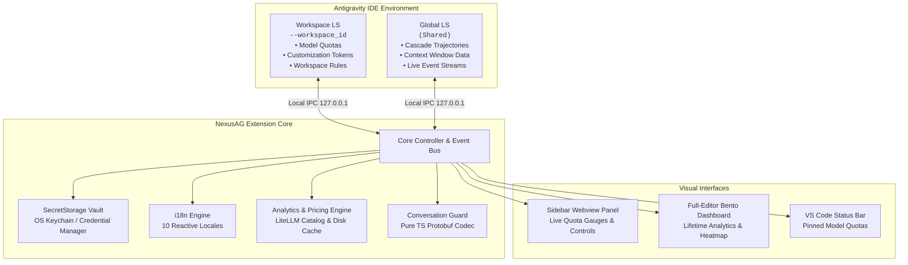

<p align="center">
  <a href="../../README.md">English</a> •
  <a href="README.tr.md">Türkçe</a> •
  <a href="README.pt-BR.md">Português</a> •
  <a href="README.es.md">Español</a> •
  <a href="README.de.md">Deutsch</a> •
  <a href="README.fr.md"><b>Français</b></a> •
  <a href="README.ja.md">日本語</a> •
  <a href="README.zh-CN.md">简体中文</a> •
  <a href="README.hi.md">हिन्दी</a> •
  <a href="README.ru.md">Русский</a>
</p>

<p align="center">
  
</p>

<p align="center">
  <a href="https://github.com/AlperenAKKAYA99/NexusAG/releases"></a>
  
  
  
  
  
  
</p>

---

# NexusAG

**NexusAG** est le panneau de contrôle de nouvelle génération conçu pour l'environnement **Google Antigravity IDE**. Il permet aux développeurs de changer de compte en 1 clic, de surveiller les quotas IA en temps réel sur plusieurs profils Google, d'analyser la fenêtre de contexte pas à pas, de récupérer les conversations orphelines sur disque et d'auditer la consommation globale de jetons via un tableau de bord analytique complet.

---

## ⚡ Démarrage Rapide en 60 Secondes

1. **Installer** — Recherchez `NexusAG` dans le marketplace Antigravity ou installez le package `.vsix`.
2. **Ajouter un Compte** — Cliquez sur `+` dans la barre latérale pour vous connecter via Google OAuth ou utilisez `🔑` pour coller des jetons.
3. **Surveiller & Basculer** — Vos jauges de quota en direct, comptes à rebours et analyses de tokens sont immédiatement opérationnels !

---

## 📸 Sélecteur Multi-comptes et Galerie d'Interface (UI Showcase)

<table align="center" width="100%">
  <tr>
    <td align="center" width="25%" valign="top">
      <br/>
      <sub><b>⚡ Sélecteur Multi-comptes</b><br/>Changement de compte en 1 clic, jauges de quotas et comptes à rebours</sub>
    </td>
    <td align="center" width="25%" valign="top">
      <br/>
      <sub><b>🔑 Budget de Tokens et Contexte</b><br/>Donut des personnalisations, jauge de session et règles</sub>
    </td>
    <td align="center" width="25%" valign="top">
      <br/>
      <sub><b>📈 Statistiques d'Utilisation (Sidebar)</b><br/>Totaux de jetons de session, activité horaire et coûts mensuels</sub>
    </td>
    <td align="center" width="25%" valign="top">
      <br/>
      <sub><b>🌐 Paramètres et Hub 10 Langues</b><br/>Sélecteur réactif de langue, intervalles d'actualisation et réparation</sub>
    </td>
  </tr>
  <tr>
    <td align="center" width="25%" valign="top">
      <br/>
      <sub><b>🔑 Ajouter des Comptes via Token</b><br/>Collage par lot de tokens d'actualisation OAuth avec validation</sub>
    </td>
    <td align="center" width="25%" valign="top">
      <br/>
      <sub><b>🔒 Authentification Google OAuth Fluide</b><br/>Connexion dans le navigateur en 1 clic avec retour automatique</sub>
    </td>
    <td align="center" colspan="2" valign="top">
      <br/>
      <sub><b>🔍 Détail de la Fenêtre de Contexte (Onglet Éditeur)</b><br/>Arborescence des étapes, ventilation des tokens et export Markdown</sub>
    </td>
  </tr>
  <tr>
    <td align="center" colspan="4" valign="top">
      <br/>
      <sub><b>📊 Tableau de Bord Bento d'Analyse Approfondie (Plein Éditeur)</b><br/>Audit de tout l'historique, heatmap GitHub, grille des coûts par modèle et top conversations</sub>
    </td>
  </tr>
</table>

---

## ✨ Fonctionnalités Majeures

### ⚡ Sélecteur Multi-comptes et Quotas en Temps Réel
- **Comptes Illimités** — Suivez plusieurs comptes Google simultanément sans conflit.
- **Bascule Instantanée en 1 Clic** — Changez le compte actif de l'IDE directement depuis la barre latérale.
- **Jauges de Quotas en Temps Réel** — Barres colorées (🟢 >50%, 🟡 20-50%, 🔴 <20%) avec compte à rebours de réinitialisation précis.
- **Intégration Barre d'État** — Épinglez vos modèles favoris avec une étoile (★) pour un suivi constant.
- **Renouvellement Proactif des Jetons** — Rafraîchissement automatique des jetons d'accès évitant les erreurs 401.
- **Détails de l'Abonnement** — Affichage direct du palier (Ultra, Premium, Free) et des crédits d'utilisation.

### 🌍 100% Internationalisation et Réactivité Immédiate
- **10 Langues Natives**: Anglais, Turc, Portugais, Espagnol, Allemand, Français, Japonais, Chinois Simplifié, Hindi et Russe.
- **Basculement Sans Rechargement** — Changer de langue dans l'onglet Paramètres traduit instantanément **100%** de l'interface (Sidebar, Tableau Bento, Inspection de Contexte et alertes).

### 🔑 Budget de Tokens et Intelligence de Contexte
- **Graphique Donut des Personnalisations** — Empreinte token des outils MCP, règles, flux et compétences.
- **Jauge de Fenêtre de Contexte Active** — Comparaison en direct entre tokens consommés et limite maximale du modèle.
- **Inspecteur de Contexte de l'Espace de Travail** — Liens directs vers les fichiers `.agent/` et modes d'activation.

### 🔍 Détail de la Fenêtre de Contexte (Onglet Éditeur Complet)
- Accessible en un clic via **"Voir Tout →"**.
- **Arborescence Hiérarchique** — Décomposition du System Prompt, des Outils, de MCP et des messages.
- **Aperçus Intégrés** — Examinez le contenu de chaque étape directement dans l'éditeur.
- **Badges Flamme (🔥)** — Repérez immédiatement les étapes les plus coûteuses en tokens.
- **Export Markdown** — Exportez facilement les métriques de contexte.

### 📈 Statistiques Approfondies et Tableau de Bord Bento
- Accessible via **"Ouvrir le Tableau Complet →"**.
- **Agrégation de Tout l'Historique** — Analyse l'ensemble des conversations enregistrées dans Antigravity.
- **9 Métriques KPI** — Tokens d'entrée, de cache, de sortie, de réflexion, nombre d'appels et taux de cache.
- **Heatmap d'Activité Style GitHub** — Grille annuelle avec sélecteur d'année et pic d'utilisation.
- **Moteur Tarifaire LiteLLM** — Estimation précise des coûts de facturation API.

### 🛡️ Garde de Conversation (Conversation Guard)
- **Détection Automatique des Conversations Perdues** — Compare les fichiers `.pb` avec l'index IDE 15s après le démarrage.
- **Réparation en 1 Clic** — Ferme AG en toute sécurité, reconstruit l'index et relance l'IDE sans perte de données.

---

## 🔒 Sécurité et Confidentialité

- **100% Données Locales** — Aucune donnée de conversation, aucun prompt ni fichier ne quitte votre machine.
- **Chiffrement au Niveau de l'OS** — Jetons OAuth sécurisés dans le `SecretStorage` natif de VS Code (Trousseau macOS, Windows Credential Manager, Linux Secret Service).
- **Communication Exclusivement Locale** — Les échanges avec les serveurs de langage restent cantonnés à l'IPC `127.0.0.1`.
- **Zéro (0) Dépendance à l'Exécution** — Chaîne d'approvisionnement sécurisée avec **0 package npm tiers**. Tout est conçu en TypeScript pur.
- **APIs Officielles Uniquement** — Requêtes limitées aux services Google OAuth et Cloud Code Quota officiels.
- **Audit de Sécurité** — Rapport détaillé : [CYBER_SECURITY_AUDIT_REPORT.md](CYBER_SECURITY_AUDIT_REPORT.md) (0 vulnérabilité critique, 0 porte dérobée).
- **Open Source** — Entièrement transparent sous **Licence MIT**.

---

## 🏗️ Architecture & Internal Mechanics



---

## 🚀 Démarrage Rapide

### Installation
1. Recherchez **NexusAG** dans le Marketplace d'extensions Antigravity et cliquez sur **Installer**.
2. Ou installez directement depuis le fichier `.vsix` :
```bash
antigravity-ide.cmd --install-extension nexus-ag-1.1.0.vsix --force
```

---

## ⌨️ Command Palette

| Command | Identifier | Description |
|---|---|---|
| **NexusAG: Refresh Quota** | `ag.refreshQuota` | Forces an immediate quota and token budget refresh from Google APIs. |
| **NexusAG: Add Account** | `ag.addAccount` | Opens browser window for 1-click Google OAuth authentication. |
| **NexusAG: Add Account via Token** | `ag.addAccountByToken` | Opens modal for batch importing OAuth refresh tokens. |
| **NexusAG: Remove Account** | `ag.removeAccount` | Removes a selected account from local storage and tracking. |
| **NexusAG: Open Usage Statistics** | `ag.openUsageStats` | Launches the full-editor deep analytics bento dashboard. |
| **NexusAG: Fix Missing Conversations** | `ag.fixConversations` | Scans disk storage and repairs unindexed `.pb` conversations. |

---

## ⚙️ Configuration Settings

| Setting | Type | Default | Description |
|---|---|---|---|
| `ag-switchboard.language` | `string` | `auto` | Interface language (`auto`, `en`, `tr`, `pt-BR`, `es`, `de`, `fr`, `ja`, `zh-CN`, `hi`, `ru`). |
| `ag-switchboard.refreshInterval` | `string` | `1m` | Background polling frequency for quota updates (`instant`, `30s`, `1m`, `2m`, `5m`). |
| `ag-switchboard.modelPricing` | `object` | Defaults | Custom per-model rates per 1M tokens (`input`, `output`, `cache`). |
| `ag-switchboard.switchWithFixConversations` | `boolean` | `true` | Automatically synchronizes and repairs the conversation index on account switch. |
| `ag-switchboard.diagnosticMode` | `boolean` | `false` | Enables verbose diagnostic file logging for troubleshooting. |

---

## 📊 Project Stats

<div align="center">

| Metric | Specification |
|---|---|
| **Total Source Modules** | 60 TypeScript + 2 CSS files |
| **Codebase Volume** | ~19,200+ Lines of Code |
| **Runtime Dependencies** | **0** (Zero external dependencies) |
| **Build System** | esbuild (Sub-second webview bundling) |
| **Supported Locales** | 10 Native Languages (251 keys each, 100% parity) |
| **Security Audit** | Passed — 0 critical / high findings |
| **Supported Platforms** | macOS (Apple Silicon / Intel), Windows 10/11, Linux (x64/arm64) |

</div>

---

## 🛠️ Built With

- **[TypeScript](https://www.typescriptlang.org/)** — End-to-end static typing and enterprise resilience
- **[esbuild](https://esbuild.github.io/)** — Lightning-fast compilation and optimized asset packaging
- **[Font Awesome Pro](https://fontawesome.com/)** — Crisp, modern vector iconography
- **[LiteLLM Pricing Catalog](https://github.com/BerriAI/litellm)** — Accurate, community-maintained AI token pricing
- **Native VS Code API** — Deep integration with `SecretStorage`, `WebviewViewProvider`, and `StatusBarItem`

---

## ❓ Frequently Asked Questions (FAQ)

<details>
<summary><b>Is my code, prompt, or account data sent to any third-party servers?</b></summary>
<br/>
<b>No.</b> NexusAG operates with a strict zero-telemetry policy. The extension communicates exclusively with official Google authentication and quota APIs, and with your local Antigravity Language Server on <code>127.0.0.1</code>. No analytics, transcripts, or telemetry are ever collected or transmitted.
</details>

<details>
<summary><b>Where are my Google credentials and OAuth tokens stored?</b></summary>
<br/>
All authentication tokens are secured using VS Code's native <code>SecretStorage</code> API (macOS Keychain, Windows Credential Manager, or Linux Secret Service/Keyring).
</details>

<details>
<summary><b>Why does NexusAG have zero (0) runtime dependencies?</b></summary>
<br/>
To eliminate supply-chain vulnerability vectors, minimize package bundle size, and guarantee maximum execution speed. All protocol handling—including Protobuf binary encoding and decoding—is custom-built in native TypeScript.
</details>

---

## 🤝 Contributing & Development

Contributions, bug reports, and feature suggestions are warmly welcomed!

1. Fork the repository: `git clone https://github.com/AlperenAKKAYA99/NexusAG.git`
2. Install development dependencies: `npm install`
3. Compile the extension & webviews: `npm run compile`
4. Launch Extension in Debug Mode (`F5` in VS Code / Antigravity IDE)
---

## 📋 Changelog Highlights

For the full release history, see [CHANGELOG.md](CHANGELOG.md).

- **v1.1.0 (Current)** — 10-language instant reactive localization, multi-banner asset generation, enhanced UI showcase, and unified branding.
- **v1.0.5** — Usage Stats deduplication via `responseId`, dynamic model auto-humanization, and quota 100% bugfix.
- **v1.0.4** — **Conversation Guard**, standalone detached repair worker, and pure-TypeScript Protobuf trajectory codec for orphaned conversation recovery.
- **v1.0.3** — Multi-window state isolation, USS event gating, and background polling resilience.
- **v1.0.2** — Cross-source pin matching (★), status bar quota integration, heatmap cost tooltips, and diagnostic logging harness.
- **v1.0.1** — Dual-LS architecture, full context window drill-down tab, and live event stream monitoring.
- **v1.0.0** — Initial public release: 1-click Google account switching, full-editor bento analytics, GitHub-style activity heatmap, and SecretStorage vault.

---

## 📄 License & Author

Distribué sous **Licence MIT**. Développé avec ☕ par **[Alperen AKKAYA](https://github.com/AlperenAKKAYA99)**

