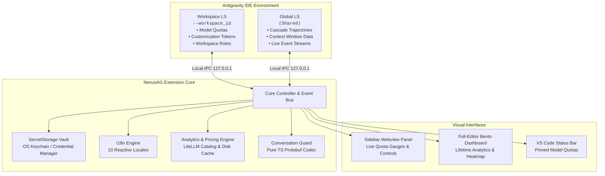

<p align="center">
  <a href="../../README.md">English</a> •
  <a href="README.tr.md">Türkçe</a> •
  <a href="README.pt-BR.md">Português</a> •
  <a href="README.es.md">Español</a> •
  <a href="README.de.md">Deutsch</a> •
  <a href="README.fr.md">Français</a> •
  <a href="README.ja.md">日本語</a> •
  <a href="README.zh-CN.md">简体中文</a> •
  <a href="README.hi.md"><b>हिन्दी</b></a> •
  <a href="README.ru.md">Русский</a>
</p>

<p align="center">
  
</p>

<p align="center">
  <a href="https://github.com/AlperenAKKAYA99/NexusAG/releases"></a>
  
  
  
  
  
  
</p>

---

# NexusAG

**NexusAG** **Google Antigravity IDE** के लिए डिज़ाइन किया गया अगली पीढ़ी का बुद्धिमान नियंत्रण कक्ष और इंटेलिजेंस सूट है। यह डेवलपर्स को 1-क्लिक में खाते बदलने, कई Google प्रोफाइल में रीयल-टाइम AI कोटा की निगरानी करने, कॉन्टेक्स्ट विंडो टोकन ब्रेकडाउन का विश्लेषण करने, डिस्क से खोई हुई बातचीत को पुनर्प्राप्त करने और पूरे इतिहास के टोकन उपयोग का विश्लेषण करने की अनुमति देता है।

---

## ⚡ 60 सेकंड में शुरुआत करें

1. **इंस्टॉल करें** — Antigravity एक्सटेंशन मार्केटप्लेस में `NexusAG` खोजें या `.vsix` पैकेज इंस्टॉल करें।
2. **खाता जोड़ें** — ब्राउज़र में 1-क्लिक Google OAuth लॉगिन के लिए साइडबार में `+` पर क्लिक करें या `🔑` से टोकन चिपकाएं।
3. **निगरानी और स्विच** — आपके लाइव कोटा गेज, रीसेट टाइमर और आजीवन टोकन विश्लेषण तुरंत सक्रिय हैं!

---

## 📸 मल्टी-अकाउंट स्विचबोर्ड और यूआई गैलरी (UI Showcase)

<table align="center" width="100%">
  <tr>
    <td align="center" width="25%" valign="top">
      <br/>
      <sub><b>⚡ मल्टी-अकाउंट स्विचबोर्ड</b><br/>1-क्लिक खाता स्विचिंग, रीयल-टाइम कोटा प्रगति और रीसेट टाइमर</sub>
    </td>
    <td align="center" width="25%" valign="top">
      <br/>
      <sub><b>🔑 टोकन बजट और कॉन्टेक्स्ट</b><br/>कस्टमाइज़ेशन डोनट, सक्रिय सत्र गेज और नियम</sub>
    </td>
    <td align="center" width="25%" valign="top">
      <br/>
      <sub><b>📈 उपयोग आंकड़े (साइडबार)</b><br/>सत्र टोकन योग, प्रति घंटा गतिविधि और मासिक लागत</sub>
    </td>
    <td align="center" width="25%" valign="top">
      <br/>
      <sub><b>🌐 सेटिंग्स और 10-भाषा केंद्र</b><br/>त्वरित प्रतिक्रियाशील भाषा चयनकर्ता, अंतराल और मरम्मत</sub>
    </td>
  </tr>
  <tr>
    <td align="center" width="25%" valign="top">
      <br/>
      <sub><b>🔑 टोकन द्वारा खाते जोड़ें</b><br/>सत्यापन के साथ बैच OAuth रीफ़्रेश टोकन पेस्ट</sub>
    </td>
    <td align="center" width="25%" valign="top">
      <br/>
      <sub><b>🔒 निर्बाध Google OAuth प्रमाणीकरण</b><br/>ऑटो-रिटर्न के साथ 1-क्लिक ब्राउज़र लॉगिन</sub>
    </td>
    <td align="center" colspan="2" valign="top">
      <br/>
      <sub><b>🔍 कॉन्टेक्स्ट विंडो विवरण (संपादक टैब)</b><br/>पदानुक्रमित स्टेप ट्री, टोकन श्रेणी विभाजन और मार्कडाउन निर्यात</sub>
    </td>
  </tr>
  <tr>
    <td align="center" colspan="4" valign="top">
      <br/>
      <sub><b>📊 डीप टोकन एनालिटिक्स बेन्टो डैशबोर्ड (पूर्ण संपादक)</b><br/>आजीवन बातचीत ऑडिट, GitHub-शैली हीटमैप, मॉडल लागत तालिका और शीर्ष चैट</sub>
    </td>
  </tr>
</table>

---

## ✨ मुख्य विशेषताएं

### ⚡ मल्टी-अकाउंट स्विचबोर्ड और रीयल-टाइम कोटा ट्रैकिंग
- **असीमित खाते** — बिना किसी रुकावट के एक साथ कई Google खातों की निगरानी करें।
- **1-क्लिक त्वरित स्विचिंग** — साइडबार से सीधे सक्रिय खाते को तुरंत बदलें।
- **रीयल-टाइम कोटा गेज** — रंग-कोडित क्षमता संकेतक (🟢 >50%, 🟡 20-50%, 🔴 <20%) और सटीक रीसेट टाइमर।
- **स्टेटस बार एकीकरण** — पसंदीदा मॉडल को स्टार (★) करें और बिना पैनल खोले स्थिति देखें।
- **सक्रिय टोकन नवीनीकरण** — स्वचालित बैकग्राउंड रीफ्रेश लंबे सत्रों के दौरान 401 त्रुटियों को रोकता है।

### 🌍 100% बहुभाषी समर्थन और त्वरित प्रतिक्रियाशील स्विचिंग
- **10 मूल भाषाएं**: अंग्रेजी, तुर्की, पुर्तगाली, स्पेनिश, जर्मन, फ्रेंच, जापानी, चीनी, हिन्दी और रूसी।
- **बिना पुनः लोड किए त्वरित स्विचिंग** — सेटिंग्स में भाषा बदलने पर **100% इंटरफ़ेस तुरंत बदल जाता है**।

### 🔑 टोकन बजट और कॉन्टेक्स्ट इंटेलिजेंस
- **कस्टमाइज़ेशन बजट डोनट** — MCP टूल्स, रूल्स, वर्कफ़्लो और स्किल्स का टोकन उपयोग देखें।
- **सक्रिय कॉन्टेक्स्ट गेज** — मॉडल की सीमा और उपयोग किए गए टोकन की तुलना रीयल-टाइम में करें।

### 🔍 कॉन्टेक्स्ट विंडो ड्रिल-डाउन (पूर्ण संपादक टैब)
- **"सभी देखें →"** पर क्लिक करके सीधे पहुंचें।
- **पदानुक्रमित स्टेप ट्री** — सिस्टम प्रॉम्प्ट, टूल्स, MCP और चैट संदेशों का सटीक टोकन विभाजन।
- **इनलाइन स्टेप पूर्वावलोकन** — IDE छोड़े बिना प्रत्येक स्टेप का आउटपुट देखें।
- **फ्लेम बैज (🔥)** — सबसे भारी टोकन उपभोक्ताओं की तुरंत पहचान करें।

### 📈 डीप टोकन एनालिटिक्स और बेन्टो डैशबोर्ड
- **"पूरा डैशबोर्ड खोलें →"** पर क्लिक करके देखें।
- **आजीवन उपयोग का सारांश** — Antigravity में आपकी सभी पिछली बातचीतों का विश्लेषण करता है।
- **9 प्रमुख KPI मेट्रिक्स** — इनपुट, कैश रीड, आउटपुट, रीजनिंग टोकन, लागत और कैश हिट दर।
- **GitHub स्टाइल हीटमैप** — 365 दिनों का गतिविधि ग्रिड।

### 🛡️ कन्वर्सेशन गार्ड (Conversation Guard)
- **खोई हुई बातचीत का पता लगाना** — डिस्क पर मौजूद `.pb` फ़ाइलों की तुलना साइडबार इंडेक्स से करता है।
- **1-क्लिक मरम्मत** — सुरक्षित रूप से इंडेक्स को पुनर्निर्मित करता है और IDE को पुनः प्रारंभ करता है।

---

## 🔒 सुरक्षा और गोपनीयता

- **100% स्थानीय डेटा** — कोई भी बातचीत डेटा, प्रॉम्प्ट या कोड कभी भी आपकी मशीन से बाहर नहीं जाता है।
- **OS-स्तरीय क्रेडेंशियल एन्क्रिप्शन** — OAuth टोकन VS Code के `SecretStorage` (macOS Keychain, Windows Credential Manager, Linux Secret Service) में सुरक्षित रहते हैं।
- **पूरी तरह से स्थानीय संचार** — Language Server के साथ संचार केवल `127.0.0.1` लूपबैक IPC पर होता है।
- **शून्य (0) रनटाइम निर्भरताएं** — शून्य बाहरी npm पैकेज, सप्लाई चेन जोखिम से पूर्ण सुरक्षा।
- **केवल आधिकारिक API** — केवल आधिकारिक Google OAuth और Cloud Code Quota API से कनेक्शन।
- **सुरक्षा ऑडिटेड** — विस्तृत सुरक्षा रिपोर्ट: [CYBER_SECURITY_AUDIT_REPORT.md](CYBER_SECURITY_AUDIT_REPORT.md) (0 महत्वपूर्ण कमजोरियां, 0 बैकडोर)।
- **ओपन सोर्स** — **MIT लाइसेंस** के तहत पूरी तरह से पारदर्शी।

---

## 🏗️ Architecture & Internal Mechanics



---

## 🚀 शुरुआत करें

### Installation
1. Antigravity Extension Marketplace में **NexusAG** खोजें और **Install** पर क्लिक करें।
2. या सीधे `.vsix` फ़ाइल से इंस्टॉल करें:
```bash
antigravity-ide.cmd --install-extension nexus-ag-1.1.1.vsix --force
```

---

## ⌨️ Command Palette

| Command | Identifier | Description |
|---|---|---|
| **NexusAG: Refresh Quota** | `ag.refreshQuota` | Forces an immediate quota and token budget refresh from Google APIs. |
| **NexusAG: Add Account** | `ag.addAccount` | Opens browser window for 1-click Google OAuth authentication. |
| **NexusAG: Add Account via Token** | `ag.addAccountByToken` | Opens modal for batch importing OAuth refresh tokens. |
| **NexusAG: Remove Account** | `ag.removeAccount` | Removes a selected account from local storage and tracking. |
| **NexusAG: Open Usage Statistics** | `ag.openUsageStats` | Launches the full-editor deep analytics bento dashboard. |
| **NexusAG: Fix Missing Conversations** | `ag.fixConversations` | Scans disk storage and repairs unindexed `.pb` conversations. |

---

## ⚙️ Configuration Settings

| Setting | Type | Default | Description |
|---|---|---|---|
| `ag-switchboard.language` | `string` | `auto` | Interface language (`auto`, `en`, `tr`, `pt-BR`, `es`, `de`, `fr`, `ja`, `zh-CN`, `hi`, `ru`). |
| `ag-switchboard.refreshInterval` | `string` | `1m` | Background polling frequency for quota updates (`instant`, `30s`, `1m`, `2m`, `5m`). |
| `ag-switchboard.modelPricing` | `object` | Defaults | Custom per-model rates per 1M tokens (`input`, `output`, `cache`). |
| `ag-switchboard.switchWithFixConversations` | `boolean` | `true` | Automatically synchronizes and repairs the conversation index on account switch. |
| `ag-switchboard.diagnosticMode` | `boolean` | `false` | Enables verbose diagnostic file logging for troubleshooting. |

---

## 📊 Project Stats

<div align="center">

| Metric | Specification |
|---|---|
| **Total Source Modules** | 60 TypeScript + 2 CSS files |
| **Codebase Volume** | ~19,200+ Lines of Code |
| **Runtime Dependencies** | **0** (Zero external dependencies) |
| **Build System** | esbuild (Sub-second webview bundling) |
| **Supported Locales** | 10 Native Languages (251 keys each, 100% parity) |
| **Security Audit** | Passed — 0 critical / high findings |
| **Supported Platforms** | macOS (Apple Silicon / Intel), Windows 10/11, Linux (x64/arm64) |

</div>

---

## 🛠️ Built With

- **[TypeScript](https://www.typescriptlang.org/)** — End-to-end static typing and enterprise resilience
- **[esbuild](https://esbuild.github.io/)** — Lightning-fast compilation and optimized asset packaging
- **[Font Awesome Pro](https://fontawesome.com/)** — Crisp, modern vector iconography
- **[LiteLLM Pricing Catalog](https://github.com/BerriAI/litellm)** — Accurate, community-maintained AI token pricing
- **Native VS Code API** — Deep integration with `SecretStorage`, `WebviewViewProvider`, and `StatusBarItem`

---

## ❓ Frequently Asked Questions (FAQ)

<details>
<summary><b>Is my code, prompt, or account data sent to any third-party servers?</b></summary>
<br/>
<b>No.</b> NexusAG operates with a strict zero-telemetry policy. The extension communicates exclusively with official Google authentication and quota APIs, and with your local Antigravity Language Server on <code>127.0.0.1</code>. No analytics, transcripts, or telemetry are ever collected or transmitted.
</details>

<details>
<summary><b>Where are my Google credentials and OAuth tokens stored?</b></summary>
<br/>
All authentication tokens are secured using VS Code's native <code>SecretStorage</code> API (macOS Keychain, Windows Credential Manager, or Linux Secret Service/Keyring).
</details>

<details>
<summary><b>Why does NexusAG have zero (0) runtime dependencies?</b></summary>
<br/>
To eliminate supply-chain vulnerability vectors, minimize package bundle size, and guarantee maximum execution speed. All protocol handling—including Protobuf binary encoding and decoding—is custom-built in native TypeScript.
</details>

---

## 🤝 Contributing & Development

Contributions, bug reports, and feature suggestions are warmly welcomed!

1. Fork the repository: `git clone https://github.com/AlperenAKKAYA99/NexusAG.git`
2. Install development dependencies: `npm install`
3. Compile the extension & webviews: `npm run compile`
4. Launch Extension in Debug Mode (`F5` in VS Code / Antigravity IDE)
---

## 📋 Changelog Highlights

For the full release history, see [CHANGELOG.md](CHANGELOG.md).

- **v1.1.1 (Current)** — Bulk token export & copy system with smart round-trip extraction, clipboard auto-clearing timer, and enhanced multi-account security.
- **v1.1.0** — 10-language instant reactive localization, multi-banner asset generation, enhanced UI showcase, and unified branding.
- **v1.0.5** — Usage Stats deduplication via `responseId`, dynamic model auto-humanization, and quota 100% bugfix.
- **v1.0.4** — **Conversation Guard**, standalone detached repair worker, and pure-TypeScript Protobuf trajectory codec for orphaned conversation recovery.
- **v1.0.3** — Multi-window state isolation, USS event gating, and background polling resilience.
- **v1.0.2** — Cross-source pin matching (★), status bar quota integration, heatmap cost tooltips, and diagnostic logging harness.
- **v1.0.1** — Dual-LS architecture, full context window drill-down tab, and live event stream monitoring.
- **v1.0.0** — Initial public release: 1-click Google account switching, full-editor bento analytics, GitHub-style activity heatmap, and SecretStorage vault.

---

## 📄 License & Author

**MIT लाइसेंस** के तहत वितरित। **[Alperen AKKAYA](https://github.com/AlperenAKKAYA99)** द्वारा ☕ के साथ विकसित।

