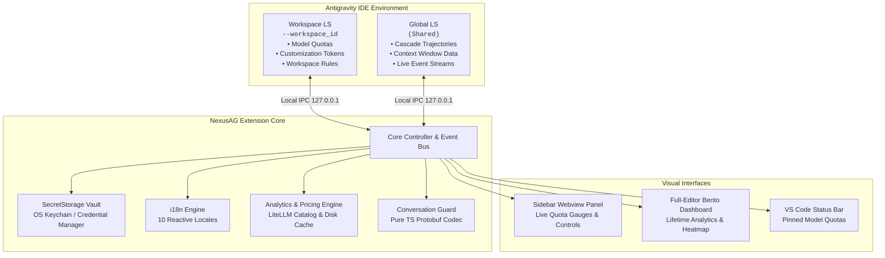

<p align="center">
  <a href="../../README.md">English</a> •
  <a href="README.tr.md">Türkçe</a> •
  <a href="README.pt-BR.md">Português</a> •
  <a href="README.es.md">Español</a> •
  <a href="README.de.md">Deutsch</a> •
  <a href="README.fr.md">Français</a> •
  <a href="README.ja.md"><b>日本語</b></a> •
  <a href="README.zh-CN.md">简体中文</a> •
  <a href="README.hi.md">हिन्दी</a> •
  <a href="README.ru.md">Русский</a>
</p>

<p align="center">
  
</p>

<p align="center">
  <a href="https://github.com/AlperenAKKAYA99/NexusAG/releases"></a>
  
  
  
  
  
  
</p>

---

# NexusAG

**NexusAG** は、**Google Antigravity IDE** のために設計された次世代のインテリジェント・コントロールパネルです。ワンクリックでのアカウント切り替え、複数 Google プロファイルのリアルタイム AI クォータ容量監視、コンテキストウィンドウのトークン詳細ツリー分析、ディスクからの消失会話履歴の自動復旧、そしてエディタ全画面ダッシュボードによる全期間トークン消費分析を提供します。

---

## ⚡ 60秒クイックスタート

1. **インストール** — Antigravity 拡張機能マーケットプレイスで `NexusAG` を検索するか、`.vsix` パッケージをインストールします。
2. **アカウント追加** — サイドバーの `+` アイコンをクリックして Google OAuth ログインするか、`🔑` でトークンを貼り付けます。
3. **監視と切り替え** — リアルタイムのクォータメーター、リセットタイマー、トークン分析が即座に有効化されます！

---

## 📸 マルチアカウント切替盤 ＆ UI ギャラリー (UI Showcase)

<table align="center" width="100%">
  <tr>
    <td align="center" width="25%" valign="top">
      <br/>
      <sub><b>⚡ マルチアカウント切替盤</b><br/>ワンクリック切替、リアルタイム利用枠進捗＆リセットタイマー</sub>
    </td>
    <td align="center" width="25%" valign="top">
      <br/>
      <sub><b>🔑 トークンバジェット＆コンテキスト</b><br/>カスタマイズドーナツ、アクティブセッション枠＆ルール</sub>
    </td>
    <td align="center" width="25%" valign="top">
      <br/>
      <sub><b>📈 利用統計（サイドバー）</b><br/>セッショントークン合計、時間別アクティビティ＆月別コスト</sub>
    </td>
    <td align="center" width="25%" valign="top">
      <br/>
      <sub><b>🌐 設定＆10言語ハブ</b><br/>即時リアクティブ言語切替、ポーリング間隔＆復元スキャン</sub>
    </td>
  </tr>
  <tr>
    <td align="center" width="25%" valign="top">
      <br/>
      <sub><b>🔑 トークン一括追加モーダル</b><br/>検証機能付き OAuth リフレッシュトークンの一括登録</sub>
    </td>
    <td align="center" width="25%" valign="top">
      <br/>
      <sub><b>🔒 シームレスな Google OAuth 認証</b><br/>自動クローズ対応のワンクリック・ブラウザ認証フロー</sub>
    </td>
    <td align="center" colspan="2" valign="top">
      <br/>
      <sub><b>🔍 コンテキストウィンドウ詳細（エディタタブ）</b><br/>階層化ステップツリー、トークンカテゴリ分類＆Markdown出力</sub>
    </td>
  </tr>
  <tr>
    <td align="center" colspan="4" valign="top">
      <br/>
      <sub><b>📊 トークン詳細分析 Bento ダッシュボード（全画面エディタ）</b><br/>全履歴の会話監査、GitHub風活動ヒートマップ、モデル別コスト表＆会話ランキング</sub>
    </td>
  </tr>
</table>

---

## ✨ 主な機能と特徴

### ⚡ マルチアカウント切替盤とリアルタイム利用枠監視
- **無制限のアカウント登録** — 複数の Google アカウントを競合なく同時に監視できます。
- **ワンクリック即時切り替え** — メニューを開くことなく、サイドバーから直接アクティブアカウントを即座に切り替えます。
- **カラー別リアルタイムゲージ** — 残量に応じた色分け表示（🟢 >50%、🟡 20-50%、🔴 <20%）と正確なリセットカウントダウン。
- **ステータスバー連動** — お気に入りモデルに星（★）を付けることで、パネルを開かずにステータスバーで枠を常時確認可能。
- **プロアクティブなトークン更新** — バックグラウンドでアクセストークンを自動更新し、長時間の開発セッションでも認証切れを防止します。
- **プラン情報の可視化** — Ultra、Premium、Free などのプラン階層とクレジット残量を即時表示。

### 🌍 100% 完全多言語対応・即時リアクティブ切替
- **10の主要言語をネイティブサポート**: 英語、トルコ語、ポルトガル語、スペイン語、ドイツ語、フランス語、日本語、簡体字中国語、ヒンディー語、ロシア語。
- **リロード不要のリアクティブ切替** — 設定タブで言語を選択すると、サイドバー、全画面 Bento ダッシュボード、コンテキスト詳細画面、ダイアログに至るまで **100% の UI が瞬時に切り替わります**。

### 🔑 トークンバジェット＆コンテキスト・インテリジェンス
- **カスタマイズバジェット・ドーナツ** — MCP ツール、Rules、Workflows、Skills ごとの消費量を視覚化。
- **アクティブコンテキスト利用枠** — 使用中トークン数とモデルの上限値をリアルタイムで比較。
- **ワークスペースコンテキスト検査** — `.agent/` ディレクトリ内のルールへの直接ファイルリンクとトリガー状態を表示。

### 🔍 コンテキストウィンドウ詳細分析（全画面エディタタブ）
- サイドバーの **"すべて見る →"** からワンクリックで展開。
- **階層化ステップツリー** — System Prompt、ツール呼び出し、MCP、チャット履歴ごとのトークン数と割合。
- **インライン・ステッププレビュー** — IDE を離れることなく、プロンプトやモデル応答、コマンド出力を直接プレビュー。
- **炎バッジ（🔥）** — コンテキストを最も圧迫している重いステップを瞬時に識別。
- **Markdown エクスポート** — ワンクリックでレポートをコピーまたはファイル保存。

### 📈 トークン詳細分析＆ Bento ダッシュボード
- **"全画面ダッシュボードを開く →"** から起動。
- **全履歴スキャン** — Antigravity 上で行われた過去すべての会話からトークン消費を集計。
- **9つの主要 KPI 指標** — 入力、キャッシュ読み取り、出力、思考トークン、API コスト試算、キャッシュ率。
- **GitHub スタイル・アクティビティヒートマップ** — 365日間の活動グリッドとピーク日表示。
- **LiteLLM 動的プライシング** — 各モデルの最新単価に基づいた高精度な API 利用コスト算出。

### 🛡️ 会話履歴復元ガード（Conversation Guard）
- **消失会話の自動検知** — 起動15秒後にディスク上の `.pb` ファイルとサイドバー索引を照合。
- **ワンクリック復旧** — 安全に AG を終了し、ディスクからインデックスを再構築して IDE を自動再起動します。

---

## 🔒 セキュリティとプライバシー

- **100% ローカル完結** — 会話履歴、プロンプト、ソースコードが外部サーバーへ送信されることは一切ありません。
- **OS レベルの認証情報暗号化** — OAuth トークンは VS Code ネイティブの `SecretStorage`（macOS キーチェーン、Windows 資格情報マネージャー、Linux Secret Service）に暗号化保存されます。
- **完全ローカル通信** — Language Server との通信は `127.0.0.1` ループバック IPC ソケットのみに限定されます。
- **ランタイム依存ゼロ（0）** — サプライチェーン攻撃リスクを完全に排除するため、外部 npm パッケージへの実行時依存は **0** です。
- **公式 API のみ使用** — 公式 Google OAuth および Cloud Code Quota API エンドポイント以外への外部通信は行いません。
- **セキュリティ監査済み** — 包括的セキュリティ監査レポート：[CYBER_SECURITY_AUDIT_REPORT.md](CYBER_SECURITY_AUDIT_REPORT.md)（重大な脆弱性 0件、バックドア 0件）。
- **完全オープンソース** — **MIT ライセンス**の下、全コードが公開・検証可能です。

---

## 🏗️ Architecture & Internal Mechanics



---

## 🚀 はじめ方

### Installation
1. Antigravity 拡張機能マーケットプレイスで **NexusAG** を検索し、**インストール** をクリックします。
2. または `.vsix` ファイルから直接インストールします:
```bash
antigravity-ide.cmd --install-extension nexus-ag-1.1.1.vsix --force
```

---

## ⌨️ Command Palette

| Command | Identifier | Description |
|---|---|---|
| **NexusAG: Refresh Quota** | `ag.refreshQuota` | Forces an immediate quota and token budget refresh from Google APIs. |
| **NexusAG: Add Account** | `ag.addAccount` | Opens browser window for 1-click Google OAuth authentication. |
| **NexusAG: Add Account via Token** | `ag.addAccountByToken` | Opens modal for batch importing OAuth refresh tokens. |
| **NexusAG: Remove Account** | `ag.removeAccount` | Removes a selected account from local storage and tracking. |
| **NexusAG: Open Usage Statistics** | `ag.openUsageStats` | Launches the full-editor deep analytics bento dashboard. |
| **NexusAG: Fix Missing Conversations** | `ag.fixConversations` | Scans disk storage and repairs unindexed `.pb` conversations. |

---

## ⚙️ Configuration Settings

| Setting | Type | Default | Description |
|---|---|---|---|
| `ag-switchboard.language` | `string` | `auto` | Interface language (`auto`, `en`, `tr`, `pt-BR`, `es`, `de`, `fr`, `ja`, `zh-CN`, `hi`, `ru`). |
| `ag-switchboard.refreshInterval` | `string` | `1m` | Background polling frequency for quota updates (`instant`, `30s`, `1m`, `2m`, `5m`). |
| `ag-switchboard.modelPricing` | `object` | Defaults | Custom per-model rates per 1M tokens (`input`, `output`, `cache`). |
| `ag-switchboard.switchWithFixConversations` | `boolean` | `true` | Automatically synchronizes and repairs the conversation index on account switch. |
| `ag-switchboard.diagnosticMode` | `boolean` | `false` | Enables verbose diagnostic file logging for troubleshooting. |

---

## 📊 Project Stats

<div align="center">

| Metric | Specification |
|---|---|
| **Total Source Modules** | 60 TypeScript + 2 CSS files |
| **Codebase Volume** | ~19,200+ Lines of Code |
| **Runtime Dependencies** | **0** (Zero external dependencies) |
| **Build System** | esbuild (Sub-second webview bundling) |
| **Supported Locales** | 10 Native Languages (251 keys each, 100% parity) |
| **Security Audit** | Passed — 0 critical / high findings |
| **Supported Platforms** | macOS (Apple Silicon / Intel), Windows 10/11, Linux (x64/arm64) |

</div>

---

## 🛠️ Built With

- **[TypeScript](https://www.typescriptlang.org/)** — End-to-end static typing and enterprise resilience
- **[esbuild](https://esbuild.github.io/)** — Lightning-fast compilation and optimized asset packaging
- **[Font Awesome Pro](https://fontawesome.com/)** — Crisp, modern vector iconography
- **[LiteLLM Pricing Catalog](https://github.com/BerriAI/litellm)** — Accurate, community-maintained AI token pricing
- **Native VS Code API** — Deep integration with `SecretStorage`, `WebviewViewProvider`, and `StatusBarItem`

---

## ❓ Frequently Asked Questions (FAQ)

<details>
<summary><b>Is my code, prompt, or account data sent to any third-party servers?</b></summary>
<br/>
<b>No.</b> NexusAG operates with a strict zero-telemetry policy. The extension communicates exclusively with official Google authentication and quota APIs, and with your local Antigravity Language Server on <code>127.0.0.1</code>. No analytics, transcripts, or telemetry are ever collected or transmitted.
</details>

<details>
<summary><b>Where are my Google credentials and OAuth tokens stored?</b></summary>
<br/>
All authentication tokens are secured using VS Code's native <code>SecretStorage</code> API (macOS Keychain, Windows Credential Manager, or Linux Secret Service/Keyring).
</details>

<details>
<summary><b>Why does NexusAG have zero (0) runtime dependencies?</b></summary>
<br/>
To eliminate supply-chain vulnerability vectors, minimize package bundle size, and guarantee maximum execution speed. All protocol handling—including Protobuf binary encoding and decoding—is custom-built in native TypeScript.
</details>

---

## 🤝 Contributing & Development

Contributions, bug reports, and feature suggestions are warmly welcomed!

1. Fork the repository: `git clone https://github.com/AlperenAKKAYA99/NexusAG.git`
2. Install development dependencies: `npm install`
3. Compile the extension & webviews: `npm run compile`
4. Launch Extension in Debug Mode (`F5` in VS Code / Antigravity IDE)
---

## 📋 Changelog Highlights

For the full release history, see [CHANGELOG.md](CHANGELOG.md).

- **v1.1.1 (Current)** — Bulk token export & copy system with smart round-trip extraction, clipboard auto-clearing timer, and enhanced multi-account security.
- **v1.1.0** — 10-language instant reactive localization, multi-banner asset generation, enhanced UI showcase, and unified branding.
- **v1.0.5** — Usage Stats deduplication via `responseId`, dynamic model auto-humanization, and quota 100% bugfix.
- **v1.0.4** — **Conversation Guard**, standalone detached repair worker, and pure-TypeScript Protobuf trajectory codec for orphaned conversation recovery.
- **v1.0.3** — Multi-window state isolation, USS event gating, and background polling resilience.
- **v1.0.2** — Cross-source pin matching (★), status bar quota integration, heatmap cost tooltips, and diagnostic logging harness.
- **v1.0.1** — Dual-LS architecture, full context window drill-down tab, and live event stream monitoring.
- **v1.0.0** — Initial public release: 1-click Google account switching, full-editor bento analytics, GitHub-style activity heatmap, and SecretStorage vault.

---

## 📄 License & Author

**MIT ライセンス**の下で公開されています。Made with ☕ by **[Alperen AKKAYA](https://github.com/AlperenAKKAYA99)**

