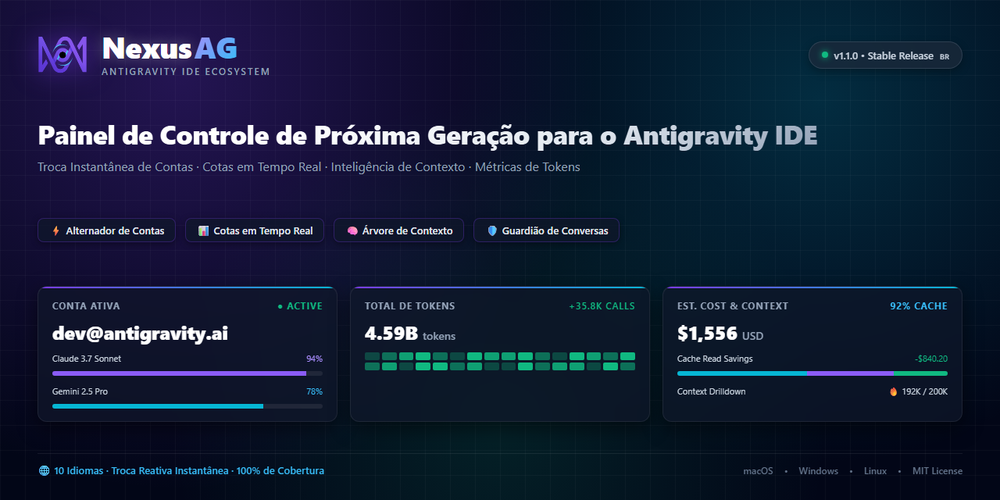
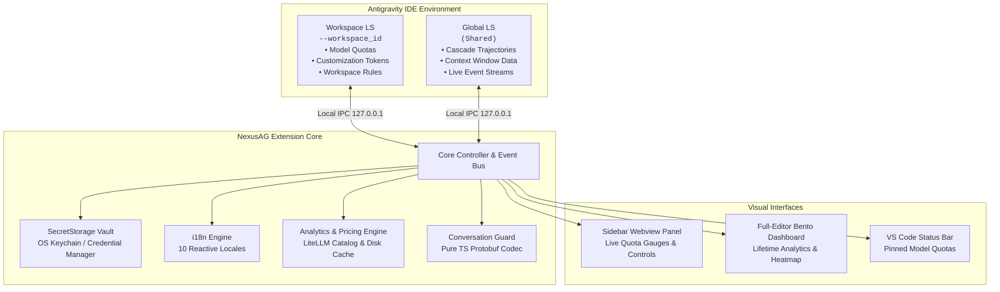

<p align="center">
  <a href="../../README.md">English</a> •
  <a href="README.tr.md">Türkçe</a> •
  <a href="README.pt-BR.md"><b>Português</b></a> •
  <a href="README.es.md">Español</a> •
  <a href="README.de.md">Deutsch</a> •
  <a href="README.fr.md">Français</a> •
  <a href="README.ja.md">日本語</a> •
  <a href="README.zh-CN.md">简体中文</a> •
  <a href="README.hi.md">हिन्दी</a> •
  <a href="README.ru.md">Русский</a>
</p>

<p align="center">
  
</p>

<p align="center">
  <a href="https://github.com/AlperenAKKAYA99/NexusAG/releases"></a>
  
  
  
  
  
  
</p>

---

# NexusAG

**NexusAG** é o painel de controle e suíte de inteligência de última geração desenvolvido para o **Google Antigravity IDE**. Permite alternar contas com 1 clique, monitorar cotas de IA em tempo real em múltiplos perfis Google, inspecionar a janela de contexto token por token, recuperar conversas perdidas do disco e analisar o consumo de tokens de todo o histórico com um painel analítico completo no editor.

---

## ⚡ Comece em 60 Segundos

1. **Instalar** — Busque por `NexusAG` no marketplace do Antigravity ou instale o pacote `.vsix`.
2. **Adicionar Conta** — Clique em `+` na barra lateral para login Google OAuth no navegador ou use `🔑` para colar tokens.
3. **Monitorar & Alternar** — Seus medidores de cota em tempo real, contagens regressivas e métricas estão imediatamente ativos!

---

## 📸 Alternador de Contas e Galeria de Interface (UI Showcase)

<table align="center" width="100%">
  <tr>
    <td align="center" width="25%" valign="top">
      <br/>
      <sub><b>⚡ Alternador de Contas</b><br/>Troca de conta em 1 clique, progresso de cotas e timers de reset</sub>
    </td>
    <td align="center" width="25%" valign="top">
      <br/>
      <sub><b>🔑 Orçamento de Tokens e Contexto</b><br/>Donut de customizações, medidor da sessão e regras</sub>
    </td>
    <td align="center" width="25%" valign="top">
      <br/>
      <sub><b>📈 Métricas de Uso (Sidebar)</b><br/>Totais de tokens da sessão, atividade horária e custos mensais</sub>
    </td>
    <td align="center" width="25%" valign="top">
      <br/>
      <sub><b>🌐 Configurações e Hub de 10 Idiomas</b><br/>Seletor reativo de idiomas, intervalos de atualização e reparo</sub>
    </td>
  </tr>
  <tr>
    <td align="center" width="25%" valign="top">
      <br/>
      <sub><b>🔑 Adicionar Contas via Token</b><br/>Inserção em lote de refresh tokens OAuth com validação</sub>
    </td>
    <td align="center" width="25%" valign="top">
      <br/>
      <sub><b>🔒 Autenticação Google OAuth Sem Fricção</b><br/>Login via navegador com 1 clique e retorno automático</sub>
    </td>
    <td align="center" colspan="2" valign="top">
      <br/>
      <sub><b>🔍 Detalhes da Janela de Contexto (Aba do Editor)</b><br/>Árvore hierárquica de etapas, categorias de tokens e exportação</sub>
    </td>
  </tr>
  <tr>
    <td align="center" colspan="4" valign="top">
      <br/>
      <sub><b>📊 Painel Bento de Análise Profunda de Tokens (Editor Completo)</b><br/>Auditoria de todo o histórico, heatmap estilo GitHub, distribuição de custos e top conversas</sub>
    </td>
  </tr>
</table>

---

## ✨ Principais Recursos e Destaques

### ⚡ Alternador de Contas e Monitoramento de Cotas
- **Contas Ilimitadas** — Monitore múltiplas contas Google simultaneamente sem conflitos.
- **Troca com 1 Clique** — Alterne a conta ativa no IDE diretamente pela barra lateral instantaneamente.
- **Medidores de Cota em Tempo Real** — Barras de capacidade coloridas (🟢 >50%, 🟡 20-50%, 🔴 <20%) e contagens regressivas exatas para o reset.
- **Integração com a Barra de Status** — Marque seus modelos favoritos com estrela (★) para visualização rápida na barra de status.
- **Renovação Proativa de Token** — Atualização automática do access_token em segundo plano evita erros 401 durante sessões longas.
- **Informações do Plano** — Identificação imediata da camada de assinatura (Ultra, Premium, Free) e créditos de prompt/fluxo.

### 🌍 100% Internacionalização e Troca Reativa Instantânea
- **10 Idiomas Nativos**: Inglês, Turco, Português (Brasil), Espanhol, Alemão, Francês, Japonês, Chinês Simplificado, Hindi e Russo.
- **Troca Reativa Sem Recarregar** — Mudar de idioma na aba Configurações traduz instantaneamente **100%** da interface (Sidebar, Painel Bento no Editor, Detalhes de Contexto e diálogos) sem necessidade de reiniciar.

### 🔑 Orçamento de Tokens e Inteligência de Contexto
- **Gráfico Donut de Customizações** — Consumo de tokens para Ferramentas MCP, Regras, Fluxos e Skills.
- **Medidor de Contexto Ativo** — Monitoramento em tempo real do limite de contexto do modelo versus tokens consumidos.
- **Inspetor de Espaço de Trabalho** — Links diretos para regras e workflows em `.agent/` com modos de ativação.

### 🔍 Detalhamento da Janela de Contexto (Aba de Editor Completa)
- Acesse com um clique através do botão **"Ver Tudo →"**.
- **Árvore Hierárquica** — Divisão detalhada de System Prompt, Ferramentas, MCP e Mensagens de Chat com porcentagens exatas.
- **Prévia de Etapas Inline** — Inspecione o conteúdo de cada etapa sem sair do IDE.
- **Insígnias de Chamas (🔥)** — Destaca visualmente os maiores consumidores de contexto.
- **Exportação em Markdown** — Copie ou salve relatórios completos de contexto.

### 📈 Análise Profunda de Tokens e Painel Bento
- Acesse através do botão **"Abrir Painel Completo →"**.
- **Agregação Histórica** — Analisa cada conversa registrada no Antigravity desde a instalação.
- **9 Métricas KPI** — Tokens de Entrada, Cache, Saída, Raciocínio, chamadas totais, custo estimado e taxa de acerto de cache.
- **Heatmap Estilo GitHub** — Grade de atividade anual com seletor de ano e indicadores de picos.
- **Cálculo Dinâmico com LiteLLM** — Estimativa precisa de custos de API por modelo.

### 🛡️ Guardião de Conversas (Conversation Guard)
- **Detecção Automática** — Compara arquivos locais `.pb` do disco com o índice da barra lateral 15s após a inicialização.
- **Reparo com 1 Clique** — Fecha o AG com segurança, reconstrói o índice do zero e reinicia o IDE sem perda de dados.

---

## 🔒 Segurança e Privacidade

- **100% Dados Locais** — Nenhum dado de conversa, prompt ou código sai do seu computador.
- **Criptografia no Nível do SO** — Tokens OAuth armazenados no `SecretStorage` nativo do VS Code (macOS Keychain, Windows Credential Manager, Linux Secret Service).
- **Comunicação Estritamente Local** — Toda comunicação com Language Servers é feita via sockets IPC `127.0.0.1`.
- **Zero (0) Dependências de Execução** — Cadeia de suprimentos limpa com **0 pacotes npm de runtime**. Tudo feito em TypeScript puro.
- **Apenas APIs Oficiais** — Comunicação restrita às APIs oficiais do Google OAuth e Cloud Code Quota.
- **Auditoria de Segurança** — Relatório completo: [CYBER_SECURITY_AUDIT_REPORT.md](CYBER_SECURITY_AUDIT_REPORT.md) (0 vulnerabilidades críticas, 0 backdoors).
- **Código Aberto** — Totalmente transparente sob a **Licença MIT**.

---

## 🏗️ Architecture & Internal Mechanics



---

## 🚀 Primeiros Passos

### Installation
1. Procure por **NexusAG** no marketplace de extensões do Antigravity e clique em **Instalar**.
2. Ou instale via arquivo `.vsix`:
```bash
antigravity-ide.cmd --install-extension nexus-ag-1.1.0.vsix --force
```

---

## ⌨️ Command Palette

| Command | Identifier | Description |
|---|---|---|
| **NexusAG: Refresh Quota** | `ag.refreshQuota` | Forces an immediate quota and token budget refresh from Google APIs. |
| **NexusAG: Add Account** | `ag.addAccount` | Opens browser window for 1-click Google OAuth authentication. |
| **NexusAG: Add Account via Token** | `ag.addAccountByToken` | Opens modal for batch importing OAuth refresh tokens. |
| **NexusAG: Remove Account** | `ag.removeAccount` | Removes a selected account from local storage and tracking. |
| **NexusAG: Open Usage Statistics** | `ag.openUsageStats` | Launches the full-editor deep analytics bento dashboard. |
| **NexusAG: Fix Missing Conversations** | `ag.fixConversations` | Scans disk storage and repairs unindexed `.pb` conversations. |

---

## ⚙️ Configuration Settings

| Setting | Type | Default | Description |
|---|---|---|---|
| `ag-switchboard.language` | `string` | `auto` | Interface language (`auto`, `en`, `tr`, `pt-BR`, `es`, `de`, `fr`, `ja`, `zh-CN`, `hi`, `ru`). |
| `ag-switchboard.refreshInterval` | `string` | `1m` | Background polling frequency for quota updates (`instant`, `30s`, `1m`, `2m`, `5m`). |
| `ag-switchboard.modelPricing` | `object` | Defaults | Custom per-model rates per 1M tokens (`input`, `output`, `cache`). |
| `ag-switchboard.switchWithFixConversations` | `boolean` | `true` | Automatically synchronizes and repairs the conversation index on account switch. |
| `ag-switchboard.diagnosticMode` | `boolean` | `false` | Enables verbose diagnostic file logging for troubleshooting. |

---

## 📊 Project Stats

<div align="center">

| Metric | Specification |
|---|---|
| **Total Source Modules** | 60 TypeScript + 2 CSS files |
| **Codebase Volume** | ~19,200+ Lines of Code |
| **Runtime Dependencies** | **0** (Zero external dependencies) |
| **Build System** | esbuild (Sub-second webview bundling) |
| **Supported Locales** | 10 Native Languages (251 keys each, 100% parity) |
| **Security Audit** | Passed — 0 critical / high findings |
| **Supported Platforms** | macOS (Apple Silicon / Intel), Windows 10/11, Linux (x64/arm64) |

</div>

---

## 🛠️ Built With

- **[TypeScript](https://www.typescriptlang.org/)** — End-to-end static typing and enterprise resilience
- **[esbuild](https://esbuild.github.io/)** — Lightning-fast compilation and optimized asset packaging
- **[Font Awesome Pro](https://fontawesome.com/)** — Crisp, modern vector iconography
- **[LiteLLM Pricing Catalog](https://github.com/BerriAI/litellm)** — Accurate, community-maintained AI token pricing
- **Native VS Code API** — Deep integration with `SecretStorage`, `WebviewViewProvider`, and `StatusBarItem`

---

## ❓ Frequently Asked Questions (FAQ)

<details>
<summary><b>Is my code, prompt, or account data sent to any third-party servers?</b></summary>
<br/>
<b>No.</b> NexusAG operates with a strict zero-telemetry policy. The extension communicates exclusively with official Google authentication and quota APIs, and with your local Antigravity Language Server on <code>127.0.0.1</code>. No analytics, transcripts, or telemetry are ever collected or transmitted.
</details>

<details>
<summary><b>Where are my Google credentials and OAuth tokens stored?</b></summary>
<br/>
All authentication tokens are secured using VS Code's native <code>SecretStorage</code> API (macOS Keychain, Windows Credential Manager, or Linux Secret Service/Keyring).
</details>

<details>
<summary><b>Why does NexusAG have zero (0) runtime dependencies?</b></summary>
<br/>
To eliminate supply-chain vulnerability vectors, minimize package bundle size, and guarantee maximum execution speed. All protocol handling—including Protobuf binary encoding and decoding—is custom-built in native TypeScript.
</details>

---

## 🤝 Contributing & Development

Contributions, bug reports, and feature suggestions are warmly welcomed!

1. Fork the repository: `git clone https://github.com/AlperenAKKAYA99/NexusAG.git`
2. Install development dependencies: `npm install`
3. Compile the extension & webviews: `npm run compile`
4. Launch Extension in Debug Mode (`F5` in VS Code / Antigravity IDE)
---

## 📋 Changelog Highlights

For the full release history, see [CHANGELOG.md](CHANGELOG.md).

- **v1.1.0 (Current)** — 10-language instant reactive localization, multi-banner asset generation, enhanced UI showcase, and unified branding.
- **v1.0.5** — Usage Stats deduplication via `responseId`, dynamic model auto-humanization, and quota 100% bugfix.
- **v1.0.4** — **Conversation Guard**, standalone detached repair worker, and pure-TypeScript Protobuf trajectory codec for orphaned conversation recovery.
- **v1.0.3** — Multi-window state isolation, USS event gating, and background polling resilience.
- **v1.0.2** — Cross-source pin matching (★), status bar quota integration, heatmap cost tooltips, and diagnostic logging harness.
- **v1.0.1** — Dual-LS architecture, full context window drill-down tab, and live event stream monitoring.
- **v1.0.0** — Initial public release: 1-click Google account switching, full-editor bento analytics, GitHub-style activity heatmap, and SecretStorage vault.

---

## 📄 License & Author

Distribuído sob a **Licença MIT**. Desenvolvido com ☕ por **[Alperen AKKAYA](https://github.com/AlperenAKKAYA99)**

