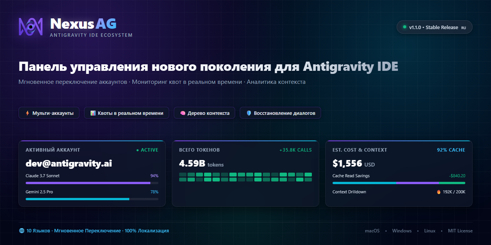
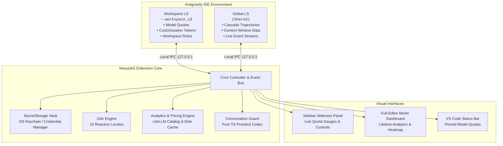

<p align="center">
  <a href="../../README.md">English</a> •
  <a href="README.tr.md">Türkçe</a> •
  <a href="README.pt-BR.md">Português</a> •
  <a href="README.es.md">Español</a> •
  <a href="README.de.md">Deutsch</a> •
  <a href="README.fr.md">Français</a> •
  <a href="README.ja.md">日本語</a> •
  <a href="README.zh-CN.md">简体中文</a> •
  <a href="README.hi.md">हिन्दी</a> •
  <a href="README.ru.md"><b>Русский</b></a>
</p>

<p align="center">
  
</p>

<p align="center">
  <a href="https://github.com/AlperenAKKAYA99/NexusAG/releases"></a>
  
  
  
  
  
  
</p>

---

# NexusAG

**NexusAG** — это панель управления нового поколения и интеллектуальный центр для **Google Antigravity IDE**. Расширение позволяет разработчикам переключать учетные записи в 1 клик, отслеживать лимиты AI в реальном времени для нескольких профилей Google, детально исследовать окно контекста, восстанавливать утерянные диалоги с диска и проводить глубокий финансовый аудит расходов на токены через полноэкранный дашборд.

---

## ⚡ Быстрый старт за 60 секунд

1. **Установка** — Найдите `NexusAG` в Marketplace расширений Antigravity или установите пакет `.vsix`.
2. **Добавление аккаунта** — Нажмите иконку `+` на боковой панели для входа через Google OAuth или используйте `🔑` для вставки токенов.
3. **Мониторинг и переключение** — Ваши шкалы квот, таймеры сброса и пожизненная аналитика токенов сразу активны!

---

## 📸 Мульти-аккаунты и галерея интерфейса (UI Showcase)

<table align="center" width="100%">
  <tr>
    <td align="center" width="25%" valign="top">
      <br/>
      <sub><b>⚡ Мульти-аккаунты</b><br/>Переключение в 1 клик, прогресс квот и таймеры сброса</sub>
    </td>
    <td align="center" width="25%" valign="top">
      <br/>
      <sub><b>🔑 Бюджет токенов и контекст</b><br/>Кольцевая диаграмма кастомизаций, активная сессия и правила</sub>
    </td>
    <td align="center" width="25%" valign="top">
      <br/>
      <sub><b>📈 Статистика использования (Боковая панель)</b><br/>Итоги токенов сессии, почасовая активность и помесячные затраты</sub>
    </td>
    <td align="center" width="25%" valign="top">
      <br/>
      <sub><b>🌐 Настройки и 10 языков</b><br/>Мгновенный переключатель языка, интервалы опроса и сканирование</sub>
    </td>
  </tr>
  <tr>
    <td align="center" width="25%" valign="top">
      <br/>
      <sub><b>🔑 Добавление аккаунтов по токену</b><br/>Пакетный ввод OAuth refresh-токенов с валидацией</sub>
    </td>
    <td align="center" width="25%" valign="top">
      <br/>
      <sub><b>🔒 Бесшовная авторизация Google OAuth</b><br/>Вход через браузер в 1 клик с автоматическим возвратом</sub>
    </td>
    <td align="center" colspan="2" valign="top">
      <br/>
      <sub><b>🔍 Детализация окна контекста (Вкладка редактора)</b><br/>Иерархическое дерево шагов, категории токенов и экспорт в Markdown</sub>
    </td>
  </tr>
  <tr>
    <td align="center" colspan="4" valign="top">
      <br/>
      <sub><b>📊 Полноэкранный дашборд Bento глубокой аналитики токенов</b><br/>Аудит диалогов за все время, тепловая карта GitHub, расчет затрат по моделям и топ диалогов</sub>
    </td>
  </tr>
</table>

---

## ✨ Ключевые возможности

### ⚡ Мульти-аккаунты и мониторинг квот в реальном времени
- **Неограниченное число аккаунтов** — Одновременное отслеживание нескольких аккаунтов Google без конфликтов.
- **Мгновенное переключение в 1 клик** — Меняйте активный профиль IDE прямо из боковой панели без выхода из системы.
- **Цветовая индикация емкости** — Наглядные индикаторы (🟢 >50%, 🟡 20-50%, 🔴 <20%) и точные таймеры сброса лимитов.
- **Интеграция со строкой состояния** — Закрепляйте модели звездочкой (★) для постоянного контроля в строке состояния.
- **Упреждающее обновление токенов** — Фоновое обновление access_token предотвращает ошибки авторизации 401.
- **Сведения о тарифе** — Отображение уровня подписки (Ultra, Premium, Free) и остатка кредитов.

### 🌍 100% Мультиязычность и мгновенное переключение
- **10 встроенных языков**: английский, турецкий, португальский, испанский, немецкий, французский, японский, китайский, хинди и русский.
- **Мгновенный отклик без перезагрузки** — При выборе языка в настройках **100% интерфейса мгновенно переводится** (боковая панель, аналитический дашборд Bento, инспектор контекста и диалоговые окна).

### 🔑 Бюджет токенов и аналитика контекста
- **Диаграмма кастомизаций** — Точный объем токенов для MCP Tools, Rules, Workflows и Skills.
- **Индикатор активного контекста** — Сравнение использованных токенов с максимальным лимитом модели в реальном времени.
- **Инспектор правил рабочей области** — Быстрый переход к файлам в `.agent/` с указанием режимов активации.

### 🔍 Детализация окна контекста (Отдельная вкладка редактора)
- Открывается в 1 клик по кнопке **"Показать все →"**.
- **Иерархическое дерево** — Полная разбивка системного промпта, инструментов, MCP и истории сообщений с процентами.
- **Встроенный просмотр шагов** — Просматривайте промпты, ответы модели и выводы команд прямо в интерфейсе.
- **Значки пламени (🔥)** — Мгновенно подсвечивают самые ресурсоемкие шаги в контексте.
- **Экспорт в Markdown** — Копируйте отчеты о контексте или сохраняйте их в файл.

### 📈 Глубокая аналитика токенов и дашборд Bento
- Открывается по кнопке **"Открыть полный дашборд →"**.
- **Анализ за все время** — Сканирует и суммирует использование токенов по всем диалогам за историю использования Antigravity.
- **9 ключевых метрик KPI** — Входные, кэшированные, выходные токены, токены рассуждений, общее число вызовов и коэффициент кэша.
- **Тепловая карта в стиле GitHub** — Сетка активности за 365 дней с возможностью выбора года.
- **Динамический расчет цен LiteLLM** — Точная оценка затрат на API по актуальным тарифам.

### 🛡️ Защита диалогов (Conversation Guard)
- **Автоматический поиск утерянных диалогов** — Сравнивает локальные файлы `.pb` с индексом через 15 секунд после запуска.
- **Восстановление в 1 клик** — Безопасно закрывает AG, заново пересобирает индекс с диска и перезапускает IDE без потери данных.

---

## 🔒 Безопасность и приватность

- **100% Локальные данные** — Никакие диалоги, промпты или файлы никогда не покидают ваше устройство.
- **Шифрование на уровне ОС** — Токены OAuth защищены через встроенный `SecretStorage` VS Code (macOS Keychain, Windows Credential Manager, Linux Secret Service).
- **Строго локальное взаимодействие** — Связь с Language Server происходит исключительно через сокеты IPC на `127.0.0.1`.
- **Ноль (0) зависимостей времени выполнения** — Чистая цепочка поставок с **0 сторонних пакетов npm в runtime**. Написано на чистом TypeScript.
- **Только официальные API** — Запросы ограничены исключительно официальными API Google OAuth и Cloud Code Quota.
- **Пройден аудит безопасности** — Полный отчет: [CYBER_SECURITY_AUDIT_REPORT.md](CYBER_SECURITY_AUDIT_REPORT.md) (0 критических уязвимостей, 0 бэкдоров).
- **Открытый исходный код** — Полная прозрачность под **лицензией MIT**.

---

## 🏗️ Architecture & Internal Mechanics



---

## 🚀 С чего начать

### Installation
1. Найдите **NexusAG** в Marketplace расширений Antigravity и нажмите **Установить**.
2. Или установите напрямую из файла `.vsix`:
```bash
antigravity-ide.cmd --install-extension nexus-ag-1.1.0.vsix --force
```

---

## ⌨️ Command Palette

| Command | Identifier | Description |
|---|---|---|
| **NexusAG: Refresh Quota** | `ag.refreshQuota` | Forces an immediate quota and token budget refresh from Google APIs. |
| **NexusAG: Add Account** | `ag.addAccount` | Opens browser window for 1-click Google OAuth authentication. |
| **NexusAG: Add Account via Token** | `ag.addAccountByToken` | Opens modal for batch importing OAuth refresh tokens. |
| **NexusAG: Remove Account** | `ag.removeAccount` | Removes a selected account from local storage and tracking. |
| **NexusAG: Open Usage Statistics** | `ag.openUsageStats` | Launches the full-editor deep analytics bento dashboard. |
| **NexusAG: Fix Missing Conversations** | `ag.fixConversations` | Scans disk storage and repairs unindexed `.pb` conversations. |

---

## ⚙️ Configuration Settings

| Setting | Type | Default | Description |
|---|---|---|---|
| `ag-switchboard.language` | `string` | `auto` | Interface language (`auto`, `en`, `tr`, `pt-BR`, `es`, `de`, `fr`, `ja`, `zh-CN`, `hi`, `ru`). |
| `ag-switchboard.refreshInterval` | `string` | `1m` | Background polling frequency for quota updates (`instant`, `30s`, `1m`, `2m`, `5m`). |
| `ag-switchboard.modelPricing` | `object` | Defaults | Custom per-model rates per 1M tokens (`input`, `output`, `cache`). |
| `ag-switchboard.switchWithFixConversations` | `boolean` | `true` | Automatically synchronizes and repairs the conversation index on account switch. |
| `ag-switchboard.diagnosticMode` | `boolean` | `false` | Enables verbose diagnostic file logging for troubleshooting. |

---

## 📊 Project Stats

<div align="center">

| Metric | Specification |
|---|---|
| **Total Source Modules** | 60 TypeScript + 2 CSS files |
| **Codebase Volume** | ~19,200+ Lines of Code |
| **Runtime Dependencies** | **0** (Zero external dependencies) |
| **Build System** | esbuild (Sub-second webview bundling) |
| **Supported Locales** | 10 Native Languages (251 keys each, 100% parity) |
| **Security Audit** | Passed — 0 critical / high findings |
| **Supported Platforms** | macOS (Apple Silicon / Intel), Windows 10/11, Linux (x64/arm64) |

</div>

---

## 🛠️ Built With

- **[TypeScript](https://www.typescriptlang.org/)** — End-to-end static typing and enterprise resilience
- **[esbuild](https://esbuild.github.io/)** — Lightning-fast compilation and optimized asset packaging
- **[Font Awesome Pro](https://fontawesome.com/)** — Crisp, modern vector iconography
- **[LiteLLM Pricing Catalog](https://github.com/BerriAI/litellm)** — Accurate, community-maintained AI token pricing
- **Native VS Code API** — Deep integration with `SecretStorage`, `WebviewViewProvider`, and `StatusBarItem`

---

## ❓ Frequently Asked Questions (FAQ)

<details>
<summary><b>Is my code, prompt, or account data sent to any third-party servers?</b></summary>
<br/>
<b>No.</b> NexusAG operates with a strict zero-telemetry policy. The extension communicates exclusively with official Google authentication and quota APIs, and with your local Antigravity Language Server on <code>127.0.0.1</code>. No analytics, transcripts, or telemetry are ever collected or transmitted.
</details>

<details>
<summary><b>Where are my Google credentials and OAuth tokens stored?</b></summary>
<br/>
All authentication tokens are secured using VS Code's native <code>SecretStorage</code> API (macOS Keychain, Windows Credential Manager, or Linux Secret Service/Keyring).
</details>

<details>
<summary><b>Why does NexusAG have zero (0) runtime dependencies?</b></summary>
<br/>
To eliminate supply-chain vulnerability vectors, minimize package bundle size, and guarantee maximum execution speed. All protocol handling—including Protobuf binary encoding and decoding—is custom-built in native TypeScript.
</details>

---

## 🤝 Contributing & Development

Contributions, bug reports, and feature suggestions are warmly welcomed!

1. Fork the repository: `git clone https://github.com/AlperenAKKAYA99/NexusAG.git`
2. Install development dependencies: `npm install`
3. Compile the extension & webviews: `npm run compile`
4. Launch Extension in Debug Mode (`F5` in VS Code / Antigravity IDE)
---

## 📋 Changelog Highlights

For the full release history, see [CHANGELOG.md](CHANGELOG.md).

- **v1.1.0 (Current)** — 10-language instant reactive localization, multi-banner asset generation, enhanced UI showcase, and unified branding.
- **v1.0.5** — Usage Stats deduplication via `responseId`, dynamic model auto-humanization, and quota 100% bugfix.
- **v1.0.4** — **Conversation Guard**, standalone detached repair worker, and pure-TypeScript Protobuf trajectory codec for orphaned conversation recovery.
- **v1.0.3** — Multi-window state isolation, USS event gating, and background polling resilience.
- **v1.0.2** — Cross-source pin matching (★), status bar quota integration, heatmap cost tooltips, and diagnostic logging harness.
- **v1.0.1** — Dual-LS architecture, full context window drill-down tab, and live event stream monitoring.
- **v1.0.0** — Initial public release: 1-click Google account switching, full-editor bento analytics, GitHub-style activity heatmap, and SecretStorage vault.

---

## 📄 License & Author

Распространяется под **лицензией MIT**. Создано с ☕ автором **[Alperen AKKAYA](https://github.com/AlperenAKKAYA99)**

