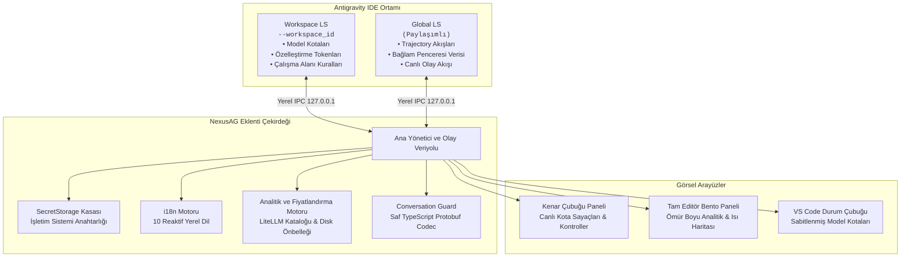

<p align="center">
  <a href="readme.md">English</a> •
  <a href="README.tr.md"><b>Türkçe</b></a> •
  <a href="README.pt-BR.md">Português</a> •
  <a href="README.es.md">Español</a> •
  <a href="README.de.md">Deutsch</a> •
  <a href="README.fr.md">Français</a> •
  <a href="README.ja.md">日本語</a> •
  <a href="README.zh-CN.md">简体中文</a> •
  <a href="README.hi.md">हिन्दी</a> •
  <a href="README.ru.md">Русский</a>
</p>

<p align="center">
  
</p>

<p align="center">
  <a href="https://github.com/AlperenAKKAYA99/NexusAG/releases"></a>
  
  
  
  
  
  
</p>

---

# NexusAG

> **Sorun:** Antigravity IDE'de birden fazla Google hesabını yönetmek; yorucu manuel oturum kapatıp açmaları, kalan yapay zeka kotasını tahmin etmeye çalışmayı, hesap geçişlerinde bağlam kaybını ve diskteki indekslenmemiş konuşmaların silinme riskini beraberinde getirir.
>
> **Çözüm:** NexusAG size entegre bir görev kontrol paneli sunar — hesapları **tek tıkla** değiştirin, hassas sıfırlanma sayaçlarıyla canlı kota göstergelerini takip edin, her prompt adımının token dağılımını inceleyin, sahipsiz kalan konuşmaları doğrudan yerel diskten kurtarın ve tam editör bento analitik paneliyle tüm zamanların token maliyetini denetleyin.

---

## ⚡ 60 Saniyede Başlayın

1. **Yükleyin** — Antigravity Eklenti Mağazası'nda `NexusAG` arayın veya `.vsix` dosyasını kurun.
2. **Hesap Ekleyin** — Kenar çubuğundaki `+` butonuna tıklayarak tarayıcı üzerinden Google ile oturum açın veya `🔑` ile token yapıştırın.
3. **İzleyin & Değiştirin** — Canlı kota göstergeleriniz, sıfırlanma sayaçlarınız, aktif bağlam penceresi metrikleriniz ve tüm zamanların kullanım analitiği anında devrede!

---

## 📸 Çoklu Hesap Panosu ve Arayüz Galerisi (UI Showcase)

<table align="center" width="100%">
  <tr>
    <td align="center" width="25%" valign="top">
      <br/>
      <sub><b>⚡ Çoklu Hesap Panosu</b><br/>Tek tıkla hesap değişimi, canlı kota ilerlemesi ve sıfırlanma sayaçları</sub>
    </td>
    <td align="center" width="25%" valign="top">
      <br/>
      <sub><b>🔑 Token Bütçesi ve Bağlam</b><br/>Özelleştirme donutu, aktif oturum göstergesi ve kurallar</sub>
    </td>
    <td align="center" width="25%" valign="top">
      <br/>
      <sub><b>📈 Kullanım İstatistikleri (Sidebar)</b><br/>Oturum token toplamları, saatlik etkinlik ve aylık maliyet dağılımı</sub>
    </td>
    <td align="center" width="25%" valign="top">
      <br/>
      <sub><b>🌐 Ayarlar ve 10 Dil Merkezi</b><br/>Anlık reaktif dil değiştirici, arka plan aralıkları ve onarım</sub>
    </td>
  </tr>
  <tr>
    <td align="center" width="25%" valign="top">
      <br/>
      <sub><b>🔑 Token ile Hesap Ekleme</b><br/>Doğrulamalı toplu OAuth yenileme tokenı yapıştırma</sub>
    </td>
    <td align="center" width="25%" valign="top">
      <br/>
      <sub><b>🔒 Sorunsuz Google OAuth</b><br/>Tek tıkla tarayıcı kimlik doğrulaması ve otomatik dönüş</sub>
    </td>
    <td align="center" colspan="2" valign="top">
      <br/>
      <sub><b>🔍 Bağlam Penceresi Detaylı İnceleme (Editör Sekmesi)</b><br/>Hiyerarşik adım ağacı, token kategorisi dağılımı ve Markdown dışa aktarma</sub>
    </td>
  </tr>
  <tr>
    <td align="center" colspan="4" valign="top">
      <br/>
      <sub><b>📊 Derin Token Analitiği Bento Paneli (Tam Editör)</b><br/>Tüm zamanların konuşma denetimi, GitHub tarzı aktivite ısı haritası, model maliyet dağılımı ve en çok tüketilen oturumlar</sub>
    </td>
  </tr>
</table>

---

## ✨ Öne Çıkan Temel Özellikler

### ⚡ Çoklu Hesap Panosu ve Canlı Kota İzleme
*Hesaplar arasında zahmetsizce geçiş yapın ve kota tükenme sürprizlerinden kurtulun.*
- **Sınırsız Profil** — Kişisel, kurumsal ve müşteri Google hesaplarını birbirine karışmadan aynı anda izleyin.
- **Tek Tıkla Anında Geçiş** — Aktif Antigravity IDE hesabını pencereyi yeniden başlatmaya gerek kalmadan kenar çubuğundan anında değiştirin.
- **Canlı Kota Göstergeleri** — Renk kodlu kapasite çubukları (🟢 >%50, 🟡 %20–50, 🔴 <%20) ve dakikasına kadar tam sıfırlanma geri sayım sayaçları.
- **Durum Çubuğu Entegrasyonu** — Favori modellerinizi yıldızlayarak (★) kota göstergesini doğrudan IDE durum çubuğuna sabitleyin.
- **Proaktif Token Yenileme** — Arka planda otomatik yenilenen OAuth erişim tokenları, uzun kodlama maratonlarında 401 oturum kesintilerini önler.
- **Abonelik Katmanı Bilgileri** — Plan türü (Ultra, Pro, Free), yapay zeka istem kredileri ve akış kredilerinin anlık gösterimi.

### 🌍 %100 Uluslararasılaştırma ve Anlık Reaktif Yerelleştirme
*Dünya genelindeki tüm geliştiriciler için ana dillerinde uyarlandı.*
- **10 Yerel Dil Desteği**:
  `English (en)` • `Türkçe (tr)` • `Português (pt-BR)` • `Español (es)` • `Deutsch (de)` • `Français (fr)` • `日本語 (ja)` • `简体中文 (zh-CN)` • `हिन्दी (hi)` • `Русский (ru)`
- **Yeniden Yüklemesiz Reaktif Geçiş** — Ayarlar sekmesinde dil değiştirdiğiniz anda arayüzün **%100'ü** (Kenar Çubuğu, Tam Editör Bento Paneli, Bağlam İnceleyici, bildirimler ve ipuçları) sayfa yenilenmeden anında çevrilir.
- **Sistem Dili Otomatik Algılama** — İlk açılışta IDE'nizin mevcut dilini otomatik olarak tanır ve uygular.

### 🔑 Token Bütçesi ve Bağlam Penceresi Zekası
*Ajan bağlamınızı gerçek zamanlı denetleyin ve optimize edin.*
- **Özelleştirme Bütçesi Donutu** — MCP Araçları, Proje Kuralları, İş Akışları ve Yetenekler (Skills) tarafından tüketilen tokenların net dökümü.
- **Aktif Bağlam Penceresi Sayacı** — Mevcut konuşma tokenlarını modelin fiziksel maksimum bağlam tavanıyla karşılaştıran canlı donut görselleştirmesi.
- **Çalışma Alanı Bağlam Denetçisi** — Tüm `.agent/` kurallarına, iş akışlarına ve yeteneklerine çalışma zamanı durumlarıyla (`always-on`, `model-decision`, `manual`) doğrudan dosya bağlantıları.
- **Canlı Akış Güncellemeleri** — Yapay zeka modeli yanıt üretirken token birikimini adım adım gerçek zamanlı olarak izler.

### 🔍 Bağlam Penceresi Detaylı İnceleme (Tam Editör Sekmesi)
*Tüm sistem talimatlarını, araç çıktılarını ve adımları denetleyin.*
- **Hiyerarşik Adım Ağacı** — Sistem İstemi, Araçlar, MCP Araçları ve Kullanıcı/Model Mesajlarının net token ve yüzde dökümü.
- **Satır İçi Adım Önizleme** — İstemi, model yanıtını, araç girişlerini, terminal çıktılarını ve grep sonuçlarını editörden ayrılmadan inceleyin.
- **Alev Rozetleri (🔥)** — Bağlam penceresinde en çok token tüketen adımları anında vurgulayan görsel göstergeler.
- **Markdown Olarak Dışa Aktarma** — Denetim ve ekip paylaşımları için bağlam analizini tek tıkla panoya veya `.md` dosyasına kaydedin.

### 📈 Derin Token Analitiği ve Bento Paneli
*Yapay zeka kullanım alışkanlıklarınıza dair kapsamlı ömür boyu zeka.*
- **Ömür Boyu Birikim** — Antigravity içinde gerçekleştirdiğiniz tüm geçmiş konuşmaları disk üzerinden tarayarak token tüketimini konsolide eder.
- **9 Temel KPI Metriği** — Girdi, Önbellek Okuma, Çıktı, Akıl Yürütme (Reasoning) tokenları, toplam çağrılar, tahmini maliyet, aktif günler ve önbellek başarı oranı.
- **GitHub Tarzı Katkı Isı Haritası** — Yıl seçicili 365 günlük geçmiş aktivite tablosu, hücre bazlı maliyet ipuçları ve zirve gün göstergeleri.
- **Dinamik Fiyatlandırma Motoru** — Güncel API maliyet takibi için LiteLLM fiyat kataloğu ve modele özel maliyet geçersiz kılma desteği.
- **Harcama Kalıpları** — Hafta içi ve hafta sonu kullanım dağılım grafikleri ile aylık yığılmış maliyet çubukları.

### 🛡️ Konuşma Koruması (Conversation Guard) ve Sahipsiz Konuşmaları Kurtarma
*İstemlerinizi güvence altına alın, indekslenmemiş konuşmaları veri kaybı yaşamadan kurtarın.*
- **Otomatik Uyuşmazlık Tespiti** — IDE açıldıktan 15 saniye sonra yerel `.pb` dosyalarını kenar çubuğu indeksiyle karşılaştırır.
- **Genişletilebilir Uyarı Başlığı** — İndekste bulunmayan konuşmaların sayısını ve çözümlenen başlıklarını listeler.
- **Tek Tıkla Bağımsız Onarım** — Bağımsız Node.js onarım çalışanı AG'yi güvenle kapatır, veritabanı indeksini diskten yeniden kurar ve IDE'yi açık çalışma alanıyla otomatik yeniden başlatır.

---

## 🔒 Güvenlik ve Gizlilik

Güvenlik ve kullanıcı gizliliği, NexusAG'nin temel tasarım ilkeleridir. Kod tabanı üzerinde bağımsız ve kapsamlı bir siber güvenlik denetimi gerçekleştirilmiştir:

- **%100 Yerel Veri** — Konuşma verileriniz, istemleriniz, dosya içerikleriniz veya kişisel telemetriniz asla bilgisayarınızın dışına çıkmaz.
- **İşletim Sistemi Seviyesinde Şifreleme** — Tüm OAuth yenileme tokenları VS Code'un yerel `SecretStorage` mekanizması ile saklanır (**macOS Keychain**, **Windows Credential Manager** veya **Linux Secret Service / Keyring**).
- **Yalnızca Yerel İletişim** — Language Server süreçleriyle kurulan iletişim yalnızca `127.0.0.1` döngü (loopback) IPC soketleriyle sınırlıdır.
- **Sıfır (0) Çalışma Zamanı Bağımlılığı** — **0 harici runtime npm paketi**. Protobuf varint kodlayıcısı/kod çözücüsü dahil tüm sistem saf TypeScript ile sıfırdan yazılmıştır.
- **Sadece Resmi API Uç Noktaları** — Dış ağ çağrıları yalnızca resmi Google OAuth ve Cloud Code Quota API'leri ile sınırlıdır.
- **Güvenlik Denetimi Onaylı** — Raporun tamamına [CYBER_SECURITY_AUDIT_REPORT.md](CYBER_SECURITY_AUDIT_REPORT.md) dosyasından ulaşılabilir (0 kritik açık, 0 arka kapı/zararlı yazılım).
- **Açık Kaynak Kodlu** — Projenin her satırı **MIT Lisansı** altında şeffaf ve denetlenebilir durumdadır.

---

## 🏗️ Mimari ve İç Mekanizma

NexusAG, Google Antigravity IDE tarafından başlatılan yerel Language Server (LS) süreçleriyle doğrudan eşgüdümlü çalışır:



### Önemli Mühendislik Ayrıntıları:
- **Çift LS Keşfi** — Yerel ağ dinleyicilerini (`netstat`/`lsof`) tarayarak LS portlarını tespit eder ve çalışma alanlarının birbirine karışmasını önlemek için `--workspace_id` ile kesin eşleşme sağlar.
- **Kubernetes Tarzı Hazırlık Geçidi (Readiness Gate)** — `registerGdmUser` çağrısını göndermeden önce USS IPC bağlantısının tamamen hazır olduğunu doğrulayan bir denetim mekanizması çalıştırır ve kesintisiz hesap geçişi sunar.
- **Saf TypeScript Protobuf Codec** — Hiçbir harici C/C++ ikili derleme veya native bağımlılık olmadan Protobuf formatındaki oturum akışlarını çözümleyip kodlar.

---

## ⚡ Nasıl Çalışır

```
1. IDE Başlatma ────► Çift LS Port Keşfi ────────► Aktif Kota & Kuralların Çekilmesi
                             │
2. Kullanıcı Eylemi ► Tek Tıkla Hesap Değişimi ──► SecretStorage Üzerinden Token Takası
                             │
3. Hazırlık Geçidi ─► USS IPC Soketini Doğrula ──► Yeni Kullanıcıyı Language Server'a Kaydet
                             │
4. Aktif Oturum ────► Canlı Akış Kancası ────────► Canlı Kota & Bağlam Gösterge Güncellemeleri
```

---

## 🚀 Başlangıç ve Kurulum

### Gereksinimler
- **Google Antigravity IDE** (veya uyumlu VS Code çalışma ortamı)
- Antigravity AI erişimi olan en az bir Google hesabı
- İşletim Sistemi: **macOS**, **Windows** veya **Linux**

### Kurulum

#### 1. Yöntem: Eklenti Mağazası (Önerilen)
1. Eklentiler görünümünü açın (`Ctrl+Shift+X` veya `Cmd+Shift+X`).
2. **NexusAG** araması yapın.
3. **Yükle** (Install) butonuna tıklayın.

#### 2. Yöntem: Manuel VSIX Kurulumu
En güncel `.vsix` paketini [GitHub Releases](https://github.com/AlperenAKKAYA99/NexusAG/releases) sayfasından indirin ve terminalden kurun:
```bash
antigravity-ide.cmd --install-extension nexus-ag-1.1.1.vsix --force
```

### 🎯 Kurulum Sonrası İlk Adımlar
1. Etkinlik Çubuğundaki **NexusAG** simgesine tıklayın.
2. Birincil hesabınız otomatik olarak yüklenecektir.
3. İkincil Google hesaplarınızı eklemek için `+` butonuna tıklayın veya `🔑` ile token içe/dışa aktarın.
4. Modelin kota yüzdesini durum çubuğunuza sabitlemek için yanındaki yıldız (★) simgesine tıklayın.
5. Kullanım sekmesindeki **"Tam Panoyu Aç →"** butonuna basarak tüm geçmiş yapay zeka istatistiklerinizi inceleyin.

---

## ⌨️ Komut Paleti

Tüm temel özellikler VS Code Komut Paleti üzerinden tetiklenebilir (`Ctrl+Shift+P` / `Cmd+Shift+P`):

| Komut | Tanımlayıcı | Açıklama |
|---|---|---|
| **NexusAG: Refresh Quota** | `ag.refreshQuota` | Google API'lerinden en güncel kota ve token bütçesini anında yeniler. |
| **NexusAG: Add Account** | `ag.addAccount` | Tek tıkla tarayıcı üzerinden Google OAuth girişini başlatır. |
| **NexusAG: Add Account via Token** | `ag.addAccountByToken` | Toplu OAuth yenileme tokenı yapıştırma penceresini açar. |
| **NexusAG: Copy Account Tokens** | `ag.copyTokens` | Çoklu token kopyalama ve Düz/Etiketli/JSON formatlarında dışa aktarma penceresini açar. |
| **NexusAG: Remove Account** | `ag.removeAccount` | Seçilen hesabı yerel depolamadan ve takipten kaldırır. |
| **NexusAG: Open Usage Statistics** | `ag.openUsageStats` | Tam editör bento kullanım analitiği panosunu açar. |
| **NexusAG: Fix Missing Conversations** | `ag.fixConversations` | Diski tarayarak indekste yer almayan `.pb` konuşmalarını onarır. |

---

## ⚙️ Yapılandırma Seçenekleri

Ayarlar (`Ctrl+,` / `Cmd+,`) → `NexusAG` araması yaparak yapılandırabilirsiniz:

| Ayar | Tip | Varsayılan | Açıklama |
|---|---|---|---|
| `ag-switchboard.language` | `string` | `auto` | Arayüz dili (`auto`, `en`, `tr`, `pt-BR`, `es`, `de`, `fr`, `ja`, `zh-CN`, `hi`, `ru`). |
| `ag-switchboard.refreshInterval` | `string` | `1m` | Arka plan kota yenileme periyodu (`instant`, `30s`, `1m`, `2m`, `5m`). |
| `ag-switchboard.modelPricing` | `object` | Varsayılanlar | 1M token başına model maliyet oranları (`input`, `output`, `cache`). |
| `ag-switchboard.switchWithFixConversations` | `boolean` | `true` | Hesap değiştirildiğinde konuşma indeksini otomatik senkronize edip onarır. |
| `ag-switchboard.tokenExport.defaultFormat` | `string` | `plain` | Çoklu token kopyalamada varsayılan format (`plain`, `labeled`, `json`). |
| `ag-switchboard.tokenExport.clearClipboardSeconds` | `number` | `0` | Güvenlik amacıyla token'ları N saniye sonra panodan otomatik temizler (0 = kapalı). |
| `ag-switchboard.tokenExport.confirmBulkCopy` | `boolean` | `true` | Çoklu token kopyalama öncesi onay ve güvenlik uyarısı gösterir. |
| `ag-switchboard.diagnosticMode` | `boolean` | `false` | Sorun giderme amacıyla ayrıntılı dosya günlüğü kaydını açar. |

---

## 📊 Proje İstatistikleri

<div align="center">

| Metrik | Değer |
|---|---|
| **Toplam Kaynak Modülü** | 62 TypeScript + 2 CSS dosyası |
| **Kod Tabanı Hacmi** | ~19.600+ Satır Kod |
| **Çalışma Zamanı Bağımlılığı** | **0** (Sıfır harici bağımlılık) |
| **Derleme Sistemi** | esbuild (Saniye altı webview paketleme) |
| **Desteklenen Diller** | 10 Yerel Dil (Dil başına 273 anahtar, %100 kapsama) |
| **Güvenlik Denetimi** | Onaylandı — 0 kritik / yüksek seviyeli bulgu |
| **Desteklenen Platformlar** | macOS (Apple Silicon / Intel), Windows 10/11, Linux (x64/arm64) |

</div>

---

## 🛠️ Kullanılan Teknolojiler

- **[TypeScript](https://www.typescriptlang.org/)** — Uçtan uca tip güvenliği ve kurumsal dayanıklılık
- **[esbuild](https://esbuild.github.io/)** — Ultra hızlı derleme ve optimize edilmiş webview paketleme
- **[Font Awesome Pro](https://fontawesome.com/)** — Net ve modern vektörel ikon seti
- **[LiteLLM Fiyat Kataloğu](https://github.com/BerriAI/litellm)** — Güncel ve topluluk tarafından desteklenen token fiyatlandırması
- **Yerel VS Code API** — `SecretStorage`, `WebviewViewProvider` ve `StatusBarItem` ile derin entegrasyon

---

## ❓ Sıkça Sorulan Sorular (SSS)

<details>
<summary><b>Kodlarım, istemlerim veya hesap verilerim üçüncü taraf sunuculara gidiyor mu?</b></summary>
<br/>
<b>Hayır.</b> NexusAG katı bir sıfır-telemetri politikası ile çalışır. Eklenti yalnızca resmi Google kimlik doğrulama ve kota API'leri (<code>oauth2.googleapis.com</code> ve <code>cloudcode-pa.googleapis.com</code>) ve yerel makinenizdeki Antigravity Language Server (<code>127.0.0.1</code>) ile iletişim kurar. Hiçbir analitik, sohbet dökümü veya telemetri verisi toplanmaz veya aktarılmaz.
</details>

<details>
<summary><b>Google kimlik bilgilerim ve OAuth tokenlarım nerede saklanıyor?</b></summary>
<br/>
Tüm kimlik doğrulama tokenları VS Code'un yerel <code>SecretStorage</code> API'si ile şifrelenir. Bu mekanizma şifrelemeyi doğrudan işletim sisteminizin güvenli kasasına (macOS Keychain, Windows Credential Manager veya Linux Secret Service/Keyring) devreder.
</details>

<details>
<summary><b>Aynı anda birden fazla Antigravity IDE penceresi açabilir miyim?</b></summary>
<br/>
<b>Evet.</b> NexusAG çalışma alanı düzeyinde yalıtılmış durum yönetimi (<code>workspaceState</code>) kullanır ve Language Server süreçlerini <code>--workspace_id</code> parametresine göre filtreler. Böylece farklı pencereler birbirlerinin oturum verilerini asla ezmez veya bozmaz.
</details>

<details>
<summary><b>NexusAG neden sıfır (0) çalışma zamanı bağımlılığına sahip?</b></summary>
<br/>
Tedarik zinciri saldırı açıklarını ortadan kaldırmak, paket boyutunu asgari düzeyde tutmak ve maksimum çalışma hızını garanti etmek için. Protobuf ikili kodlaması/kod çözmesi dahil olmak üzere tüm protokol işleyicileri saf TypeScript ile özel olarak yazılmıştır.
</details>

<details>
<summary><b>Hesap kotası sıfırlandığında arayüzde ne olur?</b></summary>
<br/>
Arka plan kota zamanlayıcısı belirlediğiniz aralıkta (varsayılan 1 dk) metrikleri günceller. Kenar çubuğu göstergeleri otomatik olarak yeşile döner (🟢) ve sıfırlanma geri sayım sayacı gerçek zamanlı olarak akıcı şekilde güncellenir.
</details>

<details>
<summary><b>NexusAG, Google Antigravity IDE olmadan çalışır mı?</b></summary>
<br/>
NexusAG, Google Antigravity IDE'nin dahili Language Server mimarisine ve kota uç noktalarına entegre olacak şekilde özel olarak geliştirilmiştir. Çalışması için Antigravity IDE ortamı gereklidir.
</details>

---

## 🤝 Katkıda Bulunma ve Geliştirme

Katkılar, hata bildirimleri ve özellik önerileri memnuniyetle karşılanır!

### Yerel Geliştirme Kurulumu

1. **Depoyu klonlayın:**
   ```bash
   git clone https://github.com/AlperenAKKAYA99/NexusAG.git
   cd NexusAG
   ```

2. **Geliştirme bağımlılıklarını yükleyin:**
   ```bash
   npm install
   ```

3. **Eklentiyi ve webview bileşenlerini derleyin:**
   ```bash
   npm run compile
   ```

4. **Hata Ayıklama Modunda Başlatın:**
   - VS Code / Antigravity IDE içinde `F5` tuşuna basarak Eklenti Geliştirme Ana Bilgisayarı (Extension Development Host) penceresini açın.

5. **Uluslararasılaştırmayı Doğrulayın:**
   ```bash
   npm run verify:i18n
   ```

---

## 📋 Sürüm Özeti

Tüm sürüm geçmişi için [CHANGELOG.md](CHANGELOG.md) dosyasına göz atabilirsiniz.

- **v1.1.1 (Güncel)** — Çoklu token kopyalama (Bulk Token Export) ve akıllı çift yönlü ayrıştırma, otomatik pano temizleme ve güvenlik kontrolleri.
- **v1.1.0** — 10 dilde anlık reaktif yerelleştirme (10 native locales), dinamik çok dilli promosyon banner üretimi, yenilenen arayüz galerisi ve tam kimlik birleşimi.
- **v1.0.5** — `responseId` ile kullanım istatistikleri tekrarlarının önlenmesi, model listesinin dinamik hale getirilmesi ve kota %100 hesaplama düzeltmesi.
- **v1.0.4** — **Conversation Guard**, bağımsız arka plan onarım çalışanı ve saf TypeScript Protobuf kod çözücüsü ile kayıp konuşmaları diskten kurtarma.
- **v1.0.3** — Çoklu pencere (cross-window) durum yalıtımı, USS olay geçidi ve arka plan yoklama dayanıklılığı.
- **v1.0.2** — Kaynaklar arası pin eşleme (★), durum çubuğu kota entegrasyonu, ısı haritası maliyet ipuçları ve ayrıntılı tanılama altyapısı.
- **v1.0.1** — Çift LS mimarisi, bağlam penceresi detaylı inceleme sekmesi ve canlı akış izleyicisi.
- **v1.0.0** — İlk genel sürüm: Tek tıkla çoklu hesap panosu, tam editör bento analitik paneli, GitHub tarzı aktivite ısı haritası ve SecretStorage kasa güvenliği.


---

## 🙏 Teşekkürler

- Sürekli geri bildirim ve test desteği sağlayan tüm Antigravity geliştirici topluluğuna teşekkür ederiz.

---

## 📄 Lisans ve Geliştirici

**MIT Lisansı** altında dağıtılmaktadır. Detaylar için [LICENSE](LICENSE) dosyasına bakabilirsiniz.

Geliştirici: ☕ **[Alperen AKKAYA](https://github.com/AlperenAKKAYA99)**
