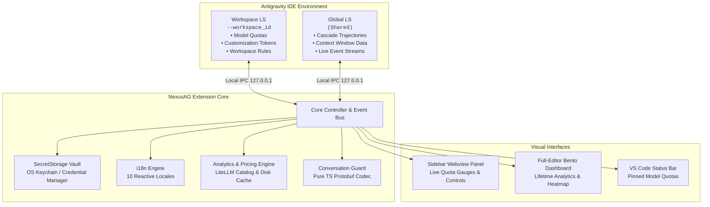

<p align="center">
  <a href="../../README.md">English</a> •
  <a href="README.tr.md">Türkçe</a> •
  <a href="README.pt-BR.md">Português</a> •
  <a href="README.es.md">Español</a> •
  <a href="README.de.md">Deutsch</a> •
  <a href="README.fr.md">Français</a> •
  <a href="README.ja.md">日本語</a> •
  <a href="README.zh-CN.md"><b>简体中文</b></a> •
  <a href="README.hi.md">हिन्दी</a> •
  <a href="README.ru.md">Русский</a>
</p>

<p align="center">
  
</p>

<p align="center">
  <a href="https://github.com/AlperenAKKAYA99/NexusAG/releases"></a>
  
  
  
  
  
  
</p>

---

# NexusAG

**NexusAG** 是专为 **Google Antigravity IDE** 打造的新一代多账户智能控制中心。让开发者能够一键瞬时切换多账号，实时监控多个 Google 账户的 AI 配额与重置倒计时，深层解析上下文窗口 Token 消耗分级树，自动挽救并重建丢失的对话记录，并通过全尺寸 Bento 仪表盘对历史全部 Token 账单进行精细化成本核算。

---

## ⚡ 60秒快速上手

1. **安装** — 在 Antigravity 扩展市场中搜索 `NexusAG` 或安装 `.vsix` 安装包。
2. **添加账户** — 点击侧边栏的 `+` 图标通过浏览器完成 Google OAuth 登录，或点击 `🔑` 批量粘贴令牌。
3. **监控与切换** — 实时配额仪表盘、重置倒计时和全生命周期 Token 分析即刻就绪！

---

## 📸 多账户控制中心与 UI 界面展示 (UI Showcase)

<table align="center" width="100%">
  <tr>
    <td align="center" width="25%" valign="top">
      <br/>
      <sub><b>⚡ 多账户控制中心</b><br/>一键瞬时切号、实时配额进度条与重置倒计时</sub>
    </td>
    <td align="center" width="25%" valign="top">
      <br/>
      <sub><b>🔑 Token 预算与上下文</b><br/>自定义项环形图、活跃会话用量与工作区规则</sub>
    </td>
    <td align="center" width="25%" valign="top">
      <br/>
      <sub><b>📈 侧边栏使用统计</b><br/>会话 Token 总量、每小时活跃趋势与月度费用明细</sub>
    </td>
    <td align="center" width="25%" valign="top">
      <br/>
      <sub><b>🌐 设置与 10 语言中心</b><br/>即时响应式语言切换、后台轮询频率与索引修复</sub>
    </td>
  </tr>
  <tr>
    <td align="center" width="25%" valign="top">
      <br/>
      <sub><b>🔑 令牌一键批量添加</b><br/>带格式校验的多行 OAuth Refresh Token 批量导入窗口</sub>
    </td>
    <td align="center" width="25%" valign="top">
      <br/>
      <sub><b>🔒 极速 Google OAuth 网页授权</b><br/>支持浏览器 1 键安全授权与自动跳回 IDE 闭环</sub>
    </td>
    <td align="center" colspan="2" valign="top">
      <br/>
      <sub><b>🔍 上下文窗口深度解析（独立编辑标签页）</b><br/>多级分层步骤树、Token 分类占比色条与 Markdown 一键导出</sub>
    </td>
  </tr>
  <tr>
    <td align="center" colspan="4" valign="top">
      <br/>
      <sub><b>📊 全尺寸 Bento Token 深度消耗大盘（全屏独立视图）</b><br/>全历史会话穿透审计、GitHub 风格贡献热力图、模型精细化单价表与高额会话榜单</sub>
    </td>
  </tr>
</table>

---

## ✨ 核心特性一览

### ⚡ 多账户极速切号与实时配额监控
- **支持无上限绑定** — 完美同时管理多个 Google 账户，互不干扰。
- **一键免登瞬时切换** — 无需重复登录，直接在侧边栏点击即可秒级切换 IDE 当前活跃账号。
- **动态配额容量进度条** — 颜色直观分区（🟢 >50%、🟡 20-50%、🔴 <20%），配备精准的重置倒计时。
- **状态栏无感常驻** — 点击星号（★）即可将最爱模型或配额钉在底栏，无需展开面板随时掌控。
- **前置令牌自动续期** — 后台自动续期 access_token，彻底告别长时间编码中的 401 认证中断。
- **订阅套餐与积分信息** — 快速查看账号所属层级（Ultra、Premium、Free）及 AI 积分余量。

### 🌍 100% 全量本地化与即时无刷新多语言响应
- **原生内置 10 种国际主流语言**: 英语、土耳其语、巴西葡萄牙语、西班牙语、德语、法语、日语、简体中文、印地语和俄语。
- **秒级即时响应** — 在设置页切换语言时，**100%** 的界面元素（侧边栏、全尺寸 Bento 仪表盘、上下文树、对话框及系统提示）瞬间完成本地化，无需重新加载窗口。

### 🔑 Token 预算与上下文智能洞察
- **自定义项环形图** — 直观呈现 MCP 工具、全局规则、工作流和 Skills 的 Token 占用。
- **实时活跃上下文用量** — 实时监控当前模型单次调用消耗与最大上限的百分比。
- **工作区规则检查器** — 直达 `.agent/` 规则文件，清晰呈现触发模式（`always-on`、`model-decision`、`manual`）。

### 🔍 上下文窗口深度解析（全尺寸独立标签页）
- 在侧边栏点击 **"查看完整明细 →"** 一键打开。
- **多级分层树状图** — 完整拆解系统提示词、工具调用、MCP 与会话记录的精确 Token 与占比。
- **行内无跳出预览** — 直接在当前界面查看提示词明细、大模型回复、工具输入和命令输出。
- **火焰高耗预警（🔥）** — 自动标红最吃上下文的超大步骤。
- **一键导出 Markdown** — 方便存档与团队分享。

### 📈 全局 Token 消耗深度分析与 Bento 仪表盘
- 点击侧边栏 **"打开全屏分析大盘 →"** 查看。
- **全历史周期回溯** — 深度检索汇总您在 Antigravity 中产生过的所有历史会话。
- **9 项核心指标** — 统计输入、缓存命中、输出、思考 Token、调用总频次、估算账单与缓存命中率。
- **GitHub 风格贡献热力图** — 完整支持 365 天历史网格，配备年度切换与峰值日高亮。
- **LiteLLM 动态定价引擎** — 精确结合最新官方 API 资费与自定义单价，账单计算精准到分。

### 🛡️ 会话守护与恢复（Conversation Guard）
- **自动检测磁盘孤儿对话** — 开机 15 秒自动扫描本地磁盘 `.pb` 记录与侧边栏索引的比对差异。
- **一键自动化修复** — 优雅关闭 AG、从磁盘极速重建侧边栏索引并自动重拉 IDE，绝不损坏原有数据。

---

## 🔒 安全性与隐私保护

- **100% 本地数据存储** — 绝不收集或上传任何会话记录、提示词、源码或敏感遥测数据。
- **操作系统级凭据加密** — 所有 OAuth 令牌均通过 VS Code 原生 `SecretStorage` 加密托管（macOS Keychain、Windows 凭据管理器、Linux Secret Service）。
- **严格本地环回通信** — 与 Language Server 的交互全部运行于 `127.0.0.1` 本地 IPC 套接字。
- **零（0）运行时依赖** — 彻底杜绝供应链投毒攻击隐患，运行时 **0 外部第三方 npm 依赖**，全量 TypeScript 原生实现。
- **仅限官方 API 端点** — 外部网络请求仅严格发往 Google 官方 OAuth 与 Cloud Code 配额服务。
- **通过专业安全审计** — 完整审计报告见 [CYBER_SECURITY_AUDIT_REPORT.md](CYBER_SECURITY_AUDIT_REPORT.md)（0 个高危漏洞，0 个恶意后门）。
- **全面开源透明** — 在宽容的 **MIT 许可证**下开源，所有代码均可审查。

---

## 🏗️ Architecture & Internal Mechanics



---

## 🚀 快速上手

### Installation
1. 在 Antigravity 扩展商店搜索 **NexusAG**，点击 **安装**。
2. 或者直接通过 `.vsix` 安装包本地安装:
```bash
antigravity-ide.cmd --install-extension nexus-ag-1.1.1.vsix --force
```

---

## ⌨️ Command Palette

| Command | Identifier | Description |
|---|---|---|
| **NexusAG: Refresh Quota** | `ag.refreshQuota` | Forces an immediate quota and token budget refresh from Google APIs. |
| **NexusAG: Add Account** | `ag.addAccount` | Opens browser window for 1-click Google OAuth authentication. |
| **NexusAG: Add Account via Token** | `ag.addAccountByToken` | Opens modal for batch importing OAuth refresh tokens. |
| **NexusAG: Remove Account** | `ag.removeAccount` | Removes a selected account from local storage and tracking. |
| **NexusAG: Open Usage Statistics** | `ag.openUsageStats` | Launches the full-editor deep analytics bento dashboard. |
| **NexusAG: Fix Missing Conversations** | `ag.fixConversations` | Scans disk storage and repairs unindexed `.pb` conversations. |

---

## ⚙️ Configuration Settings

| Setting | Type | Default | Description |
|---|---|---|---|
| `ag-switchboard.language` | `string` | `auto` | Interface language (`auto`, `en`, `tr`, `pt-BR`, `es`, `de`, `fr`, `ja`, `zh-CN`, `hi`, `ru`). |
| `ag-switchboard.refreshInterval` | `string` | `1m` | Background polling frequency for quota updates (`instant`, `30s`, `1m`, `2m`, `5m`). |
| `ag-switchboard.modelPricing` | `object` | Defaults | Custom per-model rates per 1M tokens (`input`, `output`, `cache`). |
| `ag-switchboard.switchWithFixConversations` | `boolean` | `true` | Automatically synchronizes and repairs the conversation index on account switch. |
| `ag-switchboard.diagnosticMode` | `boolean` | `false` | Enables verbose diagnostic file logging for troubleshooting. |

---

## 📊 Project Stats

<div align="center">

| Metric | Specification |
|---|---|
| **Total Source Modules** | 60 TypeScript + 2 CSS files |
| **Codebase Volume** | ~19,200+ Lines of Code |
| **Runtime Dependencies** | **0** (Zero external dependencies) |
| **Build System** | esbuild (Sub-second webview bundling) |
| **Supported Locales** | 10 Native Languages (251 keys each, 100% parity) |
| **Security Audit** | Passed — 0 critical / high findings |
| **Supported Platforms** | macOS (Apple Silicon / Intel), Windows 10/11, Linux (x64/arm64) |

</div>

---

## 🛠️ Built With

- **[TypeScript](https://www.typescriptlang.org/)** — End-to-end static typing and enterprise resilience
- **[esbuild](https://esbuild.github.io/)** — Lightning-fast compilation and optimized asset packaging
- **[Font Awesome Pro](https://fontawesome.com/)** — Crisp, modern vector iconography
- **[LiteLLM Pricing Catalog](https://github.com/BerriAI/litellm)** — Accurate, community-maintained AI token pricing
- **Native VS Code API** — Deep integration with `SecretStorage`, `WebviewViewProvider`, and `StatusBarItem`

---

## ❓ Frequently Asked Questions (FAQ)

<details>
<summary><b>Is my code, prompt, or account data sent to any third-party servers?</b></summary>
<br/>
<b>No.</b> NexusAG operates with a strict zero-telemetry policy. The extension communicates exclusively with official Google authentication and quota APIs, and with your local Antigravity Language Server on <code>127.0.0.1</code>. No analytics, transcripts, or telemetry are ever collected or transmitted.
</details>

<details>
<summary><b>Where are my Google credentials and OAuth tokens stored?</b></summary>
<br/>
All authentication tokens are secured using VS Code's native <code>SecretStorage</code> API (macOS Keychain, Windows Credential Manager, or Linux Secret Service/Keyring).
</details>

<details>
<summary><b>Why does NexusAG have zero (0) runtime dependencies?</b></summary>
<br/>
To eliminate supply-chain vulnerability vectors, minimize package bundle size, and guarantee maximum execution speed. All protocol handling—including Protobuf binary encoding and decoding—is custom-built in native TypeScript.
</details>

---

## 🤝 Contributing & Development

Contributions, bug reports, and feature suggestions are warmly welcomed!

1. Fork the repository: `git clone https://github.com/AlperenAKKAYA99/NexusAG.git`
2. Install development dependencies: `npm install`
3. Compile the extension & webviews: `npm run compile`
4. Launch Extension in Debug Mode (`F5` in VS Code / Antigravity IDE)
---

## 📋 Changelog Highlights

For the full release history, see [CHANGELOG.md](CHANGELOG.md).

- **v1.1.1 (Current)** — Bulk token export & copy system with smart round-trip extraction, clipboard auto-clearing timer, and enhanced multi-account security.
- **v1.1.0** — 10-language instant reactive localization, multi-banner asset generation, enhanced UI showcase, and unified branding.
- **v1.0.5** — Usage Stats deduplication via `responseId`, dynamic model auto-humanization, and quota 100% bugfix.
- **v1.0.4** — **Conversation Guard**, standalone detached repair worker, and pure-TypeScript Protobuf trajectory codec for orphaned conversation recovery.
- **v1.0.3** — Multi-window state isolation, USS event gating, and background polling resilience.
- **v1.0.2** — Cross-source pin matching (★), status bar quota integration, heatmap cost tooltips, and diagnostic logging harness.
- **v1.0.1** — Dual-LS architecture, full context window drill-down tab, and live event stream monitoring.
- **v1.0.0** — Initial public release: 1-click Google account switching, full-editor bento analytics, GitHub-style activity heatmap, and SecretStorage vault.

---

## 📄 License & Author

基于 **MIT 许可证** 开源发布。由 **[Alperen AKKAYA](https://github.com/AlperenAKKAYA99)** 倾情打造。

